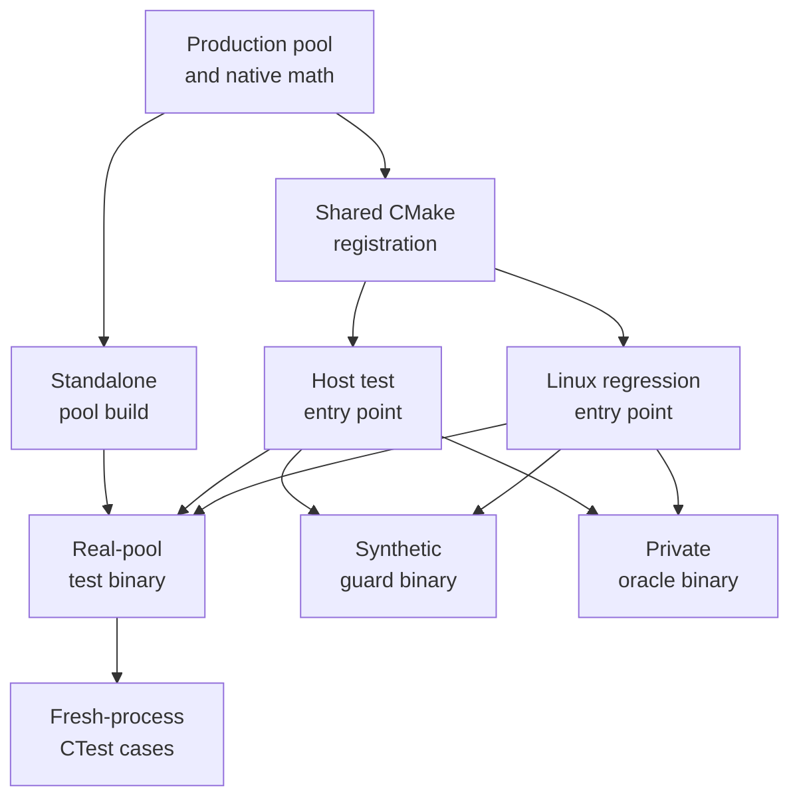
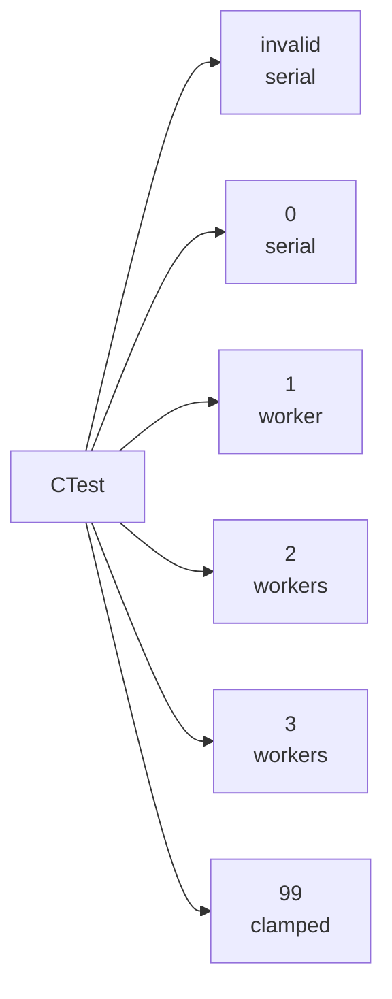
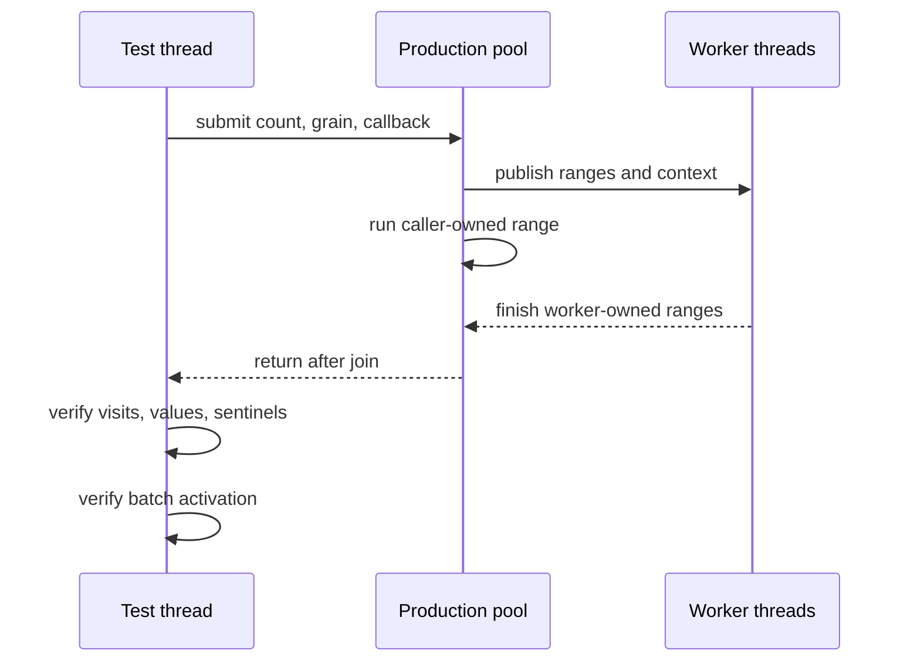

# BlueWake test architecture

## Contents

- [Purpose and status](#purpose-and-status)
- [Test boundaries](#test-boundaries)
- [Framework layers](#framework-layers)
- [Native-math registration](#native-math-registration)
- [Native work-pool suite](#native-work-pool-suite)
- [Process and configuration model](#process-and-configuration-model)
- [Correctness contract](#correctness-contract)
- [Running the tests](#running-the-tests)
- [Reading results](#reading-results)
- [Sanitizer checks](#sanitizer-checks)
- [Platform behavior](#platform-behavior)
- [Extending the framework](#extending-the-framework)
- [Source map](#source-map)

Architecture path: [Index](README.md) → [Overview](Overview.md) → **Testing**

## Purpose and status

BlueWake has source-only tests for host services, generated-code contracts,
native replacements, and build tooling. The game-thread integrity framework
organizes the native-math and worker-pool portion of those tests around one
rule: optimized native work may use helper threads internally, but the guest
thread remains the sole owner of guest CPU and device state.

The framework has two related jobs:

1. Prove that the real native worker pool partitions independent array work,
   publishes every result before returning, and obeys its configuration.
2. Preserve the existing native-math guard and differential-oracle targets so
   later tests can compare translated, serial-native, and parallel-native
   behavior without duplicating build definitions.

This chapter documents the first implementation slice proposed in
[PR #399](https://github.com/chrissotraidis/bluewake/pull/399). That PR is
currently a draft, so the framework is not yet part of `main`. Its requirements,
design, and milestones are tracked separately in the unmerged planning
[PR #397](https://github.com/chrissotraidis/bluewake/pull/397):

- [Product requirements](https://github.com/irregularthanis/bluewake/blob/docs/gamethread-integtests/docs/planning/2026-10-18-gamethread-integtests/PRD.md)
- [Technical plan](https://github.com/irregularthanis/bluewake/blob/docs/gamethread-integtests/docs/planning/2026-10-18-gamethread-integtests/TECH_PLAN.md)
- [Milestones and progress](https://github.com/irregularthanis/bluewake/blob/docs/gamethread-integtests/docs/planning/2026-10-18-gamethread-integtests/PROGRESS.md)

The architecture described here is intentionally narrower than the complete
qualification plan. Gameplay routes, candidate-owned diagnostics, worker
lifecycle injection, load generation, long soaks, and hardware qualification
remain later milestones. See [Extending the framework](#extending-the-framework).

## Test boundaries

The framework follows the ownership boundaries in
[Guest state](GuestState.md#ownership-and-address-model) and the native-module
boundaries in [Game module](GameModule.md#module-contents).

| Boundary | Framework rule | Why it matters |
| --- | --- | --- |
| Guest execution | Workers never execute arbitrary translated blocks. | One authoritative guest instruction stream preserves CPU, exception, and timing order. |
| Guest and device state | Pool callbacks operate only on immutable inputs and disjoint output ranges. | Concurrent access to CPU state, devices, or shared guest outputs would make results order-dependent. |
| Join point | `bluewake_parallel_range` is synchronous. | The guest thread cannot commit registers, cycles, or later guest work until every range is complete. |
| Public data | Public tests use generated values and sentinels. | CI must not require or publish a game disc, extracted code, save, or translated module. |
| Private comparison | The differential oracle remains explicit and excluded from normal builds. | Developers can test their own translated module without making player-owned artifacts a public dependency. |
| Production code | Tests compile the real `native_work_pool.c`. | A copied scheduler could pass while the shipped implementation is wrong. |
| Configuration | Every worker setting runs in a new process. | Pool initialization reads `BLUEWAKE_NATIVE_WORKERS` only once. |
| Windows | The pool remains serial. | The current POSIX worker backend and its lifecycle contract are not silently implied on Windows. |

The tests verify synchronization and output integrity. They do not claim that
parallel execution improves performance. Performance evidence belongs in the
[performance measurement loop](../performance/Overview.md#measurement-loop),
after correctness and path activation are established.

## Framework layers

The framework separates a small renderer-free correctness loop from the full
Linux and host build graphs.



The layers answer different questions:

| Layer | Question | External dependencies |
| --- | --- | --- |
| Standalone pool build | Does the production pool partition and publish synthetic work correctly? | C compiler; POSIX threads and the math library on non-Windows systems |
| Native-math guard | Do public guard and routing cases preserve the established native behavior? | GXRuntime; no player-owned module |
| Native-math worker case | Does the existing guard pass when the POSIX pool is enabled with two workers? | GXRuntime and POSIX threads |
| Differential oracle | Does a private translated module agree with native implementations? | A local player-owned module; built explicitly, not registered in public CTest |
| Linux integration | Are the same targets reachable through the supported Linux regression build? | The pinned RecompCore checkout and its configured dependencies |

## Native-math registration

Before the framework, the host CMake file directly declared the native-math
oracle, synthetic guard, POSIX thread linkage, and W=2 CTest case. The first
implementation slice moves those declarations into one function in
`cmake/native_math_tests.cmake`. Both the host and Linux entry points invoke
that function.

The extraction preserves these target and test names:

| Name | Kind | Default build | Public CTest | Data contract |
| --- | --- | --- | --- | --- |
| `bluewake_native_math_test` | Differential-oracle executable | No; `EXCLUDE_FROM_ALL` | No | Requires a developer's local translated module |
| `bluewake_native_math_guard_test` | Synthetic guard executable and test | Yes when tests are enabled | Yes | Repository-generated data only |
| `bluewake_native_math_workers_test` | Second CTest invocation of the guard | Uses the guard executable | POSIX only | Sets `BLUEWAKE_NATIVE_WORKERS=2` |

Keeping one registration function prevents the Linux and host entry points
from drifting in sources, include paths, floating-point flags, libraries, or
worker settings. In particular, `-ffp-contract=off` remains attached to both
native-math executables, and the private oracle remains excluded from ordinary
builds.

The source-only pool target is added separately from
`tests/native_work_pool/CMakeLists.txt`. That directory is both:

- a standalone CMake project, configured directly with
  `cmake -S tests/native_work_pool`; and
- a subdirectory of the host and Linux test builds.

This arrangement keeps the fast pool loop independent of renderer and
translated-module dependencies while proving that the supported build entry
points register the same test binary.

## Native work-pool suite

The suite compiles two files into `bluewake_native_work_pool_test`:

- the production scheduler, `cmake/composite/native_work_pool.c`; and
- the synthetic harness, `tests/native_work_pool_test.c`.

It does not link GXRuntime, Aurora, Dawn, SDL, the BlueWake host, or a translated
game module. This keeps a concurrency failure small and reproducible before it
is investigated inside a complete application build.

Each callback receives a half-open range `[first, end)`. For every submitted
index, the callback:

1. increments a visitation counter;
2. writes a deterministic value derived from the index and a per-submission
   salt; and
3. leaves every index outside the requested range untouched.

POSIX visitation counters are C11 atomics because worker callbacks execute
concurrently. Windows uses plain counters because its production pool path is
serial; this also avoids requiring C11 atomic support from Windows C
toolchains for a code path that has no concurrent writers.

The binary first exercises three boundary shapes:

| Submission | Purpose |
| --- | --- |
| Zero items, grain 1 | Empty-range behavior and safe callback boundaries |
| 17 items, grain 256 | Below-grain serial fallback even when workers exist |
| 4,099 items, grain 1 | Uneven partitioning across the caller and worker ranges |

It then executes 1,000 changing submissions. Counts range from 257 through
4,099 and wrap, while the salt changes every iteration. Reusing the allocation
but resetting every counter and sentinel makes stale context, late writes,
duplicate visits, omissions, and range overruns observable.

## Process and configuration model

The production pool uses one-time initialization. It reads
`BLUEWAKE_NATIVE_WORKERS` on the first call and retains the resulting workers
for the process lifetime. Changing the environment inside one test executable
would therefore not test a new configuration.

CTest solves that by starting the same binary in six independent processes:



| CTest case | Environment | Expected route | Platform |
| --- | --- | --- | --- |
| `bluewake_native_work_pool_serial_test` | `BLUEWAKE_NATIVE_WORKERS=invalid` | Parser rejects the value; serial callbacks only | All |
| `bluewake_native_work_pool_zero_test` | `BLUEWAKE_NATIVE_WORKERS=0` | Nonpositive value; serial callbacks only | POSIX |
| `bluewake_native_work_pool_workers_1_test` | `BLUEWAKE_NATIVE_WORKERS=1` | One worker plus the caller | POSIX |
| `bluewake_native_work_pool_workers_2_test` | `BLUEWAKE_NATIVE_WORKERS=2` | Two workers plus the caller | POSIX |
| `bluewake_native_work_pool_workers_3_test` | `BLUEWAKE_NATIVE_WORKERS=3` | Three workers plus the caller | POSIX |
| `bluewake_native_work_pool_clamped_test` | `BLUEWAKE_NATIVE_WORKERS=99` | Request clamps to the production maximum of eight workers | POSIX |

All six cases use a 15-second CTest timeout and the labels `fast` and
`native-work-pool`. A timeout is a test failure rather than evidence that a
delayed callback eventually completed.

The public batch counter distinguishes route activation from output equality.
Serial configurations must leave the count unchanged. Worker-enabled
configurations must increase it. This prevents a silently serial execution
from passing only because it produced the same values.

## Correctness contract

For every submitted range, the harness checks the state only after
`bluewake_parallel_range` returns. That return is the pool's publication and
join boundary.



The post-return checks establish:

| Assertion | Passing condition | Example defect detected |
| --- | --- | --- |
| Exact coverage | Every submitted index has visitation count 1 | Missing or overlapping integer partition |
| Deterministic output | Every submitted value equals `index XOR salt` | Stale context or incorrect range bounds |
| Range isolation | Every unsubmitted value remains `0xdeadbeef` and unvisited | End-boundary overrun or late write |
| Synchronous return | All expected output is visible immediately after return | Pool returns before workers finish |
| Repeated publication | All 1,000 changing submissions satisfy the same checks | Worker observes an earlier count, salt, or context |
| Route activation | Batch count changes only in worker-enabled processes | Configuration ignored or test accidentally remains serial |

These checks prove properties of the submitted array work. They do not yet
inject thread-creation failures, pause a worker at a deterministic barrier, or
repeatedly unload a shared library containing live pool threads. Those are
lifecycle tests planned for M3.

## Running the tests

### Standalone pool loop

Run these commands from the repository root:

```bash
cmake -S tests/native_work_pool -B build/native-work-pool \
  -DCMAKE_BUILD_TYPE=Debug
cmake --build build/native-work-pool --parallel
ctest --test-dir build/native-work-pool --output-on-failure
```

Step by step:

1. CMake creates a small C-only build graph containing the harness and the real
   pool. It discovers POSIX threads on non-Windows hosts.
2. The build command compiles and links `bluewake_native_work_pool_test`.
3. CTest starts a fresh process for every registered environment.
4. `--output-on-failure` keeps successful output compact and prints harness
   diagnostics when a case returns nonzero or times out.

This path needs no disc, translated module, renderer, or RecompCore checkout.
The expected POSIX result is `100% tests passed, 0 tests failed out of 6`.
Windows registers only the serial case.

List cases without running them:

```bash
ctest --test-dir build/native-work-pool --show-only
```

Run the labeled suite verbosely:

```bash
ctest --test-dir build/native-work-pool \
  -L native-work-pool --output-on-failure --verbose
```

### Linux integration

The integrated path requires `ref/recompcore`. The normal Linux builder fetches
the pinned checkout on its first run; see
[Linux build behavior](../LINUX.md#build-behavior). It still does not require a
private translated module for the targets below.

```bash
cmake -S linux -B build/linux-gamethread-tests \
  -DBLUEWAKE_LINUX_REGRESSION_TESTS=ON
cmake --build build/linux-gamethread-tests --parallel --target \
  bluewake_native_work_pool_test bluewake_native_math_guard_test
ctest --test-dir build/linux-gamethread-tests --output-on-failure \
  -R 'bluewake_native_(work_pool|math_(guard|workers))'
```

Step by step:

1. The option enables the Linux regression-test graph.
2. The targeted build proves that both the shared native-math registration and
   standalone pool subdirectory work through `linux/CMakeLists.txt` without
   compiling the full application.
3. The CTest expression selects the synthetic native-math guard, its W=2
   worker invocation, and all six pool cases.
4. The expected POSIX result is
   `100% tests passed, 0 tests failed out of 8`.

The private `bluewake_native_math_test` target is present but is not built by
these commands. Building and running it requires the developer's own translated
module and follows the private oracle workflow rather than public CI.

## Reading results

CTest returns zero only if every selected process exits successfully within its
timeout. The harness reports the first observed violation:

| Diagnostic | Meaning | First investigation |
| --- | --- | --- |
| `index ... visits=0` | A submitted element was omitted. | Partition endpoints and effective worker count |
| `index ... visits=2` or greater | Worker ranges overlapped. | Integer split formula and caller range |
| Incorrect `output` | Callback saw the wrong range or stale salt/context. | Work/context publication around the generation counter |
| `sentinel changed` | Work escaped the submitted half-open range or completed late. | End bounds, join behavior, and retained context |
| `unexpected batch count` | A serial process activated workers or a worker process stayed serial. | Environment parsing, creation failure, and minimum grain |
| Timeout | A worker or caller failed to complete the synchronous batch. | Condition-variable state, remaining count, and shutdown |

Detailed CTest logs are stored in:

- `build/native-work-pool/Testing/Temporary/LastTest.log`; and
- `build/linux-gamethread-tests/Testing/Temporary/LastTest.log`.

The initial PR #399 validation at commit
`97137c6e8178dd17df7e65dc41691d9a75df9c1c` recorded:

```text
Standalone:       100% tests passed, 0 tests failed out of 6
Linux integrated: 100% tests passed, 0 tests failed out of 8
```

Those results are evidence for that commit and machine, not a guarantee for a
different checkout or platform. Report the tested commit, compiler, platform,
commands, and any skipped capability with new results.

## Sanitizer checks

The standalone build is the shortest route to AddressSanitizer and Undefined
Behavior Sanitizer because it avoids the renderer and application graph:

```bash
cmake -S tests/native_work_pool -B build/native-work-pool-sanitize \
  -DCMAKE_BUILD_TYPE=Debug \
  -DCMAKE_C_FLAGS='-Wall -Wextra -Werror -fsanitize=address,undefined -fno-omit-frame-pointer' \
  -DCMAKE_EXE_LINKER_FLAGS='-fsanitize=address,undefined'
cmake --build build/native-work-pool-sanitize --parallel
ctest --test-dir build/native-work-pool-sanitize --output-on-failure
```

Some sandboxed or traced environments cannot start LeakSanitizer. If it reports
that limitation before a test executes, rerun with leak detection disabled:

```bash
ASAN_OPTIONS=detect_leaks=0 \
  ctest --test-dir build/native-work-pool-sanitize --output-on-failure
```

This retains address and undefined-behavior checks; it does not constitute a
leak check. ThreadSanitizer is a separate planned CI lane because toolchain and
runtime support must be reported independently rather than inferred from an
ASan/UBSan pass.

## Platform behavior

| Platform family | Production pool route | Registered standalone cases | Integration expectation |
| --- | --- | --- | --- |
| Linux and other POSIX hosts | Pthreads; caller plus up to eight workers | Invalid, zero, 1, 2, 3, and 99/clamped | Standalone and shared Linux registration run publicly |
| macOS | Pthreads | Same POSIX matrix | Host entry point uses the shared registration |
| Windows | Serial callback | Invalid/serial only | Source and serial build compatibility are required; Windows CI supplies build evidence |

The framework does not make Windows parallel. Adding a worker backend there
would require an explicit lifecycle design and the same output, synchronization,
failure, and unload evidence as the POSIX implementation.

## Extending the framework

The planning milestones deliberately build outward from the source-only loop:

| Milestone | Extension | New evidence |
| --- | --- | --- |
| M2 | Native guard thresholds, uneven inputs, sentinels, overlaps, and three-path oracle | Translated, serial-native, and parallel-native guest state and RAM agree |
| M3 | Creation-failure seams, delayed-worker barriers, shared-library load/unload, candidate-owned diagnostics | Effective workers, join-before-return, safe teardown, and actual candidate activation |
| M4 | Dedicated ASan/UBSan and TSan CI lanes | Memory, undefined-behavior, and race results reported separately |
| M5–M7 | Qualification runner, strict benchmark evidence, and portable save acceptance | Reproducible gameplay correctness and complete checkpoint grids |
| M8–M10 | Game-thread metrics, topology, load, soak, and Steam Deck qualification | Timing and throughput claims tied to verified execution and hardware context |

New source-only cases should preserve these rules:

1. Test production code rather than a copied implementation.
2. Use synthetic public data by default.
3. Give one-time global configuration a fresh process.
4. Prove path activation separately from result equality.
5. Use barriers or conditions for synchronization tests, never sleep timing as
   the correctness condition.
6. Bound every test with a timeout and retain failure evidence.
7. Keep private modules, discs, saves, and generated game code out of CI and
   public artifacts.
8. State exactly which platforms and sanitizer capabilities were exercised.

## Source map

Until PR #399 merges, the proposed implementation links below are pinned to its
tested fork commit rather than to files on `main`.

| Responsibility | Proposed source |
| --- | --- |
| Shared native-math target registration | [`cmake/native_math_tests.cmake`](https://github.com/irregularthanis/bluewake/blob/97137c6e8178dd17df7e65dc41691d9a75df9c1c/cmake/native_math_tests.cmake) |
| Linux test integration | [`linux/CMakeLists.txt`](https://github.com/irregularthanis/bluewake/blob/97137c6e8178dd17df7e65dc41691d9a75df9c1c/linux/CMakeLists.txt#L163-L170) |
| Host test integration | [`runtime/host/CMakeLists.txt`](https://github.com/irregularthanis/bluewake/blob/97137c6e8178dd17df7e65dc41691d9a75df9c1c/runtime/host/CMakeLists.txt#L344-L352) |
| Standalone build and CTest matrix | [`tests/native_work_pool/CMakeLists.txt`](https://github.com/irregularthanis/bluewake/blob/97137c6e8178dd17df7e65dc41691d9a75df9c1c/tests/native_work_pool/CMakeLists.txt) |
| Synthetic pool harness | [`tests/native_work_pool_test.c`](https://github.com/irregularthanis/bluewake/blob/97137c6e8178dd17df7e65dc41691d9a75df9c1c/tests/native_work_pool_test.c) |
| Production pool implementation | [`cmake/composite/native_work_pool.c`](../../cmake/composite/native_work_pool.c) |
| Production pool contract | [`cmake/composite/native_work_pool.h`](../../cmake/composite/native_work_pool.h) |
| Existing native-math guard | [`tests/native_math_guard_test.c`](../../tests/native_math_guard_test.c) |
| Existing private oracle | [`tests/native_math_test.c`](../../tests/native_math_test.c) |

For the runtime components protected by these tests, continue to
[Guest state](GuestState.md), [Game module](GameModule.md), and
[Host](Host.md). For performance qualification after correctness, continue to
[Performance](../performance/Overview.md).
