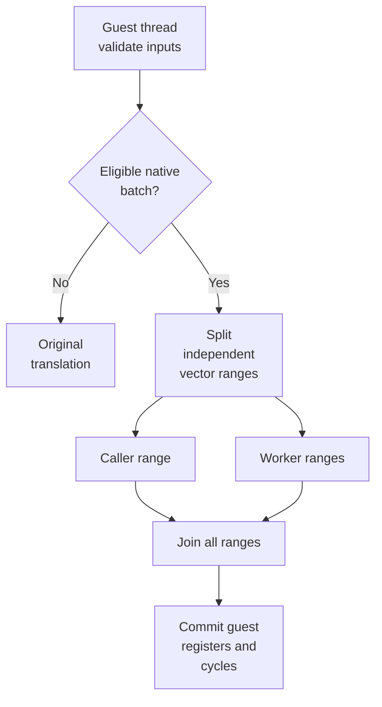
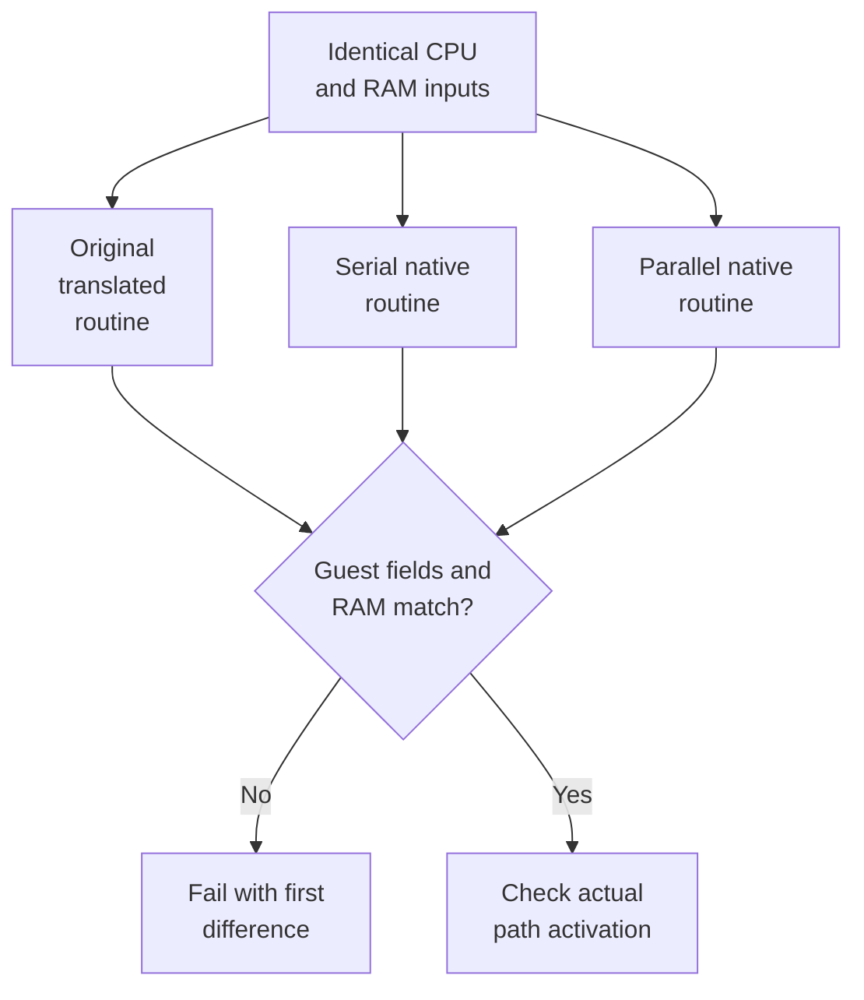

# TECH_PLAN — Game-thread integrity tests

**Status:** Planning only; no implementation/tests executed.
**Revision:** 1.2 · October 18, 2026
**Source:** `irregularthanis/bluewake@4a68ecae4725eb1ecea2d5d02f990e70c315237d`
**Directory:** `docs/planning/2026-10-18-gamethread-integtests/`
**Contracts:** [PRD.md](PRD.md) · **Tasks:** [PROGRESS.md](PROGRESS.md)

Architecture: [runtime entities](https://github.com/irregularthanis/bluewake/blob/4a68ecae4725eb1ecea2d5d02f990e70c315237d/docs/architecture/Runtime.md#runtime-entities) · [interaction boundaries](https://github.com/irregularthanis/bluewake/blob/4a68ecae4725eb1ecea2d5d02f990e70c315237d/docs/architecture/Runtime.md#interaction-boundaries). Links pin the inspected revision; worker-pool details remain in source.

## Boundaries

- Keep one authoritative guest CPU stream: [guest-state ownership](https://github.com/irregularthanis/bluewake/blob/4a68ecae4725eb1ecea2d5d02f990e70c315237d/docs/architecture/GuestState.md#ownership-and-address-model).
- Change tests and opt-in diagnostics; preserve computation, timing mode and worker defaults.
- Windows stays serial.
- Public CI uses synthetic data. Own-disc modules/cards/states stay local.
- Use ordinary Markdown; no Belmont setup or model configuration.

## Execution model



Parallelism stays inside a validated native operation. Workers must not execute arbitrary guest blocks or access CPU/device state. Flow: [guest execution loop](https://github.com/irregularthanis/bluewake/blob/4a68ecae4725eb1ecea2d5d02f990e70c315237d/docs/architecture/Host.md#main-loop-execution) → [translated dispatch](https://github.com/irregularthanis/bluewake/blob/4a68ecae4725eb1ecea2d5d02f990e70c315237d/docs/architecture/GameModule.md#translated-code-dispatch) → [CPUState](https://github.com/irregularthanis/bluewake/blob/4a68ecae4725eb1ecea2d5d02f990e70c315237d/docs/architecture/GuestState.md#cpustate-layout).

## Concrete changes

| File | Change | FR | Architecture boundary |
|---|---|---|---|
| `cmake/native_math_tests.cmake` | Share guard/oracle/worker target definitions | 1–6 | [Linux build flow](https://github.com/irregularthanis/bluewake/blob/4a68ecae4725eb1ecea2d5d02f990e70c315237d/docs/architecture/Build.md#linux-builder) |
| `linux/CMakeLists.txt`, `runtime/host/CMakeLists.txt` | Include shared definitions; preserve target names/link flags | 1–6 | [Linux build flow](https://github.com/irregularthanis/bluewake/blob/4a68ecae4725eb1ecea2d5d02f990e70c315237d/docs/architecture/Build.md#linux-builder) |
| `tests/native_work_pool/CMakeLists.txt` | Standalone build of the real pool; no renderer | 2,4,5 | [module contents](https://github.com/irregularthanis/bluewake/blob/4a68ecae4725eb1ecea2d5d02f990e70c315237d/docs/architecture/GameModule.md#module-contents) |
| `tests/native_work_pool_test.c` | Partition, publication, stress and configuration cases | 2,4,5 | [guest-state ownership](https://github.com/irregularthanis/bluewake/blob/4a68ecae4725eb1ecea2d5d02f990e70c315237d/docs/architecture/GuestState.md#ownership-and-address-model) |
| `tests/native_work_pool_fixture.c`, `tests/native_work_pool_lifecycle_test.c` | Real-pool DSO; repeated load/run/unload | 4 | [module loading and ABI](https://github.com/irregularthanis/bluewake/blob/4a68ecae4725eb1ecea2d5d02f990e70c315237d/docs/architecture/GameModule.md#module-loading-and-abi) |
| `tests/native_math_guard_test.c`, `tests/native_math_test.c` | Thresholds, sentinels, guards, three-path oracle | 1–3,6 | [CPUState](https://github.com/irregularthanis/bluewake/blob/4a68ecae4725eb1ecea2d5d02f990e70c315237d/docs/architecture/GuestState.md#cpustate-layout) |
| `cmake/composite/native_work_pool.c/.h`, `native_math.c/.h` | Test-only seams; optional structured diagnostics | 4–6,9 | [interaction boundaries](https://github.com/irregularthanis/bluewake/blob/4a68ecae4725eb1ecea2d5d02f990e70c315237d/docs/architecture/Runtime.md#interaction-boundaries) |
| `cmake/composite/CMakeLists.txt` | Optional diagnostic exports; preserve CPU ABI | 6,9 | [module loading and ABI](https://github.com/irregularthanis/bluewake/blob/4a68ecae4725eb1ecea2d5d02f990e70c315237d/docs/architecture/GameModule.md#module-loading-and-abi) |
| `scripts/bench_tour.py`, `tests/test_bench_tour.py` | Explicit settings; strict evidence validation | 6,7 | [guest execution loop](https://github.com/irregularthanis/bluewake/blob/4a68ecae4725eb1ecea2d5d02f990e70c315237d/docs/architecture/Host.md#main-loop-execution) |
| `scripts/qualify_gamethread.py` | Native/gameplay/load/soak commands | 6–9 | [runtime lifecycle](https://github.com/irregularthanis/bluewake/blob/4a68ecae4725eb1ecea2d5d02f990e70c315237d/docs/architecture/Runtime.md#runtime-lifecycle) |
| `scripts/gamethread_qualification/{report,process,linux}.py` | Schema, supervision, topology and metrics | 6–9 | [host lifecycle](https://github.com/irregularthanis/bluewake/blob/4a68ecae4725eb1ecea2d5d02f990e70c315237d/docs/architecture/Host.md#host-lifecycle) |
| `runtime/host/src/gamethread_metrics.c/.h`, `main.c` | Bounded opt-in events; actual game/worker TIDs | 9 | [guest execution loop](https://github.com/irregularthanis/bluewake/blob/4a68ecae4725eb1ecea2d5d02f990e70c315237d/docs/architecture/Host.md#main-loop-execution) |
| `scripts/gamethread_load.c` | Deterministic compute pressure | 9 | [runtime entities](https://github.com/irregularthanis/bluewake/blob/4a68ecae4725eb1ecea2d5d02f990e70c315237d/docs/architecture/Runtime.md#runtime-entities) |
| `scripts/save_continue_acceptance.sh` | Explicit inputs; reuse supervisor; preserve entry point | 8 | [memory card and SRAM](https://github.com/irregularthanis/bluewake/blob/4a68ecae4725eb1ecea2d5d02f990e70c315237d/docs/architecture/Services.md#memory-card-and-sram) |
| `tests/test_gamethread_qualification.py` | Fake apps/logs, metrics, cleanup and status tests | 6–9 | [runtime persistence](https://github.com/irregularthanis/bluewake/blob/4a68ecae4725eb1ecea2d5d02f990e70c315237d/docs/architecture/Host.md#runtime-inputs-and-persistence) |
| Linux workflows | Explicit fast targets; standalone sanitizer lane | 1–6 | [compile/package flow](https://github.com/irregularthanis/bluewake/blob/4a68ecae4725eb1ecea2d5d02f990e70c315237d/docs/architecture/Build.md#7-compile-and-package) |

All new names/snippets below are proposed, not implemented.

## 1. Test the actual pool

Architecture: [module loading and ABI](https://github.com/irregularthanis/bluewake/blob/4a68ecae4725eb1ecea2d5d02f990e70c315237d/docs/architecture/GameModule.md#module-loading-and-abi) · [shutdown](https://github.com/irregularthanis/bluewake/blob/4a68ecae4725eb1ecea2d5d02f990e70c315237d/docs/architecture/Host.md#shutdown).

Reuse `native_work_pool.c`; do not duplicate its scheduler.

```cmake
# Proposed standalone fixture
find_package(Threads REQUIRED)
add_library(pool_fixture SHARED
    ../native_work_pool_fixture.c
    ../../cmake/composite/native_work_pool.c)
target_link_libraries(pool_fixture PRIVATE Threads::Threads m)
target_compile_definitions(pool_fixture PRIVATE BLUEWAKE_POOL_TESTING=1)
```

Test-only hooks replace thread creation and coordinate delayed workers. Exclude hooks from player builds.

| Case | Assertion |
|---|---|
| Every partition | Each index visited exactly once; sentinels unchanged |
| Delayed worker | Call cannot return before release/completion |
| 1,000 changing submissions | No stale context or late writes |
| Zero workers / creation failure | Correct serial result; bounded return |
| Partial creation | Partition using effective worker count |
| Repeated DSO unload | Workers joined before code disappears |

Use atomic visitation counters to avoid undefined behavior when detecting duplicate work. Retain old buffers until delayed-write checks finish. Use barriers/conditions, not sleep-based correctness.

Each worker configuration runs in a fresh process. Preserve current parser behavior: invalid/nonpositive → serial; >8 → clamp to 8.

## 2. Extend the native oracle

Architecture: [CPUState](https://github.com/irregularthanis/bluewake/blob/4a68ecae4725eb1ecea2d5d02f990e70c315237d/docs/architecture/GuestState.md#cpustate-layout) · [guest address resolution](https://github.com/irregularthanis/bluewake/blob/4a68ecae4725eb1ecea2d5d02f990e70c315237d/docs/architecture/GuestState.md#guest-to-host-address-resolution) · [guest time and exceptions](https://github.com/irregularthanis/bluewake/blob/4a68ecae4725eb1ecea2d5d02f990e70c315237d/docs/architecture/GuestState.md#guest-time-callbacks-and-exceptions).

Compare the same seeded corpus against:



Preserve existing cases. Add:

```c
/* G=256; W is successfully created workers. */
size_t threshold = (W + 1) * 256;
size_t counts[] = {threshold - 1, threshold, threshold + 1, 4096};
```

Test W=1/2/3, uneven partitions, non-identity matrices, distinct per-index values, disjoint/in-place buffers and partial overlap in both directions.

Guard cases: invalid addresses/aliases, write observer, unsupported FP state, exceptions, insufficient budget/deadline, and invalid floats at first/middle/last positions. Derive timing boundaries from actual guards.

On decline: CPU/RAM unchanged. Routed fallback must match translation. Invalid counts unsafe for the original routine remain guard-only cases.

Reuse `cpu_state_compare.h`. Normalize documented host identity only; keep guest registers, FPSCR, reservations, cycles and observation fields. Compare existing RAM/stack/global regions plus sentinels.

## 3. Candidate-owned diagnostics

Architecture: [module loading and ABI](https://github.com/irregularthanis/bluewake/blob/4a68ecae4725eb1ecea2d5d02f990e70c315237d/docs/architecture/GameModule.md#module-loading-and-abi) · [interaction boundaries](https://github.com/irregularthanis/bluewake/blob/4a68ecae4725eb1ecea2d5d02f990e70c315237d/docs/architecture/Runtime.md#interaction-boundaries).

Propose an optional versioned export:

```c
typedef struct {
    uint32_t version, size;
    uint32_t requested_workers, effective_workers;
    uint64_t native_hits, native_declines;
    uint64_t array_calls, vectors, max_vectors;
    uint64_t completed_batches, worker_items;
    /* Additional fixed-width worker/TID records. */
} BluewakeMathStatsV1;

int bluewake_composite_native_math_stats_v1(
    BluewakeMathStatsV1 *out, uint32_t out_size);
```

- Missing export: old module still works; worker qualification incomplete.
- Read candidate counters, not a locally linked test pool.
- Worker-required tests need nonempty worker-thread execution.
- Publish counters safely; snapshot on the guest thread after join.
- Gate detailed timing/histograms behind proposed `BLUEWAKE_GAMETHREAD_DIAGNOSTICS=1`.
- No per-vector logs/clocks; no mandatory ABI change.
- Verify exports through actual symbol resolution on each platform.

## 4. Fix benchmark integration

Architecture: [guest execution loop](https://github.com/irregularthanis/bluewake/blob/4a68ecae4725eb1ecea2d5d02f990e70c315237d/docs/architecture/Host.md#main-loop-execution) · [input](https://github.com/irregularthanis/bluewake/blob/4a68ecae4725eb1ecea2d5d02f990e70c315237d/docs/architecture/Services.md#input) · [guest time and exceptions](https://github.com/irregularthanis/bluewake/blob/4a68ecae4725eb1ecea2d5d02f990e70c315237d/docs/architecture/GuestState.md#guest-time-callbacks-and-exceptions).

**Observed:** benchmark sanitization removes inherited `BLUEWAKE_*`/`DOL_*` variables.

```python
# Proposed: apply explicit allowlisted settings after sanitization.
env = measurement_environment(...)
env.update(validated_overrides({
    "BLUEWAKE_NATIVE_WORKERS": str(workers),
    "BLUEWAKE_GAMETHREAD_DIAGNOSTICS": "1",
}))
```

**Observed:** comparator can accept empty checkpoints or incomplete modes/stops.

```python
# Proposed strict qualification checks
if not checkpoints:
    raise Incomplete("no checkpoints")
if observed_modes != expected_modes:
    raise Incomplete("missing mode")
if checkpoint_retraces != expected_grid:
    raise Incomplete("missing/duplicate checkpoint")
if not all_required_scenes_loaded or not normal_completion:
    raise Incomplete("route incomplete")
```

Keep normal benchmark behavior compatible; qualification selects strict validation. Compare full grids, never common prefixes.

Freeze one setup state. Run serial twice first; then interleave configurations from identical state/input/settings/timing mode. Compute caps relative to the loaded state's retrace.

Separate bird-cutscene fixture from warp-tour stops. No eligible gameplay jobs → smoke may pass, worker qualification remains incomplete.

## 5. Runner and reporting

Architecture: [host lifecycle](https://github.com/irregularthanis/bluewake/blob/4a68ecae4725eb1ecea2d5d02f990e70c315237d/docs/architecture/Host.md#host-lifecycle) · [runtime persistence](https://github.com/irregularthanis/bluewake/blob/4a68ecae4725eb1ecea2d5d02f990e70c315237d/docs/architecture/Host.md#runtime-inputs-and-persistence) · [shutdown](https://github.com/irregularthanis/bluewake/blob/4a68ecae4725eb1ecea2d5d02f990e70c315237d/docs/architecture/Host.md#shutdown).

Proposed commands:

```bash
python3 scripts/qualify_gamethread.py native --reference REF --candidate MOD --workers 0,1,2,3 --out OUT
python3 scripts/qualify_gamethread.py gameplay --manifest LOCAL.json --workers 0,1,2 --out OUT
python3 scripts/qualify_gamethread.py load --manifest LOCAL.json --workers 0,1,2,3 --out OUT
python3 scripts/qualify_gamethread.py soak --manifest LOCAL.json --candidate-workers 2 --minutes 30 --out OUT
```

Manifest: app/module/fixture paths and hashes, scene/route predicates, settings, timing mode. Copy mutable inputs per child.

Report v1:

```json
{
  "schema_version": 1,
  "provenance": {},
  "configuration": {},
  "correctness": {},
  "coverage": {},
  "metrics": {},
  "capabilities": {},
  "outcomes": {}
}
```

Exit codes: 0 pass; 1 failure; 2 usage/preflight error; 3 required evidence incomplete. Record missing optional metrics separately.

Use argv arrays, explicit outputs, atomic summaries, retained failure logs and monotonic timeouts. Own/reap child process groups; graceful stop then bounded kill. Track AppImage real PID/TID and start time; never trust global pgrep alone. Preserve unrelated processes/data.

## 6. Game-thread metrics and load

Architecture: [device deadlines](https://github.com/irregularthanis/bluewake/blob/4a68ecae4725eb1ecea2d5d02f990e70c315237d/docs/architecture/Services.md#guest-time-and-deadlines) · [EFB/copies/VI presentation](https://github.com/irregularthanis/bluewake/blob/4a68ecae4725eb1ecea2d5d02f990e70c315237d/docs/architecture/Graphics.md#efb-copies-and-vi-presentation) · [graphics synchronization](https://github.com/irregularthanis/bluewake/blob/4a68ecae4725eb1ecea2d5d02f990e70c315237d/docs/architecture/Graphics.md#synchronization-and-completion).

Existing `BLUEWAKE_FRAME_TIMING` timestamps VI retraces, not proven logic completions. Compare [guest time and exceptions](https://github.com/irregularthanis/bluewake/blob/4a68ecae4725eb1ecea2d5d02f990e70c315237d/docs/architecture/GuestState.md#guest-time-callbacks-and-exceptions) with [EFB/copies/VI presentation](https://github.com/irregularthanis/bluewake/blob/4a68ecae4725eb1ecea2d5d02f990e70c315237d/docs/architecture/Graphics.md#efb-copies-and-vi-presentation).

M0 must identify a real update-completion marker. M8 validates counts/control flow before reporting game-frame percentiles. If unavailable, report incomplete; never divide VI intervals by two and relabel them.

Collect bounded events:

```text
update_complete(seq, retrace, tid, monotonic_ns)
batch_begin(items)
caller_range_complete()
all_workers_complete()
```

Native-pool join wait is separate from [graphics synchronization](https://github.com/irregularthanis/bluewake/blob/4a68ecae4725eb1ecea2d5d02f990e70c315237d/docs/architecture/Graphics.md#synchronization-and-completion) and [audio/DSP/ARAM](https://github.com/irregularthanis/bluewake/blob/4a68ecae4725eb1ecea2d5d02f990e70c315237d/docs/architecture/Services.md#audio-dsp-and-aram) work.

Join wait = all-workers completion minus caller completion. Report p50/p95/p99, sample count/window, hitches, job histogram and dropped events. Event loss invalidates affected timing claims.

Discover physical cores/SMT siblings and allowed CPUs. Identify game TID from startup diagnostics and worker TIDs from pool initialization. Affinity is opt-in and per-thread; confirm placement.

Sample task CPU/scheduler counters at bounded frequency (proposed 5 Hz). Missing permissions/sensors → unavailable fields. Record clock, temperature, power, charging state and renderer worker load.

### Staged matrix

| Stage | Compare against serial |
|---|---|
| A | 0/1/2/3 workers; headless; no pressure |
| B | Same counts; rendered Smooth Motion off/60 |
| C | Selected count; separate physical cores vs shared SMT |
| D | Remote-core competitor; game-thread sibling competitor; bounded all-core pressure |
| E | Threshold/large synthetic jobs under C/D |
| F | Serial/candidate paired 30-minute rendered soaks |

At least three interleaved short samples; identical guest window and documented warmup. Pressure helper uses deterministic compute, declared duty cycle and measured achieved load. Clean up on success, interruption and timeout. Never change persistent system policy.

Soaks include transition, cutscene/music, sailing, pressure segment and save/reload. Manual segments use observations; separate scripted segments supply exact checkpoints.

Measure diagnostics-off controls. Higher CPU utilization is not success. Flag >3% throughput/p95 regressions, report variability, and require repeatable gain above noise before any later worker-default proposal.

## 7. Save and CI gates

Architecture: [memory card and SRAM](https://github.com/irregularthanis/bluewake/blob/4a68ecae4725eb1ecea2d5d02f990e70c315237d/docs/architecture/Services.md#memory-card-and-sram) · [runtime persistence](https://github.com/irregularthanis/bluewake/blob/4a68ecae4725eb1ecea2d5d02f990e70c315237d/docs/architecture/Host.md#runtime-inputs-and-persistence) · [compile/package flow](https://github.com/irregularthanis/bluewake/blob/4a68ecae4725eb1ecea2d5d02f990e70c315237d/docs/architecture/Build.md#7-compile-and-package).

Save acceptance: explicit inputs → copied card → guest save chain → actual file change → guest reset → separate reload → restored control/progress. Verify source inputs unchanged on every exit. Preserve legacy entry point; replace historical paths/retrace constants with baseline-validated predicates.

CI:
- Include shared native test definitions from both CMake entry points.
- Add targets to Linux's explicit build list.
- Keep private oracle `EXCLUDE_FROM_ALL`; never run it in public CI.
- Separate standalone TSan from ASan/UBSan builds.
- Verify real DSO unload separately if sanitizer/loader retains mappings.
- Target ≤60 s fast execution; ≤10 min stress/sanitizers, excluding builds.
- Detect deliberate skipped/duplicated ranges, early return, missing activation/checkpoints.

## Implementation order

| Milestone | Depends | Deliverable |
|---|---|---|
| M0 | — | Baseline, metric marker and report contract |
| M1 | M0 | Shared/standalone test builds |
| M2 | M1 | Guard/oracle boundary tests |
| M3 | M2 | Lifecycle, failure injection, diagnostics |
| M4 | M3 | Fast/sanitizer CI |
| M5 | M0 | Python report/supervisor |
| M6 | M3,M5 | Strict gameplay comparisons |
| M7 | M6 | Portable save acceptance |
| M8 | M3,M6 | Metrics/topology |
| M9 | M7,M8 | Load/soak orchestration |
| M10 | M4,M9 | Deck qualification |

M1–M3 serialize shared C edits. M5 can run alongside them. M7/M8 use separate surfaces after M6; coordinate shared schema edits. See 44 tasks in PROGRESS.

## Decisions and checkpoints

- User confirmed existing context, opt-in diagnostics, ordinary documents and finalization.
- Keep current C/CMake/Python toolchain; no new framework/dependency.
- No UI, service, authentication, styling or model-role setup.
- No verified frame marker/private fixtures/worker activation → affected qualification incomplete.
- Required RecompCore changes follow a separate runtime PR and pin; no vendored shortcuts.
- Recheck AGENTS, open PRs and release freeze before implementation.
- Planning is not evidence of passing tests or gameplay.

## References

Pinned source root: [irregularthanis/bluewake@4a68eca](https://github.com/irregularthanis/bluewake/tree/4a68ecae4725eb1ecea2d5d02f990e70c315237d).

Inspect: `AGENTS.md`, `docs/GOAL_LOOP.md`, `native_work_pool.c`, `native_math.c`, native tests, both CMake entry points, Linux workflow, `bench_tour.py`, host VI loop and save acceptance.

Workflow: [tech-plan skill](https://github.com/blake-simpson/belmont/blob/main/plugin/skills/tech-plan/SKILL.md), adapted to ordinary documents.
