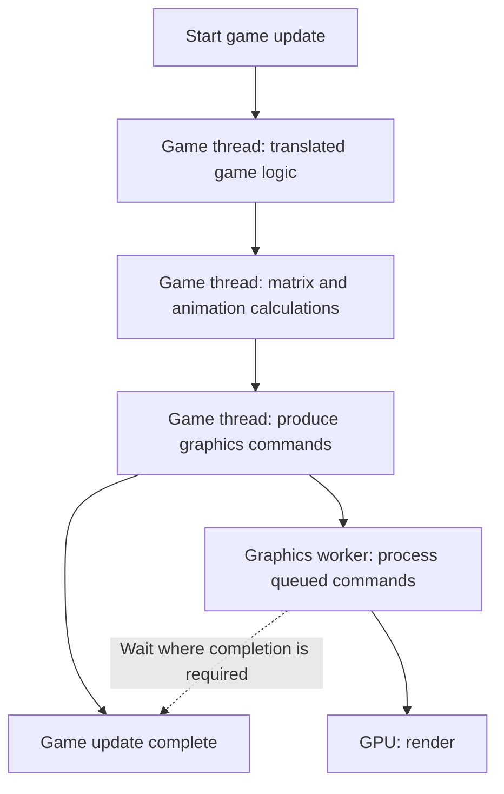

# PRD — Shorten the Steam Deck game update

Status: Draft; planning only · Created: 2026-10-19

[Technical plan](TECH_PLAN.md) · [Progress](PROGRESS.md)

## Motivation and outcome

Steam Deck players encounter slow simulation while GPU capacity remains available. The user confirmed the goal: preserve gameplay and reduce game-update time enough for stable **30 Hz logic**, with a 33.3 ms update budget. Higher presentation rates and Smooth Motion are separate from logic rate.

[Issue #215](https://github.com/chrissotraidis/bluewake/issues/215) originally reported about 20 FPS; a [later game-mode report](https://github.com/chrissotraidis/bluewake/issues/215#issuecomment-6223657482) reported 22–27 FPS on `78da642`. These are historical observations, not this plan's baseline. The desktop 5800X3D result is useful context, not evidence of the Deck's exact hotspot.

## Scope and prerequisite

Measure the critical path; parallelize profitable independent calculations; reduce serial translated/runtime overhead; investigate repeated graphics preparation and waits. Implement one measured hypothesis per change.

Assume the [#399 prerequisite chain through #417](https://github.com/chrissotraidis/bluewake/pull/399) is merged and working, as requested. Actual inspected `main` is `095f7014cb2db2fb5640641133040593a7775a78`; the stack is still open. Establish the real merged revision before implementation. Reuse its tests, diagnostics and qualification runners.

Excluded: 60 Hz simulation, arbitrary concurrent actor updates, GPU compute migration, a new scheduler framework, and automatic feature enablement before hardware qualification.

## Current bottleneck, conceptually

Boxes show dependencies, not measured durations. Work is interleaved in practice; this is not an exact frame trace.

See [host execution](https://github.com/chrissotraidis/bluewake/blob/095f7014cb2db2fb5640641133040593a7775a78/docs/architecture/Host.md#main-loop-execution) and [graphics completion](https://github.com/chrissotraidis/bluewake/blob/095f7014cb2db2fb5640641133040593a7775a78/docs/architecture/Graphics.md#synchronization-and-completion). Idle GPU capacity cannot execute the serial work ahead of it automatically.

## Requirements

### FR-01 — Identify the limiting work

Attribute game-update time to computation, translated/runtime bookkeeping, graphics preparation and blocking. Record activation and batch sizes; enabled settings alone do not prove execution. Use the [performance workflow](https://github.com/chrissotraidis/bluewake/blob/095f7014cb2db2fb5640641133040593a7775a78/docs/performance/Overview.md#performance-workflow).

Acceptance: a reproducible Deck baseline, ranked candidates, and a go/no-go decision for each proposed optimization.

### FR-02 — Share independent calculations across cores

Keep one authoritative owner of [guest state](https://github.com/chrissotraidis/bluewake/blob/095f7014cb2db2fb5640641133040593a7775a78/docs/architecture/GuestState.md#ownership-and-address-model). Workers receive stable inputs, own nonconflicting outputs, and complete before results are consumed. Only the game thread applies guest CPU/device effects; arithmetic order remains equivalent. Small or unsafe jobs stay serial. These rules enable splitting the calculation; the pool schedules it. See [parallelization rules](TECH_PLAN.md#rules-for-safely-parallelizing-calculations).

Acceptance: translated reference, serial native and parallel candidate agree on the promised guest-visible effects; eligible tests prove worker participation. Skinning remains a measured candidate, not a predetermined implementation.

### FR-03 — Reduce serial and repeated work

Optimize measured runtime overhead or repeated preparation without changing [guest deadlines](https://github.com/chrissotraidis/bluewake/blob/095f7014cb2db2fb5640641133040593a7775a78/docs/architecture/Services.md#guest-time-and-deadlines) or graphics observation order. Consider larger native routines, batching and caching where evidence supports them. Existing optimizations must not be presented as missing features.

Acceptance: isolated A/B evidence shows a shorter game-update critical path; otherwise retain the baseline and record the rejected hypothesis.

### FR-04 — Preserve behavior and lifecycle

Retain arithmetic order where exactness is promised, memory effects, registers, cycles, callbacks and rendering barriers. Preserve save/reload, shutdown and failure behavior. Declines leave guest state unchanged. See [guest state](https://github.com/chrissotraidis/bluewake/blob/095f7014cb2db2fb5640641133040593a7775a78/docs/architecture/GuestState.md) and [service lifecycle](https://github.com/chrissotraidis/bluewake/blob/095f7014cb2db2fb5640641133040593a7775a78/docs/architecture/Services.md#lifecycle-and-observable-state).

Acceptance: existing foundation checks plus candidate-specific tests pass; gameplay, audio, cutscene, input and save checks remain mandatory.

### FR-05 — Demonstrate product benefit on Deck

Measure milliseconds per actual game update, sustained logic rate, p50/p95/p99, worker activation and waits. Compare serial and 1/2/3 background workers under normal and bounded CPU pressure; maximum utilization is not the objective.

Acceptance: reproducible improvement beyond same-build noise, no material regression in control scenes, and a rendered Deck qualification report. New behavior stays opt-in until qualified.

## Success and evidence policy

| Metric | Baseline | Target / decision |
|---|---|---|
| Logic throughput | Not measured on merged baseline | Sustain approximately 30 updates/s in frozen gameplay scenes |
| Active update duration | Unknown | p95 ≤33.3 ms; report p99 and stalls separately |
| Candidate benefit | Unknown | Proposed retention policy: ≥5% median update-time reduction in target scene, exceeding measured noise |
| Control-scene regression | Unknown | Proposed limit: ≤2%; noisy comparisons are inconclusive |
| Correctness | Assumed foundation; candidate untested | All required exactness and behavior gates pass |

Freeze thresholds, scenes and the [run matrix](TECH_PLAN.md#run-matrix--proposed-freeze-at-m0) at M0. Keep unpaced headroom and normal rendered 30 Hz results separate. Report partial progress if the 30 Hz goal is not reached.

| Outcome | Meaning |
|---|---|
| Fail | Correctness error; reject candidate |
| Incomplete | Required inputs, metrics or eligible-path activation missing |
| Inconclusive | Results cannot be distinguished from noise |
| Skipped | Explicitly unsupported optional lane |
| Retain | Benefit/regression policy met; full qualification still required |

## Clarifications

- Motivation confirmed: stable 30 Hz logic while preserving gameplay.
- Preserve the three original explanatory diagrams; TECH_PLAN also includes the qualification decision flow.
- Which routine deserves implementation is an evidence decision at M0, not an assumed hotspot.
