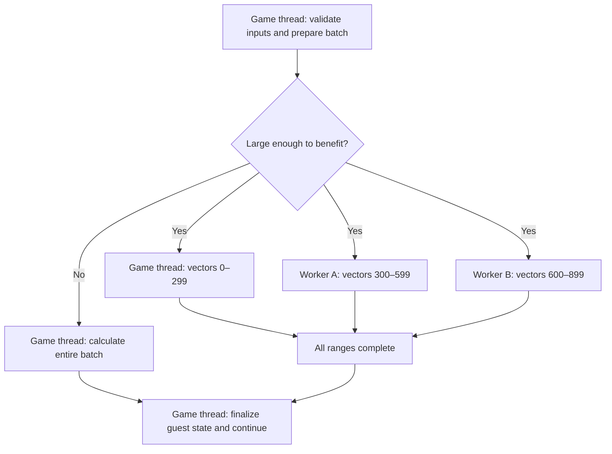
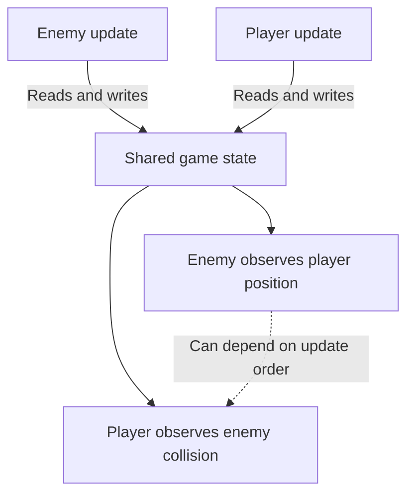
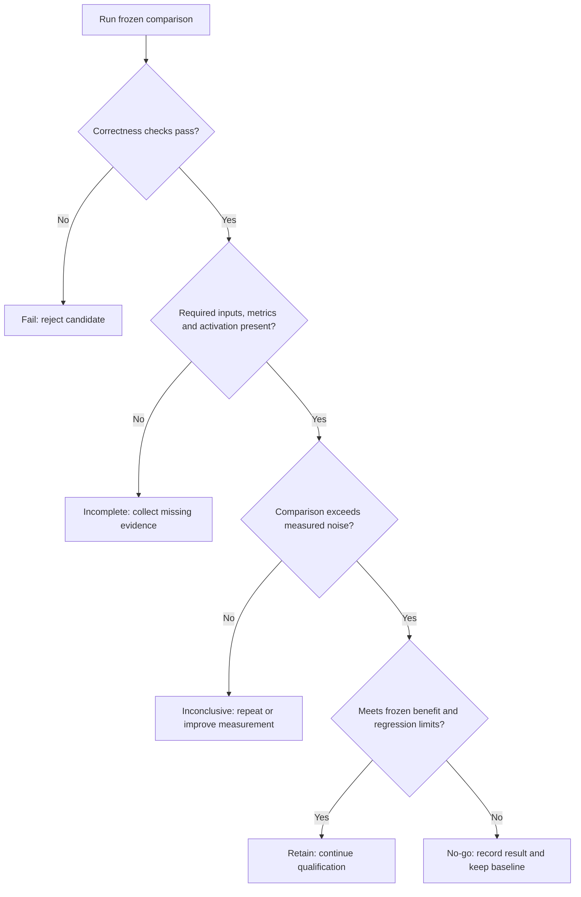

# TECH_PLAN — Shorten the Steam Deck game update

Status: Planning only · [Requirements](PRD.md) · [Tracker](PROGRESS.md)

## Inspected facts and provenance

Inspected BlueWake `main`: `095f7014cb2db2fb5640641133040593a7775a78`. Read AGENTS, GOAL_LOOP, architecture, performance/profiling guides, pool/math/skinning code and guard tests. Checked open related PRs and the upstream `gamethread` branch search (no matches); fork branches are not exhaustively inventoried. Recheck overlap before coding.

- [Existing vector arrays](https://github.com/chrissotraidis/bluewake/blob/095f7014cb2db2fb5640641133040593a7775a78/cmake/composite/native_math.c) already use synchronous fork/join. The caller participates. The [pool contract](https://github.com/chrissotraidis/bluewake/blob/095f7014cb2db2fb5640641133040593a7775a78/cmake/composite/native_work_pool.h) forbids callbacks accessing guest CPU/device/global state; [implementation](https://github.com/chrissotraidis/bluewake/blob/095f7014cb2db2fb5640641133040593a7775a78/cmake/composite/native_work_pool.c) keeps small jobs serial, supports up to eight POSIX background workers and retains Windows serial execution.
- [Existing skinning](https://github.com/chrissotraidis/bluewake/blob/095f7014cb2db2fb5640641133040593a7775a78/cmake/composite/native_skin.c) is serial and reproduces guest arithmetic/state. Its 3.1% historical donor measurement is explicitly not a BlueWake benchmark.
- [Dispatch](https://github.com/chrissotraidis/bluewake/blob/095f7014cb2db2fb5640641133040593a7775a78/cmake/composite/dispatch_loop.h) already inlines important control flow; [gather-pipe batching](https://github.com/chrissotraidis/bluewake/blob/095f7014cb2db2fb5640641133040593a7775a78/cmake/composite/gather_pipe_batch.h) already avoids a host call per word. Tune remaining costs only after profiling.
- [PERFORMANCE](https://github.com/chrissotraidis/bluewake/blob/095f7014cb2db2fb5640641133040593a7775a78/docs/PERFORMANCE.md) records a Deck experiment reducing GX worker activity without raising FPS: optimizing another thread need not shorten the bottleneck.
- Inspected assumed-foundation tip: `ce33691850969bfddd93d606903ad6b58f5160ca` ([#417](https://github.com/chrissotraidis/bluewake/pull/417)); read its pool CMake registration and qualification CLI. Its reported hardware gaps remain facts about that snapshot; this plan adopts the user's hypothetical completed foundation.

## Proposed changes

The changes below cover three connected steps. First, improve measurement so we can see which parts of a game update consume time and which are waiting. Then shorten the expensive work: share independent calculations across CPU cores, and reduce repeated checks or host calls in work that must stay sequential. Skinning is one candidate to measure, not a confirmed hotspot.

The test and qualification changes support both approaches: they check that the optimized paths actually execute, preserve guest-visible behavior, and improve update time on the Deck. The table maps each step to its code, requirements and architecture.

| Status | Surface | Practical change / requirement | Architecture |
|---|---|---|---|
| Extend existing | `scripts/linux/profile_deck.sh`, `scripts/bench_tour.py`; foundation qualification reports | Capture matched workloads, exclusive costs, wait time and batch distributions; FR-01, FR-05 | [Measurement](https://github.com/chrissotraidis/bluewake/blob/095f7014cb2db2fb5640641133040593a7775a78/docs/performance/Overview.md#tool-roles-and-platform-coverage) |
| Modify if selected | `cmake/composite/native_math.c`, `native_skin.c`; proposed value-only helper | Tune vector grain or extract independent envelope calculation; FR-02, FR-04 | [State ownership](https://github.com/chrissotraidis/bluewake/blob/095f7014cb2db2fb5640641133040593a7775a78/docs/architecture/GuestState.md#ownership-and-address-model) |
| Modify if selected | `cmake/composite/dispatch_loop.h`, `gather_pipe_batch.h` | One measured reduction in redundant checks/crossings; FR-03, FR-04 | [Host loop](https://github.com/chrissotraidis/bluewake/blob/095f7014cb2db2fb5640641133040593a7775a78/docs/architecture/Host.md#main-loop-execution) |
| Extend existing | `tests/native_math_guard_test.c`, foundation `tests/native_math_test.c`; proposed `tests/native_skin_test.c` if needed | Candidate-specific exactness, decline and activation checks; FR-02, FR-04 | [Guest state](https://github.com/chrissotraidis/bluewake/blob/095f7014cb2db2fb5640641133040593a7775a78/docs/architecture/GuestState.md) |
| Extend foundation | `scripts/qualify_gamethread.py`, `scripts/gamethread_qualification/` | Record candidate identity, update metrics, pressure matrix and outcomes; FR-01, FR-05 | [Lifecycle](https://github.com/chrissotraidis/bluewake/blob/095f7014cb2db2fb5640641133040593a7775a78/docs/architecture/Services.md#lifecycle-and-observable-state) |

Foundation paths exist on the inspected stack, not inspected main. Resolve their merged interfaces at M0. Renderer/runtime changes belong in RecompCore `bluewake-next`, followed by BlueWake pin/patch updates per [AGENTS](https://github.com/chrissotraidis/bluewake/blob/095f7014cb2db2fb5640641133040593a7775a78/AGENTS.md); this plan does not authorize publishing there.

## Rules for safely parallelizing calculations

The contract specifies what must be true for a calculation to be split safely. The refactoring establishes those conditions; the existing thread pool distributes the independent pieces across cores. This applies to the vector/skinning changes in the table above. Dispatch and graphics changes must preserve their own deadline and observation rules.

| Potential dependency | What the contract requires | How that enables parallel execution |
|---|---|---|
| Calculations read changing game state. | Inputs stay stable until all ranges finish. | Workers can read concurrently without seeing different versions. |
| Calculations overwrite another range's inputs or results. | Validate overlaps; assign separate outputs to each range. | Workers can write without coordinating every write. |
| Arithmetic helpers modify guest registers or flags. | Workers calculate values; the game thread applies CPU-state effects. | Workers avoid racing over the emulated CPU. |
| Game code consumes unfinished results. | The range call returns only after every participant finishes. | Subsequent game code sees complete results. |
| Splitting a sum changes floating-point results. | Split between independent envelopes; preserve each envelope's arithmetic order. | Scheduling changes while numerical results remain equivalent. |

These are implementation obligations, not properties automatically supplied by adding threads. If they cannot be established, retain the serial path. Existing vector arrays already follow this pattern; skinning would need the proposed refactoring and validation.

Illustrative partition: actual pool partitioning may differ.



Existing call in `mult_vec_array`:

```c
bluewake_parallel_range(count,256,vector_range,&batch);
```

Proposed skinning shape; names below are proposed, not compiled APIs:

```c
/* Before any guest mutation: resolve stable inputs, capture FP mode,
   validate budgets/overlaps, allocate bounded scratch if needed. */
if (!prepare_skin_job(cpu, &job)) return 0; /* unchanged decline */
bluewake_parallel_range(job.envelope_count, job.grain,
                       skin_envelope_range, &job); /* joins here */
commit_skin_job(cpu, &job); /* original effects, no new failure point */
```

The snippet implements three boundaries: **prepare inputs → calculate independent ranges → apply guest effects**. For skinning, preserve these additional details:

- **Arithmetic:** joint reduction order, rounding/paired-single behavior and zero-count do-while semantics.
- **Workers:** value-only FP helpers and disjoint scratch outputs; no live CPUState access.
- **Caller:** original flags, stack writes, registers, reservations and cycle accounting.
- **Fallback:** validate budgets, overlaps and allocations before guest mutation; small or ineligible jobs stay serial.
- **Lifetime:** callbacks finish before shutdown/unload releases their code or data.

Existing math's validated direct writes need not be converted to scratch unnecessarily.

## Why whole actors stay sequential

Illustrative dependency risk, not a claim about specific actor functions:



Later subsystem jobs require stable snapshots and ordered application of effects. Graphics preparation additionally needs ownership/invalidation and the [existing observation barriers](https://github.com/chrissotraidis/bluewake/blob/095f7014cb2db2fb5640641133040593a7775a78/docs/architecture/Graphics.md#synchronization-and-completion). M0 ranks caching/offload opportunities; implementation needs a bounded follow-up if it crosses those interfaces.

## Verification and measurement

| Layer | Method | Required evidence |
|---|---|---|
| Source-only | Existing pool CTest/guard tests, candidate fixtures, ASan/UBSan and supported TSan lane | Exact-once writes, boundaries, overlap declines, partial creation and unload tests |
| Private integration | Foundation translated-reference / serial-native / candidate oracle | Independent RAM, complete function/category coverage, correct registers/memory/cycles and positive activation |
| Deck A/B | Same merged revision/build inputs except candidate; controls below | Raw logs, executable/module hashes, settings, thermal/clock/power state and comparison report |
| Gameplay | Rendered route, cutscene/audio, sailing/input, copied-card save/reload, soak | Completed route, no introduced errors, matching promised state; manual observations recorded separately |
| Portability | Shared-code builds and required Windows host CI | Windows remains serial unless separately implemented and qualified |

### Run matrix — proposed; freeze at M0

A = candidate off. B = candidate on. Kernel checks also include forced-serial native.

| Dimension | Configuration |
|---|---|
| Scenes | Outset + one measured slow gameplay scene + one low-load control |
| Warmup / sample | 60 s / 120 s per measured run |
| Noise check | Three A/A pairs per scene: same build against itself |
| Comparison | Five interleaved A/B pairs per scene |
| Background workers | Serial, 1, 2, 3; fresh process for each setting |
| CPU pressure | Reuse foundation bounded-pressure stages |
| Rendered soak | At least one run lasting ≥30 minutes |

### Controls and measurements

**Keep fixed within each comparison:**

- Compiler, PGO, textures, render settings and pacing.
- Scene, route and starting state; retain state/card hashes locally.
- PRD retention thresholds, frozen before candidate measurements.

**Collect separately:**

| Run mode | Question | Primary evidence |
|---|---|---|
| Unpaced | How much execution headroom did we gain? | Actual-update duration; p50/p95/p99 |
| Normal rendered 30 Hz | Does gameplay sustain its target rate? | Logic rate, stalls and behavior checks |
| Worker / pressure matrix | Does offloading remain useful under contention? | Effective workers, worker-owned work, update time and waits |

Count actual game updates. Dispatch turns and VI counts are not substitutes.

### Decision flow



- **Fail:** any correctness error.
- **Skipped:** an unsupported optional lane, explicitly identified.
- **Incomplete:** required inputs, metrics or eligible-path activation missing.
- **Inconclusive:** A/B results cannot be distinguished from noise.
- **Retain:** measured benefit passes policy; full gameplay/hardware qualification still required.

Commands verified against inspected entry points; examples for later execution, not checks run here:

```bash
cmake -S tests/native_work_pool -B build/native-work-pool
cmake --build build/native-work-pool --parallel
ctest --test-dir build/native-work-pool --output-on-failure
python3 scripts/qualify_gamethread.py matrix
scripts/linux/profile_deck.sh --help
```

## Impact register

| ID | FR | Entity / baseline | Expected change / measure | Risk | Owner |
|---|---|---|---|---|---|
| IMP-01 | FR-01 | Update attribution: unknown | Ranked exclusive time and waits; same-scene profile/logs | Sampling confuses busy and blocked time | M0 |
| IMP-02 | FR-02 | Kernel cost/activation: unknown | Lower inclusive job time including scheduling/copy/join; batch histogram | Tiny jobs, bandwidth or FP differences | M1 |
| IMP-03 | FR-03 | Serial overhead: unknown | Fewer measured crossings/checks; lower update time | Skipped observable boundary | M2 |
| IMP-04 | FR-04 | Candidate integrity: untested | Zero required mismatches; oracle and lifecycle evidence | Incomplete coverage | M3 |
| IMP-05 | FR-05 | Merged Deck rate: unknown | Stable 30 Hz; PRD thresholds and pressure/soak evidence | Renderer contention, thermal noise | M4 |

## Implementation order

| Milestone | Depends | Can run with | Ownership, deliverable and gate |
|---|---|---|---|
| M0 | — | — | Freeze baseline, chosen candidates, interfaces, thresholds and report schema |
| M1 | M0 | M2, M3 | Own math/skin implementation; independent range kernel or measured no-go |
| M2 | M0 | M1, M3 | Own dispatch/gather surfaces; isolated serial-overhead change or measured no-go |
| M3 | M0 | M1, M2 | Own fixtures/qualification scripts; integrate M0 contract, then verify final candidate revisions |
| M4 | M1, M2, M3 | — | Combine retained changes; Deck performance, behavior, pressure and soak qualification |

Critical path: M0 → longest of M1/M2/M3 → M4. No duration estimate is supported. M3 final execution waits for candidate commits despite parallel test development. Shared pool headers/counters stay frozen; coordinate any required interface edit before dependent work resumes. Only one hardware benchmark runs per Deck at once. If M0 selects overlapping implementation files, serialize those edits. A no-go closes an experimental stream with evidence, not an invented optimization.
