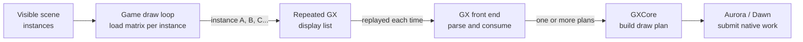
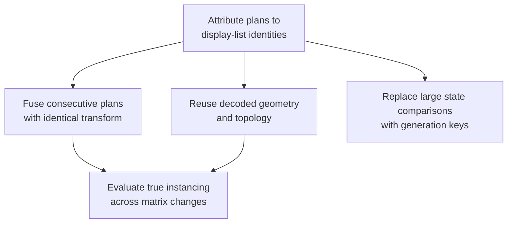

# PRD — Repeated GX display-list optimization

Status: Draft

Repository baseline: `chrissotraidis/bluewake@b1bf26a0b8a5c1c6e86b9351d658806ff9eb3c1c`

Measured build: `bluewake@b721e785fbfbb4f3351d4775d3ba767cae7de88b`, AppImage SHA-256 `406fcf53ae302b0be2ad95739650b5e371090777a7d7da3759202cdde19cc575`

Scope: investigate and reduce repeated CPU-side GX plan work, including the successful M2-B cache-hit path; excluded: visual LOD/culling changes, Smooth Motion policy, added worker threads and full draw-plan caching. This fork PR carries the diagnostics and default-off experiments; performance changes remain gated on measured evidence.

## Problem

BlueWake can hold 30 game FPS at one Outset camera angle and fall to 26–29 at another while the GPU remains lightly loaded. Matched Steam Deck captures with Smooth Motion disabled found that the slow view builds substantially more GX draw plans:

| View | Frames sampled | Planned draws/frame | Range |
| --- | ---: | ---: | ---: |
| Stable | 445 | 629.13 | 606–651 |
| Slow | 399 | 1,076.34 | 1,051–1,100 |

The slow view therefore creates **71.1% more plans**. CPU sampling also increased `GxCoreState::build_draw_plan_into` samples by about 53%, while GPU waits stayed low. This identifies CPU-side graphics conversion as a view-dependent cost, but does not yet prove which game systems own the additional draws.

Wind Waker's decompiled grass, tree, wood and flower renderers explain a likely mechanism: each visible instance loads a model matrix and calls the same small display list. RecompCore must repeatedly parse, plan and submit geometrically identical work whose transform differs per instance.

This is related to, but not replaced by, existing draw fusion. Fusion already joins adjacent compatible primitives inside a display list. Merged [PR #454](https://github.com/chrissotraidis/bluewake/pull/454) records another safe opportunity—joining consecutive plans with identical state and transform—but matrix-varying instance loops remain outside that contract.

## Solution direction

The work proceeds from evidence to increasingly broad optimizations:

The first implementation should favor reuse over altered visibility. A cache may reuse immutable decoded vertices and topology only when the display-list contents, VCD/VAT layout and referenced vertex arrays are unchanged. Transform, lighting, textures, ordering and guest-visible state remain live per draw. True instancing is a later option because it changes submission shape and interacts with transparency, shadows and Smooth Motion pairing.

M2-B proved that reuse is frequent: 91.5% of eligible lookups hit and the repeated worst view used 5.1% less GX-worker CPU. Total process CPU improved only 1.1%, indicating that key construction, validation, lookup or vertex copying consumes most of the avoided decode cost. The next M2 work first attributes that hit-path cost, then tests only the dominant mechanism in isolation.

## Outcomes and acceptance

- Name the display-list identities responsible for the stable/slow delta; an unattributed aggregate is insufficient.
- Reduce GX-worker CPU time or rendered frame time in the slow view. A lower plan count alone is not a performance result.
- Attribute M2-B hit-path cost among FIFO hashing, array/epoch validation, cache lookup and vertex copying before selecting another implementation.
- Retain a hit-path optimization only when its improvement exceeds A/A noise in GX-worker or frame time; report CPU-only gains as such.
- Preserve guest checkpoints, draw order, real rendered frames and Smooth Motion output across the benchmark scenes.
- Keep runtime behavior unchanged when the candidate is disabled until platform qualification is complete.
- Treat missing attribution, cache activation, complete scenes, or visual evidence as inconclusive rather than passing.

## Constraints

- Runtime changes belong in a companion `chrissotraidis/RecompCore` PR first; BlueWake then pins and exports the accepted runtime revision.
- Display-list bytes and referenced guest arrays can change. Cache validity must use content or mutation identity, never a guest address alone.
- Counts are recorded before all renderer batching; no proportional FPS or GPU-call reduction is assumed.
- Unknown or incompletely tracked guest-memory identity must bypass reuse. Address-only identity is never sufficient.
- Shared immutable geometry is not assumed safe: `DrawPlan` consumers and asynchronous interpolation/upload lifetimes must be proven before changing ownership.
- Private disc data, saves, modules, AppImages and raw device logs remain outside GitHub.

## References

- [Graphics architecture](../../architecture/Graphics.md#gx-command-path)
- [Steam Deck profiling procedure](../../PROFILING.md)
- [Outset draw census](../../status/OUTSET_DRAWS_2026-10-22.md)
- [Steam Deck performance report #215](https://github.com/chrissotraidis/bluewake/issues/215)
- [Fork integration PR #2](https://github.com/irregularthanis/bluewake/pull/2)
- [M0 RecompCore diagnostic](https://github.com/irregularthanis/RecompCore/commit/4b5f0ae989fcbd8f544984fdc79679acd25e87c3)
- [Wind Waker grass renderer](https://github.com/zeldaret/tww/blob/main/src/d/d_grass.cpp), [tree renderer](https://github.com/zeldaret/tww/blob/main/src/d/d_tree.cpp), [wood renderer](https://github.com/zeldaret/tww/blob/main/src/d/d_wood.cpp), and [flower renderer](https://github.com/zeldaret/tww/blob/main/src/d/d_flower.cpp)
