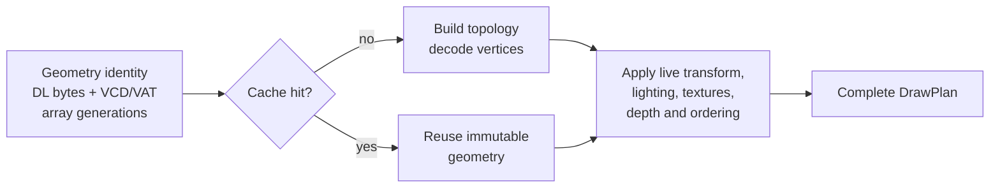

# TECH_PLAN — Repeated GX display-list optimization

Status: M0 attribution complete; second M2 candidate ready for Deck measurement

Baseline: [`chrissotraidis/bluewake@b1bf26a`](https://github.com/chrissotraidis/bluewake/commit/b1bf26a0b8a5c1c6e86b9351d658806ff9eb3c1c)

Current integration: this PR pins [`irregularthanis/RecompCore@739de26`](https://github.com/irregularthanis/RecompCore/commit/739de26186b636ad251c4062ad20db0f916fda35), which keeps the M0 diagnostic and replaces the rejected M2 validation scan with a default-off dirty-epoch candidate on BlueWake's current `1446450` runtime base. Both the dependency inventory and the builders' authoritative profile use this revision. PR [#2](https://github.com/irregularthanis/bluewake/pull/2) is the canonical workspace until the evidence supports an upstream submission.

[Product brief](PRD.md) · [Tracker](PROGRESS.md)

## Inspected facts

- The Deck A/B camera capture measured 629.13 versus 1,076.34 planned draws/frame (+71.1%) on the same instrumented AppImage. `skipped`, `cull`, `missing_vcd`, and `vtx_fail` remained zero.
- Flat CPU profiles increased `build_draw_plan_into` from approximately 96 to 147 samples (+53%), `aurora_backend_gx_write` from 47 to 67 (+43%), and `RetailGxFrontend::handle_draw` from 14 to 24 (+71%). `parse_stream` was approximately flat. These are sampled estimates, not call timings.
- [`build_draw_plan_into`](https://github.com/chrissotraidis/RecompCore/blob/bluewake-next/GXRuntime/graphics/gxcore/src/gxcore.cpp) currently derives/cache-checks pipeline state, rebuilds topology, decodes the vertex payload and prepares constants for each consumed draw.
- Existing BlueWake patches already reuse plan/vector capacity, avoid whole-state copies, cache derived pipeline state and fuse compatible adjacent primitives. Proposed work must measure incremental benefit beyond those optimizations.
- The decompiled foliage loops load a per-instance matrix and replay shared display lists. This is a source-grounded candidate mechanism, not yet attribution for the measured angle.
- Merged [#454](https://github.com/chrissotraidis/bluewake/pull/454) reports 34–59% same-transform plan-fusion potential across four rendered scenes, before downstream batching.
- The M0 diagnostic now carries the originating guest display-list address through frontend packets and draw plans. With `DOL_GXCORE_DL_ATTRIBUTION=1`, each present reports the top 12 addresses by plans plus vertices and reconciled frame totals. Plans fused across different lists use address `0` as an explicit unknown bucket.

### M0 attribution findings

Matched 15-second Game Mode captures used BlueWake `24291d4`, RecompCore `4b5f0ae`, AppImage SHA-256 `f84ff19b...948ff`, Smooth Motion pacing disabled, and the same Outset state. The stable, slow and worst views covered 449, 388 and 353 frames respectively.

| Display list | Game owner | Stable | Slow | Worst plans/frame |
| --- | --- | ---: | ---: | ---: |
| `80379980` | `l_Oba_kusa_aDL` — grass | 7.00 | 115.00 | 840.00 |
| `80382DC0` | `l_OhanaDL` — flowers | Below top 12 | 43.00 | 68.00 |
| `8037B020` | `g_dTree_Oba_kage_32DL` — tree shadow | Below top 12 | 41.00 | 18.00 |
| `8037AC60` | `l_Oba_swood_a_mikiDL` — tree trunk | Below top 12 | 38.00 | 10.00 |
| `8037AAE0` | `l_Oba_swood_a_hapaDL` — tree foliage | Below top 12 | 38.00 | 10.00 |
| `80383A40` | `l_Ohana_highDL` — high-detail flowers | Below top 12 | 22.00 | Below top 12 |

Overall plans rose from 500.63 stable to 983.61 slow and 1,776.96 worst. Grass alone rose from 115 to 840 plans/frame between slow and worst: +725 of the +793 total delta (91%). Against stable, grass adds 833 of the +1,276 total. The third capture therefore narrows the first optimization target from general foliage to repeated grass geometry. Address `0` still rose from 313.93 stable to 372.88 worst, while relocated address `8107F480` remained 35 plans/frame in both slow views.

Symbol identities come from the upstream [GZLE01 symbol map](https://github.com/zeldaret/tww/blob/main/config/GZLE01/symbols.txt). Raw logs remain private; stable SHA-256 is `9ed7955d...f692`, slow is `6efea0f9...fb70`, and worst is `f8b2bdd6...a83cd`.

## Planned changes

| Status | File / symbol | Practical change | Milestone |
| --- | --- | --- | --- |
| Implemented | RecompCore `RetailGxFrontend::write_display_list` / packet metadata | Carry the active display-list address through nested parsing, queued draws and consumed plans; preserve address `0` for unattributed or cross-list fused work | M0 |
| Implemented | RecompCore Aurora plan observer | When `DOL_GXCORE_DL_ATTRIBUTION` is set, rank up to 12 display-list addresses per present and report plan/vertex totals | M0 |
| Proposed | RecompCore `GxCoreSink` / draw submission | Implement #454's same-state, same-transform plan concatenation behind a default-off switch | M1 |
| Rejected experiment | RecompCore `GxCoreState::build_draw_plan_into` | Content-hash decoded-vertex cache activated frequently but increased GX/CPU cost | M2 |
| Proposed | RecompCore frontend/GX state | Carry XF, channel, light, texture and array generation IDs so hot cache checks compare compact identities | M3 |
| Proposed | Aurora GXCore submission | Evaluate matrix-varying instancing only after M1–M3 results establish remaining cost | M4 |
| Modify after runtime acceptance | BlueWake dependency lock, patch export and performance documentation | Pin the companion runtime revision and record qualification | M5 |

## Milestone plans

### M0 — Attribute repeated work

Carry the originating display-list address from `RetailGxFrontend::write_display_list` through consumed draws and `DrawPlan`. The opt-in present observer ranks plans and vertices by address, while address `0` keeps unknown FIFO and cross-list fused work explicit.

Status: complete. Stable, slow and worst Outset captures attribute 91% of the slow-to-worst plan increase to `l_Oba_kusa_aDL`. The evidence and private-log hashes are recorded above and in [PROGRESS.md](PROGRESS.md#m0-attribute-repeated-work).

### M1 — Same-transform fusion

Implement the constrained opportunity measured by merged [#454](https://github.com/chrissotraidis/bluewake/pull/454). Concatenate only adjacent plans whose transforms, pipeline/resources, viewport/scissor, constants, depth/blend behavior and Smooth Motion identity are compatible; preserve ordering and rebase indices exactly.

Keep the candidate default-off. Unit coverage must exercise every rejection boundary, and Deck evidence must show both fewer plans and lower GX-worker or frame time before retention.

### M2 — Geometry and topology reuse

The cache must separate immutable geometry identity from live draw state:

`DOL_GXCORE_GEOMETRY_CACHE=1` enables a thread-local, 256-entry direct-mapped cache. It reuses decoded vertices only; transforms, lighting, textures, depth, ordering and other draw state remain live.

#### Candidate comparison

| Property | M2-A: content validation | M2-B: dirty-epoch validation |
| --- | --- | --- |
| RecompCore | [`857ca0d`](https://github.com/irregularthanis/RecompCore/commit/857ca0dc720b028e66328d5feef207beb691af3f) | [`739de26`](https://github.com/irregularthanis/RecompCore/commit/739de26186b636ad251c4062ad20db0f916fda35) |
| Display-list identity | Nonzero address + raw FIFO payload | Nonzero address + raw FIFO payload |
| Decode layout | VCD/VAT walk key + fallback PN matrix | VCD/VAT walk key + fallback PN matrix |
| Indexed-array validation | Hash every referenced element byte | Hash base, stride, span and one dirty epoch per distinct array |
| Unknown address/epoch | Bypass | Bypass |
| Storage | 256 thread-local direct-mapped entries | Same |
| Default | Off | Off |
| Status | Rejected on Deck | Focused tests pass; Deck A/B pending |

The raw FIFO payload covers direct attributes and array indices. M2-B obtains indexed-array epochs from [`dol_guest_memory_dirty_epoch`](https://github.com/irregularthanis/RecompCore/blob/739de26186b636ad251c4062ad20db0f916fda35/GXRuntime/src/guest_memory_dirty.c); an unavailable epoch selects the uncached path.

#### M2-A measured result

| Metric | Cache off | Cache on | Delta |
| --- | ---: | ---: | ---: |
| Eligible cache hits | — | 1,805,242 | — |
| Eligible cache misses | — | 170,381 | — |
| Eligible hit rate | — | 91.4% | — |
| Game rate | ~28 FPS | ~24 FPS | ~-14% |
| GX-worker load | ~26% | 41–43% | +15–17 pp |
| Process CPU, 15 s | 2,033 jiffies | 2,231 jiffies | +9.7% |

Decision: reject M2-A. Per-element validation consumed more CPU than vertex decoding saved.

#### M2-B validation and pending measurement

| Check | Result |
| --- | --- |
| Repeated unchanged draw | Cache hit |
| Direct FIFO payload mutation | Cache miss |
| Indexed-array dirty mark | Cache miss |
| Indexed range outside tracked MEM1 | Safe bypass |
| Focused `gxcore_tests` | Pass |
| Full BlueWake container build | Pending |
| Same-AppImage Deck cache-off/cache-on A/B | Pending |

Retain M2-B only if matched Deck runs improve game rate or CPU/GX-worker cost without visual or lifecycle regressions.

### M3 — Generation-keyed derived state

Measure the hit rate and comparison cost of the existing derived-state cache before changing it. If material, carry monotonic XF, channel, light, texture and array identities through the frontend so hot-path equality checks compare compact generations rather than large state blocks.

Every generation must advance on the corresponding guest-visible mutation. Verification compares cached and uncached plans and rejects the candidate if compact keys do not reduce measured GX-worker or frame time.

### M4 — Matrix-varying instancing decision

Re-profile after accepted M1–M3 work. Prototype instancing only if repeated lists remain expensive and differ primarily by transform; otherwise record a measured no-go decision.

Any prototype must define per-instance transforms, ordering, transparency, shadows and Smooth Motion pairing. It cannot reuse one interpolation identity across unrelated objects.

### M5 — Integrate and qualify

For each retained candidate, land the companion RecompCore change, update BlueWake's authoritative builder pin and dependency inventory, then build the standard SteamOS-compatible AppImage. Run A/A noise measurement followed by interleaved A/B across the full Deck methodology and player-facing Outset/transition checks.

Only publish redacted commands, source/build identities, activation counters and aggregate results. Private saves, translated modules, logs and AppImages remain local.

## Verification

| Layer | Method | Required evidence | Failure / inconclusive |
| --- | --- | --- | --- |
| Source/contract | Existing frontend and GXCore tests plus focused mutable-list/array, eviction and fusion cases | Cached and uncached plans match; mutation invalidates; bounds and shutdown pass | Missing invalidation or fallback coverage |
| Attribution | Stable/slow Outset angles, same build/settings, 15–30 seconds each | Ranked display-list identities explain the plan delta; totals reconcile with frame counters | Unknown bucket or dropped events materially obscure the delta |
| Correctness | `scripts/bench_tour.py` checkpoints and rendered captures at all fixed scenes | Checkpoints match; real and interpolated frames show no regression | Missing scene, inactive candidate, or unmatched capture |
| Performance | A/A noise, then interleaved A/B on Deck using the documented methodology | Source/build receipts, activation counters, frame time/FPS, GX-worker time, plan and renderer-draw counts | Plan reduction without CPU/frame benefit is not a win |
| Player-facing | Outset slow angle plus normal traversal, effects, shadows and scene transitions | No visible ordering, alpha, animation, input or lifecycle regression | Required hardware check unavailable remains open |

Raw private artifacts stay local; public records contain redacted commands, build identities and aggregates.

## Implementation order

| Milestone | Depends | Can run with | Deliverable / integration gate |
| --- | --- | --- | --- |
| M0 | — | — | Attribute repeated work: address-aware histogram reconciled against plan totals and the stable/slow delta |
| M1 | M0 | M2, M3 | Same-transform fusion: default-off candidate and exact plan-equivalence tests |
| M2 | M0 | M1, M3 | Geometry/topology reuse: bounded invalidating cache with observable activation |
| M3 | M0 | M1, M2 | Generation-keyed state: replace measured large comparisons without semantic changes |
| M4 | M1, M2 | — | Matrix-varying instancing: go/no-go prototype only if remaining profiles justify its wider contract |
| M5 | M0 | — | Integrate accepted candidate(s): RecompCore companion, BlueWake pin/patch, full Deck A/B and documentation |

Critical path: M0 → the strongest of M1/M2/M3 → M5. M4 is conditional, not required for a useful result.

Concurrency limits: M1–M3 may be developed separately after M0 freezes packet identity and counters, but they edit shared GXCore structures and must be integrated serially before combined benchmarking.

## Decisions and gaps

- Start with attribution. The slow view is draw-heavy, but “foliage caused it” is not yet proven.
- Prefer M1 or M2 before instancing: both retain the game's visibility and draw decisions.
- Measure renderer draws separately from GX plans because existing downstream batching breaks a one-to-one assumption.
- The diagnostic is intentionally fork-only while M0 evidence is collected. Accepted runtime work will need a companion upstream RecompCore PR before BlueWake can replace the temporary fork pin.

## References

- [Graphics command path](../../architecture/Graphics.md#gx-command-path)
- [Performance measurement model](../../performance/Overview.md#benchmarking)
- [Steam Deck procedure](../../PROFILING.md)
- [Merged draw census and fusion constraints](../../status/OUTSET_DRAWS_2026-10-22.md)
- [Issue #215](https://github.com/chrissotraidis/bluewake/issues/215)
- [Fork integration PR #2](https://github.com/irregularthanis/bluewake/pull/2)
- [M0 RecompCore diagnostic](https://github.com/irregularthanis/RecompCore/commit/4b5f0ae989fcbd8f544984fdc79679acd25e87c3)
