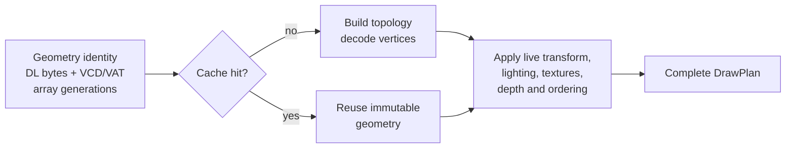

# TECH_PLAN — Repeated GX display-list optimization

Status: M0 attribution complete; optimization candidate selection ready

Baseline: [`chrissotraidis/bluewake@b1bf26a`](https://github.com/chrissotraidis/bluewake/commit/b1bf26a0b8a5c1c6e86b9351d658806ff9eb3c1c)

Current integration: this PR pins [`irregularthanis/RecompCore@4b5f0ae`](https://github.com/irregularthanis/RecompCore/commit/4b5f0ae989fcbd8f544984fdc79679acd25e87c3), the fork-only M0 attribution diagnostic replayed on BlueWake's current `1446450` runtime base. Both the dependency inventory and the builders' authoritative profile use this revision. PR [#2](https://github.com/irregularthanis/bluewake/pull/2) is the canonical workspace until the evidence supports an upstream submission.

[Product brief](PRD.md) · [Tracker](PROGRESS.md)

## Inspected facts

- The Deck A/B camera capture measured 629.13 versus 1,076.34 planned draws/frame (+71.1%) on the same instrumented AppImage. `skipped`, `cull`, `missing_vcd`, and `vtx_fail` remained zero.
- Flat CPU profiles increased `build_draw_plan_into` from approximately 96 to 147 samples (+53%), `aurora_backend_gx_write` from 47 to 67 (+43%), and `RetailGxFrontend::handle_draw` from 14 to 24 (+71%). `parse_stream` was approximately flat. These are sampled estimates, not call timings.
- [`build_draw_plan_into`](https://github.com/chrissotraidis/RecompCore/blob/bluewake-next/GXRuntime/graphics/gxcore/src/gxcore.cpp) currently derives/cache-checks pipeline state, rebuilds topology, decodes the vertex payload and prepares constants for each consumed draw.
- Existing BlueWake patches already reuse plan/vector capacity, avoid whole-state copies, cache derived pipeline state and fuse compatible adjacent primitives. Proposed work must measure incremental benefit beyond those optimizations.
- The decompiled foliage loops load a per-instance matrix and replay shared display lists. This is a source-grounded candidate mechanism, not yet attribution for the measured angle.
- Merged [#454](https://github.com/chrissotraidis/bluewake/pull/454) reports 34–59% same-transform plan-fusion potential across four rendered scenes, before downstream batching.
- The M0 diagnostic now carries the originating guest display-list address through frontend packets and draw plans. With `DOL_GXCORE_DL_ATTRIBUTION=1`, each present reports the top 12 addresses by plans plus vertices and reconciled frame totals. Plans fused across different lists use address `0` as an explicit unknown bucket.

### M0 attribution findings

Matched 15-second Game Mode captures used BlueWake `24291d4`, RecompCore `4b5f0ae`, AppImage SHA-256 `f84ff19b...948ff`, Smooth Motion pacing disabled, and the same Outset state. The stable view covered 449 frames; the slow view covered 388.

| Display list | Game owner | Stable plans/frame | Slow plans/frame | Observed delta |
| --- | --- | ---: | ---: | ---: |
| `80379980` | `l_Oba_kusa_aDL` — grass | 7.00 | 115.00 | +108.00 |
| `80382DC0` | `l_OhanaDL` — flowers | Below top 12 | 43.00 | Up to +43.00 |
| `8037B020` | `g_dTree_Oba_kage_32DL` — tree shadow | Below top 12 | 41.00 | Up to +41.00 |
| `8037AC60` | `l_Oba_swood_a_mikiDL` — tree trunk | Below top 12 | 38.00 | Up to +38.00 |
| `8037AAE0` | `l_Oba_swood_a_hapaDL` — tree foliage | Below top 12 | 38.00 | Up to +38.00 |
| `80383A40` | `l_Ohana_highDL` — high-detail flowers | Below top 12 | 22.00 | Up to +22.00 |

Overall plans rose from 500.63 to 983.61 per frame (+482.98). The six identified foliage lists contribute up to 290 slow-minus-recorded-stable top-12 plans/frame; addresses absent from the stable top 12 may have a small unrecorded stable count, so those individual deltas are upper bounds. Address `0` (cross-list fusion/unknown attribution) rose by 40.73 plans/frame, and relocated address `8107F480` contributed 35 slow-view plans/frame but is not yet symbolized. This establishes foliage display-list replay as the dominant named candidate without claiming it explains the entire delta.

Symbol identities come from the upstream [GZLE01 symbol map](https://github.com/zeldaret/tww/blob/main/config/GZLE01/symbols.txt). Raw logs remain private; stable SHA-256 is `9ed7955d...f692` and slow SHA-256 is `6efea0f9...fb70`.

## Planned changes

| Status | File / symbol | Practical change | Milestone |
| --- | --- | --- | --- |
| Implemented | RecompCore `RetailGxFrontend::write_display_list` / packet metadata | Carry the active display-list address through nested parsing, queued draws and consumed plans; preserve address `0` for unattributed or cross-list fused work | M0 |
| Implemented | RecompCore Aurora plan observer | When `DOL_GXCORE_DL_ATTRIBUTION` is set, rank up to 12 display-list addresses per present and report plan/vertex totals | M0 |
| Proposed | RecompCore `GxCoreSink` / draw submission | Implement #454's same-state, same-transform plan concatenation behind a default-off switch | M1 |
| Proposed | RecompCore `GxCoreState::build_draw_plan_into` | Reuse decoded vertices and topology for immutable repeated display-list geometry | M2 |
| Proposed | RecompCore frontend/GX state | Carry XF, channel, light, texture and array generation IDs so hot cache checks compare compact identities | M3 |
| Proposed | Aurora GXCore submission | Evaluate matrix-varying instancing only after M1–M3 results establish remaining cost | M4 |
| Modify after runtime acceptance | BlueWake dependency lock, patch export and performance documentation | Pin the companion runtime revision and record qualification | M5 |

## Cache contract

The cache must separate immutable geometry identity from live draw state:



Proposed, source-shaped key—not an implemented API:

```cpp
struct GeometryKey {
  uint32_t display_list_address;
  uint32_t display_list_size;
  uint64_t display_list_content_generation;
  uint64_t vertex_layout_generation;
  std::array<uint64_t, kArrayCount> array_generations;
};
```

An address is never sufficient: guest code may rewrite a list or an indexed array in place. Unknown-address FIFO draws use the uncached path initially. Cache eviction must be bounded, shutdown must release entries before graphics teardown, and a diagnostic mode must report hits, misses, invalidations and bytes retained.

Same-transform fusion must preserve order, pipeline/resources, viewport/scissor, constants, depth/blend behavior, index bounds and Smooth Motion tags. Matrix-varying instancing additionally needs an explicit per-instance transform contract and cannot reuse a single interpolation identity for unrelated objects.

## Verification

| Layer | Method | Required evidence | Failure / inconclusive |
| --- | --- | --- | --- |
| Source/contract | Existing frontend and GXCore tests plus focused mutable-list/array, eviction and fusion cases | Cached and uncached plans match; mutation invalidates; bounds and shutdown pass | Missing invalidation or fallback coverage |
| Attribution | Stable/slow Outset angles, same build/settings, 15–30 seconds each | Ranked display-list identities explain the plan delta; totals reconcile with frame counters | Unknown bucket or dropped events materially obscure the delta |
| Correctness | `scripts/bench_tour.py` checkpoints and rendered captures at all fixed scenes | Checkpoints match; real and interpolated frames show no regression | Missing scene, inactive candidate, or unmatched capture |
| Performance | A/A noise, then interleaved A/B on Deck using the documented methodology | Source/build receipts, activation counters, frame time/FPS, GX-worker time, plan and renderer-draw counts | Plan reduction without CPU/frame benefit is not a win |
| Player-facing | Outset slow angle plus normal traversal, effects, shadows and scene transitions | No visible ordering, alpha, animation, input or lifecycle regression | Required hardware check unavailable remains open |

Raw private artifacts stay local; public records contain redacted commands, build identities and aggregates.

## Implementation order

| Milestone | Depends | Can run with | Deliverable / integration gate |
| --- | --- | --- | --- |
| M0 | — | — | Attribute repeated work: address-aware histogram reconciled against plan totals and the stable/slow delta |
| M1 | M0 | M2, M3 | Same-transform fusion: default-off candidate and exact plan-equivalence tests |
| M2 | M0 | M1, M3 | Geometry/topology reuse: bounded invalidating cache with observable activation |
| M3 | M0 | M1, M2 | Generation-keyed state: replace measured large comparisons without semantic changes |
| M4 | M1, M2 | — | Matrix-varying instancing: go/no-go prototype only if remaining profiles justify its wider contract |
| M5 | M0 | — | Integrate accepted candidate(s): RecompCore companion, BlueWake pin/patch, full Deck A/B and documentation |

Critical path: M0 → the strongest of M1/M2/M3 → M5. M4 is conditional, not required for a useful result.

Concurrency limits: M1–M3 may be developed separately after M0 freezes packet identity and counters, but they edit shared GXCore structures and must be integrated serially before combined benchmarking.

## Decisions and gaps

- Start with attribution. The slow view is draw-heavy, but “foliage caused it” is not yet proven.
- Prefer M1 or M2 before instancing: both retain the game's visibility and draw decisions.
- Measure renderer draws separately from GX plans because existing downstream batching breaks a one-to-one assumption.
- The diagnostic is intentionally fork-only while M0 evidence is collected. Accepted runtime work will need a companion upstream RecompCore PR before BlueWake can replace the temporary fork pin.

## References

- [Graphics command path](../../architecture/Graphics.md#gx-command-path)
- [Performance measurement model](../../performance/Overview.md#benchmarking)
- [Steam Deck procedure](../../PROFILING.md)
- [Merged draw census and fusion constraints](../../status/OUTSET_DRAWS_2026-10-22.md)
- [Issue #215](https://github.com/chrissotraidis/bluewake/issues/215)
- [Fork integration PR #2](https://github.com/irregularthanis/bluewake/pull/2)
- [M0 RecompCore diagnostic](https://github.com/irregularthanis/RecompCore/commit/4b5f0ae989fcbd8f544984fdc79679acd25e87c3)
