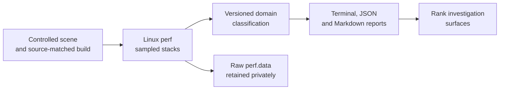

# PRD — Deep CPU profiler

Status: Draft

Sources: upstream [`a773185`](https://github.com/chrissotraidis/bluewake/commit/a7731853c197cc9763a86d62e731d65ca0b25556); measured prototype [`d1bb41b`](https://github.com/irregularthanis/bluewake/commit/d1bb41b)

Scope: Linux and SteamOS `perf` post-processing and its integration with the existing profiling workflow. Runtime instrumentation and performance optimizations are excluded.

## Motivation

[Issue #215](https://github.com/chrissotraidis/bluewake/issues/215) shows BlueWake falling below its 30 FPS game target on Steam Deck while one application thread is saturated and the GPU remains lightly loaded. [`profile_deck.sh`](../../../scripts/linux/profile_deck.sh) already captures native stacks and a flat symbol ranking, but reviewers must manually separate translated game execution, host coordination, guest-state machinery, services, GX conversion, and platform presentation.

The immediate need is a repeatable ownership view: show which BlueWake architecture domains and threads consume sampled CPU time, then preserve the raw symbols needed to choose the next investigation. This serves contributors optimizing Steam Deck without adding timing calls to hot runtime paths.

The classifier describes sampled CPU self-time. It does not replace frame-rate, wait, checkpoint, or player-visible evidence from the [performance workflow](../../performance/Overview.md#performance-workflow).

## Outcomes

- A single profiling run reports whole-process and per-thread CPU sample shares for the runtime domains documented in [Runtime](../../architecture/Runtime.md#runtime-entities), [Game thread](../../architecture/GameThread.md#performance-model), and [Graphics](../../architecture/Graphics.md#gx-command-path).
- Terminal output supports live investigation; JSON supports comparison tooling; Markdown can be pasted into an issue or PR without reformatting.
- Every parsed leaf sample belongs to exactly one domain. Unparsed input and unresolved symbols remain explicit rather than being silently discarded or guessed.
- Linux desktop and SteamOS callchain formats produce the same schema and are covered by source-only fixtures.
- `profile_deck.sh` writes the new reports beside `perf.data`, `report.txt`, and the session log without changing the captured workload.

## Success and constraints

| Measure | Baseline | Acceptance | Validation |
| --- | --- | --- | --- |
| Ownership view | Flat symbol list; manual grouping | Domain and per-thread tables from one capture | Desktop and Deck fixture tests plus real captures |
| Sample accounting | Not summarized | Domain sum and thread sum each equal parsed leaf samples | Automated invariant tests |
| Format support | Host-dependent `perf script` output | One-line desktop and multiline SteamOS callchains | Focused parser regression cases |
| Unknown data | Mixed into manual review | Unknown/unparsed counts and top symbols are printed | Deliberately unknown fixture |
| Runtime effect | Existing `perf` sampling overhead | No BlueWake runtime or module changes | Repository diff and unchanged launch contract |

Raw `perf.data`, game modules, saves, and session logs stay private. The repository may contain synthetic text fixtures and aggregate results only.

## Scope clarification

This plan productionizes the profiler. It may identify optimization candidates, but implementing those candidates requires separate measured work. The current scope interpretation should be confirmed before implementation if the desired PR instead owns the optimizations themselves.
