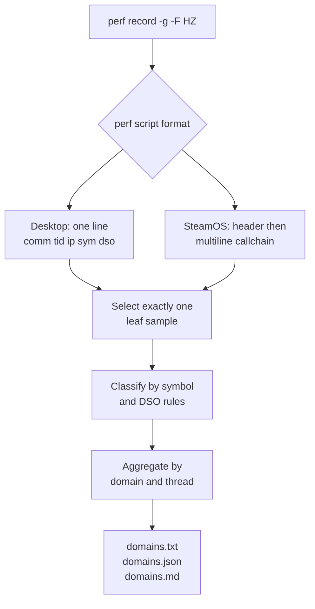

# TECH_PLAN — Deep CPU profiler

Status: Planning only

Sources: upstream [`a773185`](https://github.com/chrissotraidis/bluewake/commit/a7731853c197cc9763a86d62e731d65ca0b25556); prototype [`d1bb41b`](https://github.com/irregularthanis/bluewake/commit/d1bb41b)

[Product brief](PRD.md) · [Tracker](PROGRESS.md)

## Inspected facts

- Existing [`profile_deck.sh`](../../../scripts/linux/profile_deck.sh) records process-wide callchains at 99 Hz, writes `perf.data`, and generates a flat self-time report. Headless and rendered modes have different workload meanings documented in [Profiling](../../PROFILING.md#step-4--profile-the-rendered-path-gx-worker-and-presentation).
- BlueWake is one native process containing translated game code, host coordination, shared guest state, services, GX/Aurora, and platform workers; these boundaries are documented in the [runtime contract map](../../architecture/Runtime.md#interaction-boundaries).
- A 20-second Steam Deck prototype capture at the fixed worst Outset angle contained 3,195 samples: translated game 39.6%, GX/Aurora 15.3%, guest state/dispatch 9.1%, host 5.6%, native replacements 3.9%, and 17.7% unresolved. On the game thread, translated code was 64.6% and guest state/dispatch 13.4%.
- Desktop `perf script` emits one sample per line with the requested fields. SteamOS emits a `comm tid` header followed by a multiline callchain; only the first frame represents self-time. Prototype regressions cover both forms.
- This is attribution, not causality: [issue #215](https://github.com/chrissotraidis/bluewake/issues/215) and session timing establish the saturated game thread; the profiler divides sampled CPU ownership within that workload.

## Changes

| Status | File / surface | Practical edit | Milestone | Architecture |
| --- | --- | --- | --- | --- |
| Proposed | `scripts/linux/perf_domains.py` | Parse leaf samples, classify domains, emit terminal/JSON/Markdown | M1 | [Runtime entities](../../architecture/Runtime.md#runtime-entities) |
| Proposed | `tests/perf_domains_test.py` | Cover classification, accounting, desktop lines, SteamOS callchains, unknowns | M1 | [Testing evidence](../../architecture/GameThread.md#testing-and-evidence) |
| Modify | `scripts/linux/profile_deck.sh` | Generate three domain reports after the existing flat report | M2 | [Performance profiling](../../performance/Overview.md#profiling) |
| Modify | `docs/PROFILING.md` | Explain report meaning, invocation, artifacts, and limits | M2 | [Rendered profiling](../../PROFILING.md#step-4--profile-the-rendered-path-gx-worker-and-presentation) |

## Contracts and flow



Proposed central interface, based on the measured prototype:

```python
def classify(dso: str, symbol: str) -> str: ...
def parse_samples(lines: list[str]) -> tuple[list[Sample], int]: ...
def collect(lines: list[str]) -> dict: ...
```

Classification precedence is contractual: kernel; certified native replacements; GX/Aurora; GPU/presentation; services; guest state/dispatch; host; translated module; unknown; remaining BlueWake; system libraries. Rules use symbols where checkout paths could create false matches. The JSON schema includes total samples, unparsed lines, ordered domains, per-thread shares, and top symbols. Reports state that percentages estimate CPU self-time, not wall-clock time.

Failure is explicit: missing `perf`, failed recording, zero parsed samples, malformed required output, or a non-finalized capture fails the command. Unknown symbols remain valid evidence; unparsed records are reported. Private capture contents are never committed.

## Verification

| Layer | Input / command | Required evidence | Failure / skip |
| --- | --- | --- | --- |
| Parser | `python3 -m unittest tests/perf_domains_test.py` | Both formats; one leaf per sample; unknown retained | Any accounting mismatch fails |
| Source | `py_compile`, `bash -n`, `git diff --check`, audit | Valid Python/shell and repository policy | Any failure blocks integration |
| Desktop | Existing symbolized `perf.data` | Nonempty reports; sums reconcile; translated/GX symbols classified | Missing real capture is incomplete |
| Steam Deck | Fixed rendered scene, 20–30 s at 99 Hz | Finalized capture; per-thread/domain tables; session context | Wrong scene/build or zero symbols is inconclusive |
| Overhead boundary | Diff and launch receipts | No runtime/module source changes; same sampling command | Runtime instrumentation is out of scope |

## Implementation order

| Milestone | Depends | Can run with | Deliverable / integration gate |
| --- | --- | --- | --- |
| M0 | — | — | Freeze taxonomy, schema, two input formats, and baseline evidence |
| M1 | M0 | M2 | Parser/classifier and focused fixtures; owns the new Python tool/tests |
| M2 | M0 | M1 | Workflow/docs integration; owns shell/docs and consumes the frozen CLI |
| M3 | M1, M2 | — | Desktop and Steam Deck validation; reconcile reports and publish aggregates |

Critical path: M0 → M1 → M3. M1 and M2 may proceed together after the CLI/output names are frozen. They must not edit each other's files; M3 is the integration gate.

## Decisions and gaps

- Sampling is preferred over in-process timers because the profiler must not perturb every hot call or require a new game build.
- Classification is intentionally explainable pattern matching, not an opaque statistical model. New symbol families require fixtures.
- The prototype proves feasibility, not upstream acceptance. Its private raw Deck capture cannot be reviewed remotely; M3 must record commands, source/build identity, aggregate output, and checksums without publishing game data.
- Windows/macOS profilers use different input formats and remain future adapters; this plan does not claim portability beyond Linux `perf`.

## References

- [Steam Deck performance tracker](https://github.com/chrissotraidis/bluewake/issues/215)
- [Performance domains](../../performance/Overview.md#performance-domains)
- [Game-thread performance model](../../architecture/GameThread.md#performance-model)
- [GX command path](../../architecture/Graphics.md#gx-command-path)
