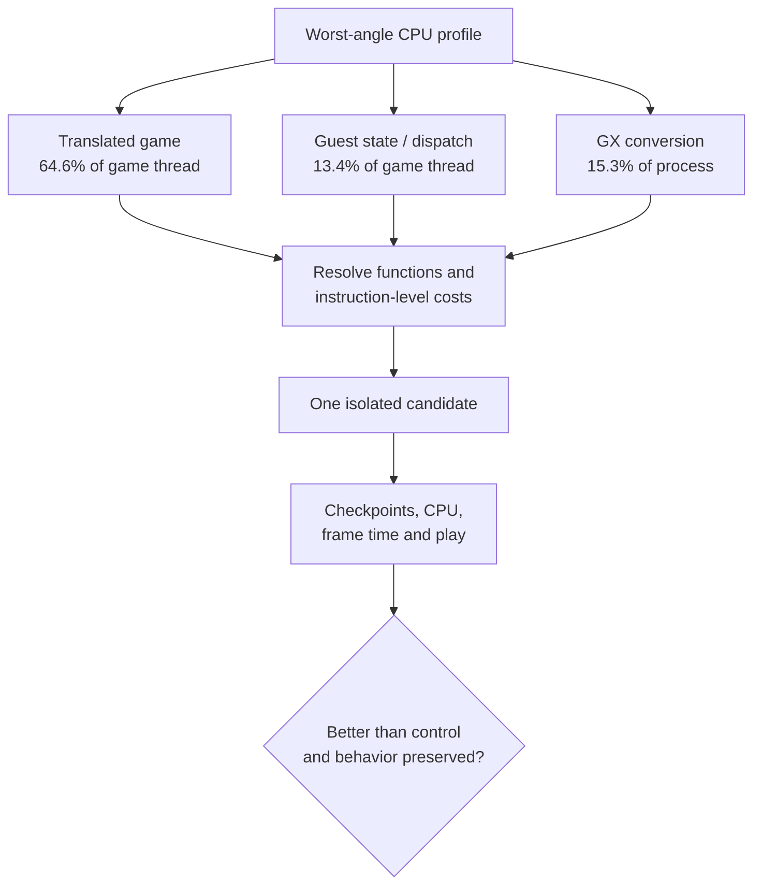

# PRD — Steam Deck runtime CPU optimization

Status: Draft

Sources: upstream [`a773185`](https://github.com/chrissotraidis/bluewake/commit/a7731853c197cc9763a86d62e731d65ca0b25556); measured profile from prototype [`d1bb41b`](https://github.com/irregularthanis/bluewake/commit/d1bb41b)

Scope: investigate and optimize CPU paths identified in a rendered Steam Deck profile. Building a general-purpose profiler is excluded; the existing profiler is measurement infrastructure.

## Problem

[Issue #215](https://github.com/chrissotraidis/bluewake/issues/215) tracks BlueWake falling below its 30 FPS game target on Steam Deck while the game thread saturates one CPU core. A fixed worst-angle Outset capture now divides 3,195 CPU samples by runtime ownership:

| Surface | Whole process | Game thread | Leading symbols |
| --- | ---: | ---: | --- |
| Translated game | 39.6% | 64.6% | `func_802456E0`, `func_803256E0`, `func_802ED6E0` |
| Guest state and dispatch | 9.1% | 13.4% | `chassis_dispatch`, `ppc_guest_alias_resolve`, `host_direct_can_skip_with`, `bw_direct_call_ready` |
| GX and Aurora | 15.3% | mostly GX worker | `submit_packet`, `build_draw_plan_into`, `fill_render_packet`, `parse_stream` |
| Host coordination | 5.6% | 9.1% | host observation and integration helpers |
| Compatibility services | 0.1% | 0.2% | no material signal |

The next work should convert those measurements into isolated candidates. It must not assume that a hot symbol is safe to remove, that worker CPU controls frame rate, or that lower CPU usage preserves guest behavior.

## Outcomes

- Resolve leading translated chunks to original Wind Waker functions and exact expensive instructions before proposing native replacements or generator changes.
- Measure call frequency and exclusive cost for dispatch/address-resolution checks; select only a redundant or amortizable operation with a preserved correctness contract.
- Determine whether GX conversion delays the game thread or merely uses otherwise available worker capacity. Pursue it only when frame-aligned evidence shows player-facing value.
- Produce isolated control/candidate builds and retain changes only when improvement exceeds same-build noise across the affected fixed scene and full benchmark methodology.
- Record rejected candidates with measurements so the same hypotheses are not repeatedly reimplemented.

## Acceptance and constraints

| Gate | Required result |
| --- | --- |
| Attribution | Candidate has source/function/instruction references, activation counts, owning thread, and measured self-time. |
| Correctness | Focused contracts pass; guest checkpoints match unless an intentional timing field is documented; rendered behavior is checked. |
| Performance | Interleaved A/A and A/B show a repeatable improvement in game-thread CPU, frame time, or game speed beyond noise. |
| Steam Deck | Stable, slow, and worst fixed views plus the established full-scene procedure are completed when the fixed-view gate is positive. |
| Isolation | One hypothesis changes per candidate; build source, dependency revisions, options, and AppImage hashes are recorded. |

Private saves, raw profiles, game modules, and AppImages remain local. This plan does not promise that every measured surface will produce an optimization.
