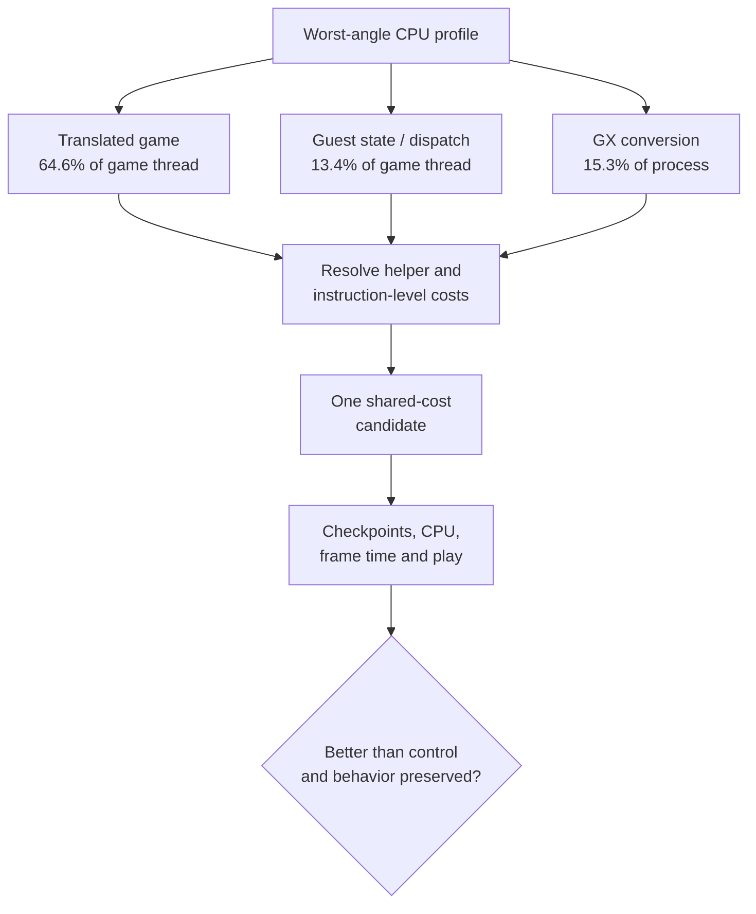

# PRD — Steam Deck runtime CPU optimization

Status: Draft

Control: upstream [`v0.9.0`](https://github.com/chrissotraidis/bluewake/releases/tag/v0.9.0) at [`211abfd`](https://github.com/chrissotraidis/bluewake/commit/211abfdecf13beb5b9f2120459a1a3cde50dd84e). Measurement tooling: [`d1bb41b`](https://github.com/irregularthanis/bluewake/commit/d1bb41b); it does not replace the control application source.

Scope: investigate and optimize shared translated-code costs identified in a rendered Steam Deck profile. Building a general-purpose profiler and repeating rejected narrow native hooks are excluded; existing profiling tools remain measurement infrastructure.

## Problem

[Issue #215](https://github.com/chrissotraidis/bluewake/issues/215) tracks BlueWake falling below its 30 FPS game target on Steam Deck while the game thread saturates one CPU core. A fixed worst-angle Outset capture now divides 3,195 CPU samples by runtime ownership:

| Surface | Whole process | Game thread | Leading symbols |
| --- | ---: | ---: | --- |
| Translated game | 39.6% | 64.6% | `func_802456E0`, `func_803256E0`, `func_802ED6E0` |
| Guest state and dispatch | 9.1% | 13.4% | `chassis_dispatch`, `ppc_guest_alias_resolve`, `host_direct_can_skip_with`, `bw_direct_call_ready` |
| GX and Aurora | 15.3% | mostly GX worker | `submit_packet`, `build_draw_plan_into`, `fill_render_packet`, `parse_stream` |
| Host coordination | 5.6% | 9.1% | host observation and integration helpers |
| Compatibility services | 0.1% | 0.2% | no material signal |

The next work should convert those measurements into isolated candidates. It must not assume that a hot symbol is safe to remove, that worker CPU controls frame rate, or that lower CPU usage preserves guest behavior.

A 120-second diagnostic subdivided the leading `func_802456E0` chunk. The
three GroundCross routines account for about 1.55% of whole-process cycles,
while shared generated helpers account for about 3.37%. The earlier guarded
`GroundCrossGrpRp` experiment in [PR #436](https://github.com/chrissotraidis/bluewake/pull/436)
covered only 28.1% of calls, made its accepted path slower, and produced no
repeatable Deck gain. The broader opportunity is therefore shared translated
machinery, not another narrow replacement of that routine.

## Outcomes

- Measure the existing direct-call fast path and determine whether repeated readiness or host-observation checks can be safely specialized, combined, or amortized.
- Attribute floating-point helper cost by operation and identify only checks or conversions proven redundant within a translated block.
- Split gather-pipe cost into packing, guest-memory validation, command parsing, and synchronization; pursue it only when the dominant component affects frame progress.
- Treat a complete `GroundCross` family replacement as a fallback investigation only if shared-helper work produces no viable candidate and new evidence overcomes PR #436's negative result.
- Produce isolated control/candidate builds and retain changes only when improvement exceeds same-build noise across the affected fixed scene and full benchmark methodology.
- Record rejected candidates with measurements so the same hypotheses are not repeatedly reimplemented.

Current M2 evidence identifies one qualifying candidate: cache the answer to
whether guest aliases overlap the gather-pipe FIFO windows, invalidated by the
RecompCore alias generation. Against the same PR #480 foundation, the candidate
improved all five fixed headless scenes by 2.43–3.37% and the aggregate median
by 2.84%, with identical guest checkpoints. It advances to contract freeze;
this result does not yet make the option a production default.

## Acceptance and constraints

| Gate | Required result |
| --- | --- |
| Attribution | Candidate has source/function/instruction references, activation counts, owning thread, and measured self-time. |
| Correctness | Focused contracts pass; guest checkpoints match unless an intentional timing field is documented; rendered behavior is checked. |
| Performance | Interleaved A/A and A/B show a repeatable improvement in game-thread CPU, frame time, or game speed beyond noise. |
| Steam Deck | Stable, slow, and worst fixed views plus the established full-scene procedure are completed when the fixed-view gate is positive. |
| Isolation | One hypothesis changes per candidate; build source, dependency revisions, options, and AppImage hashes are recorded. |

Every candidate is compared with the frozen `0.9.0` control unless its source
dependency requires a new source-matched control. Tooling-only profiler changes
may be applied outside the application binary, but they must not silently alter
the measured runtime.

Private saves, raw profiles, game modules, and AppImages remain local. This plan does not promise that every measured surface will produce an optimization.
