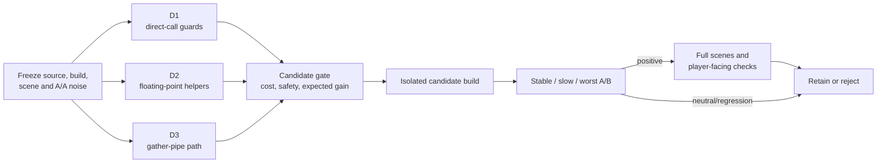

# TECH_PLAN — Steam Deck runtime CPU optimization

Status: Planning only

Sources: upstream [`a773185`](https://github.com/chrissotraidis/bluewake/commit/a7731853c197cc9763a86d62e731d65ca0b25556); measured profile from [`d1bb41b`](https://github.com/irregularthanis/bluewake/commit/d1bb41b)

[Product brief](PRD.md) · [Tracker](PROGRESS.md)

## Inspected facts

- BlueWake's game thread runs translated DOL/REL code, host edges, guest-state access, and service delivery serially; see the [game-thread execution model](../../architecture/GameThread.md#high-level-execution).
- The graphics path moves GX writes from that thread into frontend/GX conversion and platform rendering; see the [GX command path](../../architecture/Graphics.md#gx-command-path).
- The rendered worst-angle capture attributes 64.6% of game-thread samples to translated code, 13.4% to guest state/dispatch, 9.1% to host coordination, and 6.3% to native replacements. Whole-process GX/Aurora is 15.3%.
- A private 120-second, 99 Hz headless diagnostic attributed 7.23% of process cycles to `func_802456E0`. Generated-source mapping assigns about 1.55% process-wide to `GroundCross`, `GroundCrossRp`, and `GroundCrossGrpRp`, versus 3.37% to shared generated helpers. Optimized shared tails make the helper-to-caller split approximate.
- [PR #436](https://github.com/chrissotraidis/bluewake/pull/436) already tested a guarded `GroundCrossGrpRp` path: 28.1% acceptance, 226.1 ns native versus 179.3 ns translated for accepted early returns, and fixed-view results within noise. That partial hook is closed and is not the next candidate.
- [`direct_calls.py`](../../../scripts/windows/direct_calls.py) already rewrites eligible constant and indirect guest calls. [`bw_direct_call_ready`](../../../cmake/composite/direct_calls.h) checks exception/budget state, interrupt state, depth and host observation at entry and return; the plan must measure those existing checks before proposing a change.
- Compatibility services account for 0.1% of whole-process samples and are not a current candidate.
- [`profile_deck.sh`](../../../scripts/linux/profile_deck.sh), [`bench_tour.py`](../../../scripts/bench_tour.py), session timing, and guest checkpoints already provide the measurement layers described in the [performance workflow](../../performance/Overview.md#performance-workflow).

## Investigation flow



## Workstreams

| Order | Existing surface to inspect | Practical investigation | Candidate gate |
| --- | --- | --- | --- |
| D1 | [`bw_direct_call_ready`](../../../cmake/composite/direct_calls.h), generated sites in [`direct_calls.py`](../../../scripts/windows/direct_calls.py), and `host_direct_can_skip_with` | Count entry/return checks; attribute each predicate; classify constant watched addresses and state changes between paired checks | Remove, combine, or specialize a check only when its invalidation contract is preserved |
| D2 | [`inline_fp.h`](../../../cmake/composite/inline_fp.h) and generated call sites | Attribute samples by FP operation and inspect rounding, conversion and CPU-state synchronization around hot blocks | Eliminate only repeated state work; preserve PowerPC results and exceptions |
| D3 | [`gather_pipe.h`](../../../cmake/composite/gather_pipe.h), GXRuntime submission, and [GX command path](../../architecture/Graphics.md#gx-command-path) | Separate packing, bounds/alias checks, parsing, queueing and waits by thread/frame | Change the dominant component only if it improves game-thread progress |
| Fallback | `GroundCross` → `GroundCrossRp` → `GroundCrossGrpRp` | Price a complete-region replacement against the measured 1.55% ceiling and [PR #436](https://github.com/chrissotraidis/bluewake/pull/436) | Proceed only with broader coverage and a predicted gain beyond noise |

D1 and D2 share generated-module sources, so their instrumentation can run in
parallel but candidate edits must remain separate. D3 is independently
measurable; RecompCore runtime changes require a companion PR before BlueWake
pins them.

## First candidate: paired direct-call guards

Eligible calls already bypass the chassis, but generated sites commonly run
`bw_direct_call_ready` before entering the callee and again after it returns:

```c
/* Existing generated shape, simplified. */
if (bw_direct_call_ready(ctx, target)) {
    bw_chunk_fns[index](ctx);
    if (ctx->pc == return_pc && bw_direct_call_ready(ctx, return_pc))
        goto translated_return;
}
```

The investigation will measure the two checks separately and record which
inputs can change during the callee: exception, cycle budget/downcount,
interrupt-source state, direct depth, and host-observed addresses. A proposed
specialized path may reuse only facts proven unchanged; otherwise the second
check remains. Constant-target classification must come from the builder's
watch list, while mutable host flags remain runtime inputs.

## Candidate contract

Every proposal adds a short record before implementation:

```text
source/build + scene → owning thread → calls/frame → exclusive samples/time
                     → safety invariant → expected avoided work → acceptance metric
```

For a translated routine, source mapping must prove the original function range contains the sampled instruction; proximity to a symbol is insufficient. A native replacement must preserve guest registers, memory, exceptions, timing fields required by callers, and fallback behavior. For dispatch/state work, the plan must identify what invalidates any cached decision. For GX work, cached or reused data must retain ordering, mutation, interpolation, and lifecycle contracts.

## Verification

| Layer | Method | Required evidence | Stop condition |
| --- | --- | --- | --- |
| Baseline | Three same-build fixed-view samples | Noise interval, source/build receipt, activation | Unstable scene or mismatched build |
| Attribution | `perf`, counters, source/range inspection | Thread, calls, exclusive share, exact code path | Unresolved ownership |
| Focused correctness | Existing host/GX/native tests plus candidate-specific regression | Candidate path activated; fallback and mutation covered | Missing activation or mismatch |
| Fixed-view A/B | Interleaved control/candidate at stable, slow, worst angles | CPU/frame-time/game-speed delta exceeds noise | Neutral or regression stops full tour |
| Full qualification | Established headless/rendered scenes, checkpoints, player traversal | Repeatable benefit and no observable regression | Incomplete scene or checkpoint evidence is inconclusive |

The profiler ranks work; it does not validate an optimization. A lower worker percentage alone is insufficient if game speed and frame progress do not improve.

## Implementation order

| Milestone | Depends | Can run with | Deliverable / gate |
| --- | --- | --- | --- |
| M0 | — | — | Freeze source-matched baseline, A/A noise, scenes, and candidate-record format |
| M1 | M0 | M2 | Direct-call entry/return cost split, invalidation contract, and candidate or no-go |
| M2 | M0 | M1 | FP and gather-pipe operation attribution, each ending in a candidate or no-go |
| M3 | M1, M2 | — | Rank shared-cost candidates; price the complete GroundCross fallback only if needed |
| M4 | M3 | — | Implement the strongest isolated candidate with focused tests |
| M5 | M4 | — | Fixed-view gate, then full qualification only if positive |

Critical path: M0 → parallel M1/M2 → M3 → M4 → M5. Candidate implementation is serialized so A/B results have one cause.

## Decisions and gaps

- Start with the existing direct-call guards; do not propose adding direct-call rewriting because it is already present.
- `func_802456E0` decomposition confirms the prior GroundCross target was reasonable but does not reverse its negative Deck result.
- FP and gather-pipe percentages are source-attribution signals, not exclusive operation timings; M2 must split them before selection.
- The current profile has 17.7% unresolved samples. Known stripped GX leaves were classified, but unresolved entries must not be assigned speculatively.
- No candidate is accepted from this profile alone.

## References

- [Steam Deck tracker #215](https://github.com/chrissotraidis/bluewake/issues/215)
- [Runtime interaction boundaries](../../architecture/Runtime.md#interaction-boundaries)
- [Performance domains](../../performance/Overview.md#performance-domains)
- [Profiling guide](../../PROFILING.md)
