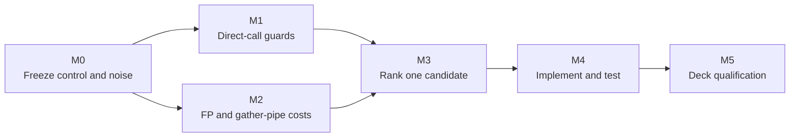
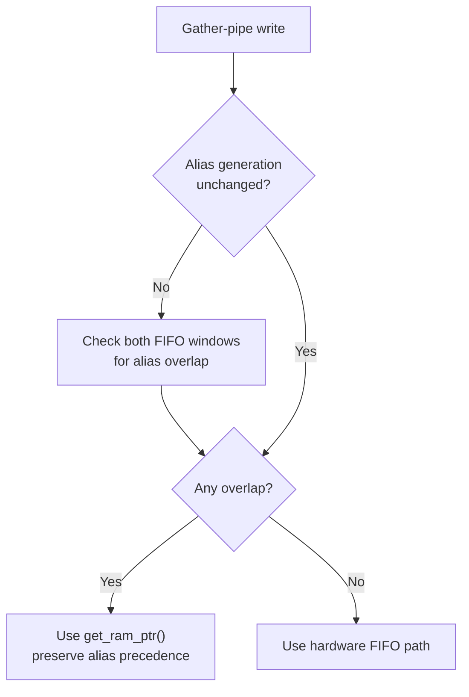

# TECH_PLAN — Steam Deck runtime CPU optimization

Status: M0 complete; M1 rejected; M2 attribution in progress

Control: upstream [`v0.9.0`](https://github.com/chrissotraidis/bluewake/releases/tag/v0.9.0) at [`211abfd`](https://github.com/chrissotraidis/bluewake/commit/211abfdecf13beb5b9f2120459a1a3cde50dd84e). Measurement tooling: [`d1bb41b`](https://github.com/irregularthanis/bluewake/commit/d1bb41b).

[Product brief](PRD.md) · [Tracker](PROGRESS.md)

## Technical basis

- The [game thread](../../architecture/GameThread.md#high-level-execution) serially runs translated DOL/REL code, guest-state access, host edges and service delivery.
- The [GX command path](../../architecture/Graphics.md#gx-command-path) begins on that thread, then moves conversion and rendering work into the graphics stack.
- The worst-angle profile assigns 64.6% of game-thread samples to translated code, 13.4% to guest state/dispatch, 9.1% to host coordination and 6.3% to native replacements.
- A separate 120-second diagnostic assigns about 3.37% process-wide to shared generated helpers and 1.55% to the `GroundCross` family.
- [PR #436](https://github.com/chrissotraidis/bluewake/pull/436) rejected a partial `GroundCrossGrpRp` hook: 28.1% acceptance, slower accepted calls and no repeatable Deck gain.



## M0 — Freeze control and measurement noise

### Build receipt

| Field | Frozen control |
| --- | --- |
| BlueWake | `v0.9.0` / `211abfdecf13beb5b9f2120459a1a3cde50dd84e` |
| RecompCore | `1446450c79046bd34e43abadc27522eeab768a6e` |
| DolRecomp | `b8b534591cba8ca7cd43943a655ee6e2591cf5de` |
| Toolchain | Ubuntu Clang 18.1.3, `x86-64-v3`, Linux container |
| Options | Prepared/fixed CPU/fixed MEM1, inline FP/GPR, gather pipe, direct calls, native J3D/vector/math/skin/game-math, lean blocks and local PGO |
| AppImage | SHA-256 `476a335f0cf6ec35a4070850de5a17e5c8d45441a60638603fc3e6e7e8d4be48` |
| Game module | SHA-256 `7b094be4e42b62c3d59db293ec364f71bcbca299e23d81859a258d992b519398` |
| Training profile | SHA-256 `a160ddf641108d1f56c994f6739ec83df0cff44d6bb20da6a1d6f9a0ebd77535` |

### Noise measurements

| Workload | Repetitions | Correctness | Observed spread |
| --- | ---: | --- | ---: |
| Headless five-scene tour | 10 per identical alias, ABBA | 31/31 checkpoints matched every run | -0.07% to +0.17%; aggregate -0.00% |
| Stable rendered view | 3 × 30 s | Same process and fixed view | 0.12% |
| Slow rendered view | 3 × 30 s | Same process and fixed view | 1.42% |
| Worst rendered view | 3 × 30 s | Same process and fixed view | 1.41% |

Candidate results must consistently exceed the matching noise band. Manual
views gate performance; the headless tour and checkpoints gate repeatability
and guest-visible correctness.

## M1 — Measure paired direct-call guards

### Existing path

[`direct_calls.py`](../../../scripts/windows/direct_calls.py) rewrites eligible
guest calls. The generated path checks
[`bw_direct_call_ready`](../../../cmake/composite/direct_calls.h) before entry
and again only when the callee reaches the expected return address:

```c
if (bw_direct_call_ready(ctx, target)) {
    bw_chunk_fns[index](ctx);
    if (ctx->pc == return_pc && bw_direct_call_ready(ctx, return_pc))
        goto translated_return;
}
```

The guard protects exception, cycle-budget, interrupt, depth and host-observation
boundaries. Constant watched addresses are already excluded during generation.

### Measurement mechanism

This PR adds opt-in [`bw_direct_call_ready_measured`](../../../cmake/composite/direct_calls.h)
calls at direct-call entry and return sites. `BLUEWAKE_DIRECT_CALL_MEASURE=1`
counts one outcome per reached guard plus expected/diverted returns. Without the
variable, generated code delegates to the original predicate and emits nothing.

### Initial Game Mode results

Artifact: PR-head AppImage `03bb2b60…`; Clang 18; `x86-64-v3`. The session
included startup and stable/slow/worst Outset views, so counts are cumulative.

| Entry outcome | Count | Share |
| --- | ---: | ---: |
| Allowed | 2,225,700,489 | 99.3971% |
| Fast address rejection | 9,642,984 | 0.4306% |
| Cycle-budget rejection | 3,413,383 | 0.1524% |
| Host-busy rejection | 434,720 | 0.0194% |
| Depth rejection | 9,806 | 0.0004% |
| Exception, unavailable or slow rejection | 0 | 0.0000% |
| **Total** | **2,239,201,382** | **100%** |

| Result after an allowed entry | Count | Share of allowed entries |
| --- | ---: | ---: |
| Reached expected return and its guard | 1,749,593,903 | 78.6087% |
| Returned elsewhere | 458,596,685 | 20.6046% |
| Did not reach the return classifier | 17,509,901 | 0.7867% |
| **Allowed entries** | **2,225,700,489** | **100%** |

| Reached return-guard outcome | Count | Share |
| --- | ---: | ---: |
| Allowed | 1,745,963,553 | 99.7925% |
| Cycle-budget rejection | 2,081,179 | 0.1190% |
| Fast address rejection | 1,549,163 | 0.0885% |
| Host-busy rejection | 8 | <0.0001% |
| Other rejection | 0 | 0.0000% |
| **Total** | **1,749,593,903** | **100%** |

### Measured implications

| Observation | Implication | Decision state |
| --- | --- | --- |
| Entry accepts 99.40% | The guard is very hot; value depends on its exclusive cost, not rejection frequency | Measure exclusive time before changing it |
| 20.60% return elsewhere | The expected-return test removes more continuation attempts than the return guard | Preserve this test |
| Return guard rejects 3,630,350 times | The second guard is semantically active, despite its 99.79% pass rate | Do not delete it unconditionally |
| 57.33% of return rejections are budget; 42.67% are fast-address | Any specialization must preserve both invalidation sources | Map which callees can change each input |
| No slow-path rejection occurred | This run used the production inline fast answer | Do not generalize to stage-select/diagnostic modes |

### Bounded M1 candidate

The experiment tested a default-off return-specific predicate. A successful
entry establishes a non-null CPU, enabled direct calls, a host callback and
valid depth; the direct call restores its prior depth. The candidate omitted
only those checks and retained exception, budget, interrupt/host state,
address filtering and expected-return control flow.

| Decision input | Value | Meaning |
| --- | ---: | --- |
| Reached guards | 3,988,795,285 | Entry plus return checks during the session |
| Session duration | 680.8 s | First to last recorded performance sample |
| Approximate guard rate | 5.86 million/s | Enough frequency to justify one direct experiment |
| Prior direct-call helper attribution | ~0.69% process-wide | Expected gain ceiling was modest |
| Reached return guards | 1,749,593,903 | The narrower specialization applies frequently |
| Actual return rejections | 3,630,350 | Required semantics cannot be removed wholesale |

### Candidate A/B

Control and candidate used the same AppImage, SHA-256 `ce0e8bed…`. Wrapper
hashes differ because one set `BLUEWAKE_DIRECT_RETURN_SPECIALIZED=1`; both
executed the same underlying artifact. Measurement counters were disabled.

| Headless scene | Control | Candidate | Delta |
| --- | ---: | ---: | ---: |
| Outset | 40.517 FPS | 39.831 FPS | -1.69% |
| Windfall | 42.738 FPS | 41.906 FPS | -1.95% |
| Dragon Roost Cavern | 58.354 FPS | 56.986 FPS | -2.34% |
| Forest Haven | 35.150 FPS | 34.569 FPS | -1.65% |
| Sea by the Fortress | 32.480 FPS | 31.813 FPS | -2.05% |
| **Geometric-mean median** | — | — | **-1.88%** |

Method: 10 runs/mode, five-pair ABBA ordering, fixed state, 5/5 scenes and
31/31 identical checkpoints on every run.

| Rendered view | Control | Candidate | Delta | M0 noise |
| --- | ---: | ---: | ---: | ---: |
| Stable | 59.92 | 59.91 | -0.02% | 0.12% |
| Slow | 56.08 | 53.75 | -4.15% | 1.42% |
| Worst | 49.43 | 49.29 | -0.28% | 1.41% |

### M1 decision — reject

- The candidate missed the `>+0.2%` headless gate in every scene.
- The consistent `-1.88%` aggregate regression is larger than M0 headless noise.
- Identical checkpoints support correctness but do not offset the regression.
- Stable/worst rendered results were neutral; slow regressed beyond its noise band.
- The runtime specialization may add hot-path branching/code-layout cost; the
  experiment establishes the net regression, not its instruction-level cause.

The specialization code is removed. The opt-in counters remain available as
measurement tooling. M1 is closed as a measured no-go; proceed to M2 rather
than spending more work inside the approximately 0.69% direct-call ceiling.

## M2 — Split FP and gather-pipe costs

| Surface | Measurement | Safety gate | Output |
| --- | --- | --- | --- |
| [`inline_fp.h`](../../../cmake/composite/inline_fp.h) | Samples/calls by PowerPC operation and surrounding state work | Preserve results, rounding, conversion and exceptions | One bounded candidate or no-go |
| [`gather_pipe.h`](../../../cmake/composite/gather_pipe.h) | Split packing, validation, parsing, queueing and waits by thread/frame | Preserve ordering, mutation, interpolation and lifecycle | One bounded candidate or no-go |

### Initial worst-view attribution

A 120-second, 99 Hz whole-process `perf` capture used the frozen M0 control at
the fixed worst Outset view. It recorded 18,946 samples with no lost samples.

| Surface | Process cycles | Largest leaf symbols |
| --- | ---: | --- |
| Inline FP helpers | 0.46% | `bw_fp_fma` 0.08%; `bw_fp_ps_madd_op` 0.08%; `bw_fp_fsubs` 0.07% |
| Slow memory helpers | 1.48% | `bw_mem_write32_slow` 0.68%; `bw_mem_write8_slow` 0.39%; `bw_mem_read32_slow` 0.24% |
| Combined measured ceiling | 1.94% | Whole-process leaf attribution; not removable work |

FP is below a useful standalone ceiling. Gather validation and packing are
inlined inside the slow-write symbols, so this capture cannot separate them.
The attribution-only `--gather-pipe-profile` build keeps validation, packing
and draining as profiler-visible functions. It changes code shape and is not a
performance candidate; normal builds retain the existing inline path.

The diagnostic capture uses the same worst view and exclusive leaf samples to
split validation, packing, drain and fallback. Only material, removable work
advances to M3.

### Diagnostic stage split

Artifact: AppImage SHA-256 `b188e84d…`; module `9cfce5bd…`; source
[`70b8ee5`](https://github.com/irregularthanis/bluewake/commit/70b8ee5).
The same 120-second, 99 Hz worst-view capture recorded 18,617 samples.

| Stage | Process cycles | Decision |
| --- | ---: | --- |
| Gather alias/address validation | 1.01% | Advance: inspect avoidable alias resolution |
| Gather byte packing | 0.14% | Reject as standalone candidate |
| Gather drain check | 0.09% | Reject as standalone candidate |
| Remaining slow memory helpers | 0.95% | Retain; mixes required fallback work |
| Inline FP helpers | 0.44% | Reject as standalone candidate |

The diagnostic total is 2.63%, versus 1.94% in the inline control. The added
calls therefore distort absolute cost; these percentages rank stages but are
not expected gains. Validation remains the only stage large enough to test.

### Selected candidate contract

`bw_gather_pipe()` currently calls `get_ram_ptr()` so a registered guest alias
at `0xCC008000–0xCC00801F`, or its `0x8C008000` mirror, takes precedence over
the hardware FIFO.

An opt-in counter run covered the stable, slow and worst views. The primary
linked runtime copy reported 1,384,426,413 resolver calls: 1,352,936,366
(97.7%) were rejected by global alias bounds. Its 31.49 million remaining calls
produced 31.49 million hits and about 345.8 million search iterations. A second
linked runtime copy reported the same bounds-rejection pattern at smaller
scale. These counters are non-atomic diagnostics, so use them as directional
evidence rather than exact performance totals.

PR [#480](https://github.com/chrissotraidis/bluewake/pull/480) already depends
on RecompCore [#45](https://github.com/chrissotraidis/RecompCore/pull/45), which
adds `ppc_guest_alias_range_overlaps()` and retains the alias generation. The
candidate can cache whether either FIFO window overlaps an alias, recompute the
answer only when that generation changes, and call `get_ram_ptr()` only while
overlap exists. This reuses #480's dependency rather than adding another global.

The candidate must retain the ordinary resolver when overlap exists and pass
the physical/mirrored alias-precedence cases in `tests/gather_memory_test.c`.
Final qualification must be based on #480 so the measured GPR improvement and
the gather candidate are tested together against the relevant future baseline.

### Implemented gather alias cache

The candidate adds a generation-keyed decision in front of the existing
resolver. It does not cache a guest pointer. Instead, it caches only whether a
guest alias currently overlaps either FIFO window. An alias mutation advances
the RecompCore generation, invalidating that decision before the next gather
access.



This removes repeated alias-table resolution from the common no-overlap path
while retaining the original resolver whenever an alias could cover the FIFO.
The implementation is opt-in through `--gather-alias-cache`; normal builds are
unchanged. The physical and mirrored FIFO alias cases are covered by the third
gather-memory test variant.

### Rendered candidate comparison

Both artifacts use PR [#480](https://github.com/chrissotraidis/bluewake/pull/480)
as their optimization foundation, Clang 18, `x86-64-v3`, and the same enabled
BlueWake optimization set. The candidate changes only the BlueWake alias-cache
integration and its RecompCore dependency. Each source snapshot performed its
normal local PGO training, so this comparison measures the complete resulting
build rather than isolating one generated instruction sequence.

| Role | BlueWake source | RecompCore | AppImage SHA-256 | Difference |
| --- | --- | --- | --- | --- |
| Control | [`73ef48e`](https://github.com/chrissotraidis/bluewake/commit/73ef48e1fe3d3ef128ff8a5ee67a2705bc74d4a3) | `47a5229` | `77b734f8…` | PR #480 foundation |
| Candidate | [`8d8587b`](https://github.com/irregularthanis/bluewake/commit/8d8587b37c360ee91f6947c40118e646a9faf4d8) | `caeedd8` | `5723637a…` | Same foundation plus generation-keyed gather alias cache |

The same Steam Deck, Game Mode launcher, disabled interpolation pacing, save,
camera positions and 20-second `perf stat` interval were used for both builds.

| Rendered view | CPU time | Cycles | Instructions | Branches |
| --- | ---: | ---: | ---: | ---: |
| Stable | -0.72% | -1.34% | -1.76% | -3.07% |
| Slow | +0.08% | +0.27% | -0.26% | -1.66% |
| Worst | -0.61% | -0.94% | -4.47% | -5.33% |

Negative values favor the candidate. The rendered samples show lower retired
work, especially in the worst view, but only small wall-time/cycle movement.
This is consistent with reduced resolver work, but the rendered samples alone
are too short and position-sensitive to qualify the candidate.

### Headless qualification

The established fixed-state tour ran ten measured passes per artifact in
candidate/control/control/candidate order. Every pass loaded all five scenes,
produced all 31 checkpoints, and matched guest-visible state across both
artifacts.

| Scene | Control | Candidate | Improvement |
| --- | ---: | ---: | ---: |
| Outset | 44.287 FPS | 45.365 FPS | +2.43% |
| Windfall | 46.711 FPS | 48.058 FPS | +2.88% |
| Dragon Roost Cavern | 63.448 FPS | 65.255 FPS | +2.85% |
| Forest Haven | 37.806 FPS | 39.079 FPS | +3.37% |
| Sea by the Fortress | 35.580 FPS | 36.445 FPS | +2.43% |

The per-run geometric-mean median improved by **2.84%**. The gain appears in
every scene and is substantially larger than the frozen same-build headless
noise. Together with identical checkpoints and the focused alias-precedence
tests, this advances the gather alias cache to M3 ranking and contract freeze.

Private Deck evidence identifier:
`8d8587b37c36-vs-73ef48e1fe3d-20261027T234341Z`.

## M3 — Rank and freeze one candidate

Each candidate record must contain:

```text
source/build + scene → owning thread → calls/frame → exclusive samples/time
                     → safety invariant → avoided work → acceptance metric
```

Rank M1/M2 candidates by exclusive cost, removable work, safety and expected
player-facing gain. Only if neither qualifies, price a complete GroundCross
replacement against its measured 1.55% process-wide ceiling.

For translated routines, mapping must prove that the sampled instruction is
inside the original function. Native replacements must preserve guest state,
exceptions, timing fields and fallback behavior.

## M4 — Implement and test the selected candidate

1. Implement one isolated, default-off candidate with a fallback.
2. Add focused activation, mutation, boundary and equivalence tests.
3. Build source-matched control/candidate artifacts and record source,
   dependency, module, PGO and AppImage hashes.

Do not combine M1 and M2 candidates in the first A/B comparison.

## M5 — Qualify or reject on Steam Deck

| Gate | Method | Required result |
| --- | --- | --- |
| Identity | Verify source, pins, flags, PGO and activation | Only the candidate differs |
| Fixed views | Interleaved stable/slow/worst control/candidate rounds | Consistent gain beyond each M0 noise band |
| Headless tour | Established five scenes and checkpoints | Repeatable gain; identical checkpoints |
| Rendered/player-facing | Full scene methodology and traversal | Repeatable improvement without observable regression |

A neutral or regressing fixed-view result stops full qualification. A lower
worker percentage alone is insufficient unless game speed or frame progress
improves.

## Current decisions and gaps

- Direct-call rewriting already exists; M1 measures its remaining guard cost.
- Compatibility services are 0.1% of process samples and are not a candidate.
- FP/gather percentages are attribution signals, not exclusive timings.
- The source profile has 17.7% unresolved samples; unknown entries remain unassigned.
- No optimization candidate is accepted yet.

## References

- [Steam Deck tracker #215](https://github.com/chrissotraidis/bluewake/issues/215)
- [Runtime interaction boundaries](../../architecture/Runtime.md#interaction-boundaries)
- [Performance domains and workflow](../../performance/Overview.md#performance-domains)
- [Profiling guide](../../PROFILING.md)
