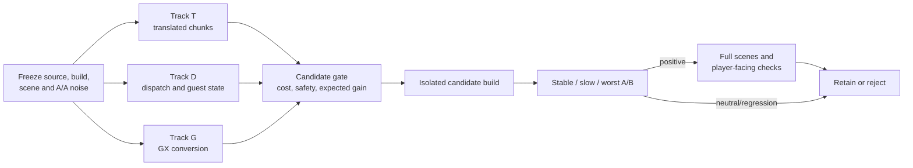

# TECH_PLAN — Steam Deck runtime CPU optimization

Status: Planning only

Sources: upstream [`a773185`](https://github.com/chrissotraidis/bluewake/commit/a7731853c197cc9763a86d62e731d65ca0b25556); measured profile from [`d1bb41b`](https://github.com/irregularthanis/bluewake/commit/d1bb41b)

[Product brief](PRD.md) · [Tracker](PROGRESS.md)

## Inspected facts

- BlueWake's game thread runs translated DOL/REL code, host edges, guest-state access, and service delivery serially; see the [game-thread execution model](../../architecture/GameThread.md#high-level-execution).
- The graphics path moves GX writes from that thread into frontend/GX conversion and platform rendering; see the [GX command path](../../architecture/Graphics.md#gx-command-path).
- The rendered worst-angle capture attributes 64.6% of game-thread samples to translated code, 13.4% to guest state/dispatch, 9.1% to host coordination, and 6.3% to native replacements. Whole-process GX/Aurora is 15.3%.
- Compatibility services account for 0.1% of whole-process samples and are not a current candidate.
- [`profile_deck.sh`](../../../scripts/linux/profile_deck.sh), [`bench_tour.py`](../../../scripts/bench_tour.py), session timing, and guest checkpoints already provide the measurement layers described in the [performance workflow](../../performance/Overview.md#performance-workflow).

## Investigation flow



## Workstreams

| Track | Existing surface to inspect | Practical investigation | Candidate type |
| --- | --- | --- | --- |
| T: translated game | generated `func_*` chunks; `config/GZLE01/symbols.txt`; decomp DOL/REL sources | Resolve each hot sample to contained functions, annotate instructions/callers, count scene activation | Native replacement, generator optimization, or no-go |
| D: dispatch/state | `chassis_dispatch`, `ppc_guest_alias_resolve`, `host_direct_can_skip_with`, `bw_direct_call_ready`; [guest-state contract](../../architecture/GuestState.md) | Separate dispatch, resolver, observation, and guard cost; identify repeated invariant checks | Hoist/cache a proven invariant or reduce dispatch bookkeeping |
| G: GX conversion | RecompCore GXRuntime `submit_packet`, `build_draw_plan_into`, `fill_render_packet`, `parse_stream`; [native draw construction](../../architecture/Graphics.md#from-gx-state-to-a-native-draw) | Measure frame-aligned worker work, game-thread waits, draw volume, and queue pressure | Reduce copies/parsing/state conversion only if it affects frame progress |

Track T and D share translated-module/runtime boundaries and must use separate candidate branches. Track G is independently measurable and can proceed in parallel, but RecompCore runtime changes require their own companion PR before BlueWake pins them.

## Candidate contract

Every proposal adds a short record before implementation:

```text
source/build + scene → owning thread → calls/frame → exclusive samples/time
                     → safety invariant → expected avoided work → acceptance metric
```

For a translated routine, source mapping must prove the original function range contains the sampled instruction; proximity to a symbol is insufficient. A native replacement must preserve guest registers, memory, exceptions, timing fields required by callers, and fallback behavior. For dispatch/state work, the plan must identify what invalidates any cached decision. For GX work, cached or reused data must retain ordering, mutation, interpolation, and lifecycle contracts.

## Verification

| Layer | Method | Required evidence | Stop condition |
| --- | --- | --- | --- |
| Baseline | Three same-build fixed-view samples | Noise interval, source/build receipt, activation | Unstable scene or mismatched build |
| Attribution | `perf`, counters, source/range inspection | Thread, calls, exclusive share, exact code path | Unresolved ownership |
| Focused correctness | Existing host/GX/native tests plus candidate-specific regression | Candidate path activated; fallback and mutation covered | Missing activation or mismatch |
| Fixed-view A/B | Interleaved control/candidate at stable, slow, worst angles | CPU/frame-time/game-speed delta exceeds noise | Neutral or regression stops full tour |
| Full qualification | Established headless/rendered scenes, checkpoints, player traversal | Repeatable benefit and no observable regression | Incomplete scene or checkpoint evidence is inconclusive |

The profiler ranks work; it does not validate an optimization. A lower worker percentage alone is insufficient if game speed and frame progress do not improve.

## Implementation order

| Milestone | Depends | Can run with | Deliverable / gate |
| --- | --- | --- | --- |
| M0 | — | — | Freeze source-matched baseline, A/A noise, scenes, and candidate-record format |
| M1 | M0 | M2, M3 | Ranked translated functions with exact source/instruction mapping |
| M2 | M0 | M1, M3 | Dispatch/state cost split and one safety-bounded candidate |
| M3 | M0 | M1, M2 | Frame-aligned GX cost/wait result and candidate or measured no-go |
| M4 | M1, M2, M3 | — | Rank the tracks; implement the strongest isolated candidate with focused tests |
| M5 | M4 | — | Fixed-view gate, then full qualification only if positive |

Critical path: M0 → parallel M1/M2/M3 investigations → M4 → M5. The investigation tracks inspect different ownership; implementation is serialized so A/B results have one cause.

## Decisions and gaps

- Start with T and D for game-thread FPS. G remains valuable but is secondary unless frame-aligned waits show it blocks progress.
- `func_802456E0` is a translated chunk, not one original function; it must be decomposed before selection.
- The current profile has 17.7% unresolved samples. Known stripped GX leaves were classified, but unresolved entries must not be assigned speculatively.
- No candidate is accepted from this profile alone.

## References

- [Steam Deck tracker #215](https://github.com/chrissotraidis/bluewake/issues/215)
- [Runtime interaction boundaries](../../architecture/Runtime.md#interaction-boundaries)
- [Performance domains](../../performance/Overview.md#performance-domains)
- [Profiling guide](../../PROFILING.md)
