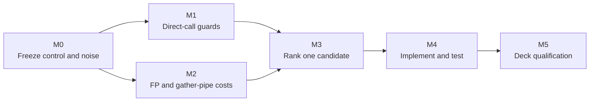

# TECH_PLAN — Steam Deck runtime CPU optimization

Status: M0 complete; M1 measurement in progress

Control: upstream [`v0.9.0`](https://github.com/chrissotraidis/bluewake/releases/tag/v0.9.0) at [`211abfd`](https://github.com/chrissotraidis/bluewake/commit/211abfdecf13beb5b9f2120459a1a3cde50dd84e). Measurement tooling: [`d1bb41b`](https://github.com/irregularthanis/bluewake/commit/d1bb41b).

[Product brief](PRD.md) · [Tracker](PROGRESS.md)

## Technical basis

- The [game thread](../../architecture/GameThread.md#high-level-execution) serially runs translated DOL/REL code, guest-state access, host edges and service delivery.
- The [GX command path](../../architecture/Graphics.md#gx-command-path) begins on that thread, then moves conversion and rendering work into the graphics stack.
- The worst-angle profile assigns 64.6% of game-thread samples to translated code, 13.4% to guest state/dispatch, 9.1% to host coordination and 6.3% to native replacements.
- A separate 120-second diagnostic assigns about 3.37% process-wide to shared generated helpers and 1.55% to the `GroundCross` family.
- [PR #436](https://github.com/chrissotraidis/bluewake/pull/436) rejected a partial `GroundCrossGrpRp` hook: 28.1% acceptance, slower accepted calls and no repeatable Deck gain.



## M0 — Freeze control and measurement noise

### Build receipt

| Field | Frozen control |
| --- | --- |
| BlueWake | `v0.9.0` / `211abfdecf13beb5b9f2120459a1a3cde50dd84e` |
| RecompCore | `1446450c79046bd34e43abadc27522eeab768a6e` |
| DolRecomp | `b8b534591cba8ca7cd43943a655ee6e2591cf5de` |
| Toolchain | Ubuntu Clang 18.1.3, `x86-64-v3`, Linux container |
| Options | Prepared/fixed CPU/fixed MEM1, inline FP/GPR, gather pipe, direct calls, native J3D/vector/math/skin/game-math, lean blocks and local PGO |
| AppImage | SHA-256 `476a335f0cf6ec35a4070850de5a17e5c8d45441a60638603fc3e6e7e8d4be48` |
| Game module | SHA-256 `7b094be4e42b62c3d59db293ec364f71bcbca299e23d81859a258d992b519398` |
| Training profile | SHA-256 `a160ddf641108d1f56c994f6739ec83df0cff44d6bb20da6a1d6f9a0ebd77535` |

### Noise measurements

| Workload | Repetitions | Correctness | Observed spread |
| --- | ---: | --- | ---: |
| Headless five-scene tour | 10 per identical alias, ABBA | 31/31 checkpoints matched every run | -0.07% to +0.17%; aggregate -0.00% |
| Stable rendered view | 3 × 30 s | Same process and fixed view | 0.12% |
| Slow rendered view | 3 × 30 s | Same process and fixed view | 1.42% |
| Worst rendered view | 3 × 30 s | Same process and fixed view | 1.41% |

Candidate results must consistently exceed the matching noise band. Manual
views gate performance; the headless tour and checkpoints gate repeatability
and guest-visible correctness.

## M1 — Measure paired direct-call guards

### Existing path

[`direct_calls.py`](../../../scripts/windows/direct_calls.py) rewrites eligible
guest calls. The generated path checks
[`bw_direct_call_ready`](../../../cmake/composite/direct_calls.h) before entry
and again only when the callee reaches the expected return address:

```c
if (bw_direct_call_ready(ctx, target)) {
    bw_chunk_fns[index](ctx);
    if (ctx->pc == return_pc && bw_direct_call_ready(ctx, return_pc))
        goto translated_return;
}
```

The guard protects exception, cycle-budget, interrupt, depth and host-observation
boundaries. Constant watched addresses are already excluded during generation.

### Measurement mechanism

This PR adds opt-in [`bw_direct_call_ready_measured`](../../../cmake/composite/direct_calls.h)
calls at direct-call entry and return sites. `BLUEWAKE_DIRECT_CALL_MEASURE=1`
counts one outcome per reached guard plus expected/diverted returns. Without the
variable, generated code delegates to the original predicate and emits nothing.

### Initial Game Mode results

Artifact: PR-head AppImage `03bb2b60…`; Clang 18; `x86-64-v3`. The session
included startup and stable/slow/worst Outset views, so counts are cumulative.

| Entry outcome | Count | Share |
| --- | ---: | ---: |
| Allowed | 2,225,700,489 | 99.3971% |
| Fast address rejection | 9,642,984 | 0.4306% |
| Cycle-budget rejection | 3,413,383 | 0.1524% |
| Host-busy rejection | 434,720 | 0.0194% |
| Depth rejection | 9,806 | 0.0004% |
| Exception, unavailable or slow rejection | 0 | 0.0000% |
| **Total** | **2,239,201,382** | **100%** |

| Result after an allowed entry | Count | Share of allowed entries |
| --- | ---: | ---: |
| Reached expected return and its guard | 1,749,593,903 | 78.6087% |
| Returned elsewhere | 458,596,685 | 20.6046% |
| Did not reach the return classifier | 17,509,901 | 0.7867% |
| **Allowed entries** | **2,225,700,489** | **100%** |

| Reached return-guard outcome | Count | Share |
| --- | ---: | ---: |
| Allowed | 1,745,963,553 | 99.7925% |
| Cycle-budget rejection | 2,081,179 | 0.1190% |
| Fast address rejection | 1,549,163 | 0.0885% |
| Host-busy rejection | 8 | <0.0001% |
| Other rejection | 0 | 0.0000% |
| **Total** | **1,749,593,903** | **100%** |

### Measured implications

| Observation | Implication | Decision state |
| --- | --- | --- |
| Entry accepts 99.40% | The guard is very hot; value depends on its exclusive cost, not rejection frequency | Measure exclusive time before changing it |
| 20.60% return elsewhere | The expected-return test removes more continuation attempts than the return guard | Preserve this test |
| Return guard rejects 3,630,350 times | The second guard is semantically active, despite its 99.79% pass rate | Do not delete it unconditionally |
| 57.33% of return rejections are budget; 42.67% are fast-address | Any specialization must preserve both invalidation sources | Map which callees can change each input |
| No slow-path rejection occurred | This run used the production inline fast answer | Do not generalize to stage-select/diagnostic modes |

### M1 pursuit decision

**Continue for one bounded return-guard experiment, then either retain it or
close M1.** This is a high-frequency, low-ceiling optimization—not a likely
explanation for the full Steam Deck slowdown.

| Decision input | Value | Meaning |
| --- | ---: | --- |
| Reached guards | 3,988,795,285 | Entry plus return checks during the session |
| Session duration | 680.8 s | First to last recorded performance sample |
| Approximate guard rate | 5.86 million/s | Small per-check savings can accumulate |
| Prior direct-call helper attribution | ~0.69% process-wide | Likely gain ceiling is modest |
| Reached return guards | 1,749,593,903 | The narrower specialization applies frequently |
| Actual return rejections | 3,630,350 | Required semantics cannot be removed wholesale |

The next candidate is a return-specific predicate. A successful entry already
establishes a non-null CPU, enabled direct calls, a host callback and valid
depth; the call restores its prior depth before the return check. The candidate
may omit only those proven entry invariants. It must retain exception, budget,
interrupt/host state and address-filter checks, which rejected real returns in
this run.

| Next step | Evidence required | Stop/continue rule |
| --- | --- | --- |
| Inspect generated/native code | Exact instructions removed from the return path; proof for every omitted input | Stop if the invariant is not valid across all rewritten calls |
| Add focused contract tests | Original and specialized predicates agree for exception, budget, interrupt, address and diverted-return cases | Stop on any disagreement |
| Headless source-matched A/B | Five scenes, ABBA ordering, identical checkpoints | Stop if aggregate gain is ≤0.2% or inconsistent across runs |
| Rendered fixed-view A/B | Stable/slow/worst views against M0 noise | Continue to full qualification only with a repeatable positive signal |

### Remaining M1 gate

- Normalize checks per retrace in controlled, source-matched runs.
- Attribute exclusive entry/return guard cost; counts alone do not establish gain.
- Explain the 0.79% that did not reach return classification.
- Test the bounded return predicate above; retain it or record a no-go.

## M2 — Split FP and gather-pipe costs

| Surface | Measurement | Safety gate | Output |
| --- | --- | --- | --- |
| [`inline_fp.h`](../../../cmake/composite/inline_fp.h) | Samples/calls by PowerPC operation and surrounding state work | Preserve results, rounding, conversion and exceptions | One bounded candidate or no-go |
| [`gather_pipe.h`](../../../cmake/composite/gather_pipe.h) | Split packing, validation, parsing, queueing and waits by thread/frame | Preserve ordering, mutation, interpolation and lifecycle | One bounded candidate or no-go |

M2 runs in parallel with M1, but source changes remain isolated so A/B results
have one cause. RecompCore changes require a companion PR before a BlueWake pin.

## M3 — Rank and freeze one candidate

Each candidate record must contain:

```text
source/build + scene → owning thread → calls/frame → exclusive samples/time
                     → safety invariant → avoided work → acceptance metric
```

Rank M1/M2 candidates by exclusive cost, removable work, safety and expected
player-facing gain. Only if neither qualifies, price a complete GroundCross
replacement against its measured 1.55% process-wide ceiling.

For translated routines, mapping must prove that the sampled instruction is
inside the original function. Native replacements must preserve guest state,
exceptions, timing fields and fallback behavior.

## M4 — Implement and test the selected candidate

1. Implement one isolated, default-off candidate with a fallback.
2. Add focused activation, mutation, boundary and equivalence tests.
3. Build source-matched control/candidate artifacts and record source,
   dependency, module, PGO and AppImage hashes.

Do not combine M1 and M2 candidates in the first A/B comparison.

## M5 — Qualify or reject on Steam Deck

| Gate | Method | Required result |
| --- | --- | --- |
| Identity | Verify source, pins, flags, PGO and activation | Only the candidate differs |
| Fixed views | Interleaved stable/slow/worst control/candidate rounds | Consistent gain beyond each M0 noise band |
| Headless tour | Established five scenes and checkpoints | Repeatable gain; identical checkpoints |
| Rendered/player-facing | Full scene methodology and traversal | Repeatable improvement without observable regression |

A neutral or regressing fixed-view result stops full qualification. A lower
worker percentage alone is insufficient unless game speed or frame progress
improves.

## Current decisions and gaps

- Direct-call rewriting already exists; M1 measures its remaining guard cost.
- Compatibility services are 0.1% of process samples and are not a candidate.
- FP/gather percentages are attribution signals, not exclusive timings.
- The source profile has 17.7% unresolved samples; unknown entries remain unassigned.
- No optimization candidate is accepted yet.

## References

- [Steam Deck tracker #215](https://github.com/chrissotraidis/bluewake/issues/215)
- [Runtime interaction boundaries](../../architecture/Runtime.md#interaction-boundaries)
- [Performance domains and workflow](../../performance/Overview.md#performance-domains)
- [Profiling guide](../../PROFILING.md)
