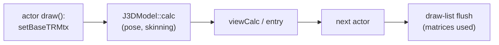

# PRD — Parallel guest execution

Status: **Reopened 2026-11-13 with a different model** (shadow batches: exact by construction); the 2026-11-03/04 research below stays as the record
Source: BlueWake `main` after #554 (busy-view numbers from #592/#593); RecompCore DSP HLE (`Source/Core/Core/HW/DSPHLE`); tww (`src/f_pc`, `src/SSystem/SComponent`, `libs/JSystem`)
Scope: shortening the game thread's critical path at busy views by running consecutive, independent pieces of its own loops on other host cores, with the serial build's guest state reproduced exactly; excluded: 60 game updates per second, any change to guest cycle accounting or interrupt landing, concurrent guest threads
[Technical plan](TECH_PLAN.md) · [Tracker](PROGRESS.md)

## Revision 2026-11-13: the problem, restated

At the busiest Outset view the game thread is 98.6 % busy at 124–129 M host cycles a game frame against ≈ 113 M for 30 FPS ([#592](https://github.com/chrissotraidis/bluewake/pull/592)). About 89 % of that is translated game code, flat (no function above 1.5 %); the draw side alone is 26 M cycles ([#593](https://github.com/chrissotraidis/bluewake/pull/593)). The serial levers are nearly spent: profile-and-trim rounds now repeat #503's list, round 7's exact natives measured −0.19 %, and the audio thread (the only separable guest thread) is 6.1 % ([#561](https://github.com/chrissotraidis/bluewake/pull/561)). What is left is the structure of the frame itself: the `fpc` process loops run a few hundred actor executes and draws one after another on one core while the Deck has three more.

### Principle: exact by construction

The parallel build must leave **the identical guest state, the identical device effects in the identical order, and the identical cycle charges** as the serial build at the same settings, so the existing oracle (guest checkpoints, pictures, replays) tests it unchanged. Every parallel result is either *validated* as serial-equivalent before it is committed, or discarded and re-executed serially. Nothing speculative ever touches live state. No "benign races", no host-timing-dependent interleavings, no "plays the same" concurrency: a nondeterministic build can't be tested by this project's methods, and `OSDisableInterrupts`-as-a-lock stops working the moment two guest threads really run at once.

### What that rules out, and why (so it isn't re-litigated)

| Route | Why it can't be exact | Evidence |
| --- | --- | --- |
| Running the guest audio thread beside the game thread | Its wake points are interrupt landings in the main thread's instruction stream; on another core its reads of the sound queue depend on host timing. Worth ≤ 6.5 % anyway | #561; tww `JASAudioThread.cpp` |
| Pipelining phases (draw N beside execute N+1) | The thread that runs ahead must start at logical time T + C, and C (the other phase's cycle count) is unknown until it finishes; every VI/AI deadline would land on the wrong instruction, and the audio thread's next wake reads what execute writes | `host_cycle_deadline_distance` (`main.c`); #530: deadlines every ≈ 8,600 guest cycles |
| Async native jobs with closed-form cycle charges (Track A) | Exact, but each region is < 1 % of a flat profile | #541 (skinning: threading ≈ +0.5–1 %), #593 (round 7) |

### The model that is exact: shadow batches

A **batch** is a run of regions the serial program executes back to back from one logical time T, short enough that no guest-visible interrupt lands inside it. Each region runs as a **shadow**: the same translated code, on a private CPU state, reading live memory (which nobody writes during the batch) and writing only to a private copy, counting its cycles, and aborting on anything it can't keep private (MMIO, a timer read, an exception, a watched call). At the join the engine checks that no region read what an earlier region wrote, that the batch's cycles fit before the next interrupt, and that the host's device work inside that span read nothing the batch wrote; then it commits the private writes in serial order and charges the cycles. Any failure commits the valid prefix and runs the rest serially from where it stands — the serial path, at the same logical point, with its own interrupt landings. See the [technical plan](TECH_PLAN.md#design-2026-11-13-shadow-batches).

The regions come from the game's own loops: `cNdIt_Method`, the iterator behind every `fpc` execute and draw pass, reads the next process *before* it runs the current one (tww `c_node_iter.cpp`), so the next actor's execute can start on another core while the current one runs. The guest's thread structure, cadence and interrupt landings are untouched: the audio thread still runs serially at exactly its landing points.

### What makes it feasible on this tree (verified 2026-11-13)

| Fact | Evidence |
| --- | --- |
| The fixed CPU and fixed MEM1 are build switches, not the translation: `--fixed-cpu` runs `global_guest_cpu.py` over the chunks; without it `ctx` is the parameter and memory is `cpu->ram` | `scripts/windows/build.py:925`, `global_guest_cpu.py` |
| Guest-visible interrupts in the main thread come from predictable timers: VI (event clock), audio DMA (`work_units_per_chunk`), decrementer, DVD events. The HLE DSP raises its interrupts synchronously when the guest writes its mailbox (`SendCommandAck` from `HandleMail*`); the host's 12,600-cycle DSP step raises none in play (`Update()` only pushes `DSP_RESUME`); the delay argument is ignored | `main.c` `host_cycle_deadline_distance`, `host_dsp_interrupt`; `dsp_hle_backend.cpp:95`; RecompCore `Zelda.cpp` |
| So the window between landings in the main thread is milliseconds (VI 2 a frame, audio DMA ≈ 2, decrementer rare), not the ≈ 8,600-cycle turn: the turn ends are the DSP's polling, 92 % of them | #530's deadline census |
| The process iterator reads `pNext` before calling the method, then `pNext->next` after | tww `c_node_iter.cpp:11–24`, `c_tree_iter.cpp`, `fpcLnIt_Queue` |
| Known false serializers: the global RNG (`cM_rnd`: three static words, read-modify-write), `J3DDrawBuffer::entryNum++`, the JAI sound-queue tail, heap allocation. Each is a word the engine can recognise; the first two have exact privatization rules | tww `c_math.cpp:167`, `J3DJoint.cpp:253` |
| The existing replay generators already run translated code on locals with private stores and per-block cycle charges, declining on what they can't replay — the same discipline, synchronous and per function | `native_gx_gen.py`, `native_leaf_gen.py`, #593 |

### Goals and kill criteria

| Stage | Question | Go if | Stop if |
| --- | --- | --- | --- |
| E0 (week 1) | What do two busy cores cost the game thread, per device? | Measured: headless −0.65 %, Deck Game Mode −21 % at full duty. **Not a stop:** the penalty is the Deck's shared power budget, not the design's; it sets the Deck's bar (the gain at the workers' real duty must beat the penalty at that duty, from a duty sweep), while devices without the budget keep the full gain | — (the gate is E2) |
| E1 (week 1) | How much slower is a shadow run than a live one (`cpu->ram`, logs)? | **E1a measured: ≈ 2–5 %** for the non-fixed code as the live module, checkpoints identical (the logging cost, E1b, comes with the trace build) | ≥ 35 % |
| E2 (weeks 2–3) | Limit study: how much of a busy frame sits in batches that validate, at 2 workers? | **Measured: ≈ 1.5 % of the execute loop** (three states; stack excluded, scratch privatized). The loop is PLAY_SCENE (41 %, one region longer than an interrupt window) plus a few heavy actors and ≈ 200 regions of a few hundred cycles. **Stop for the actor-level model.** Open: the draw pass's iterator, and PLAY_SCENE's sub-phases | < 10 % |
| M9 (weeks 4–8) | Engine + loop takeover, opt-in, differential-tested | every batch's commit equals serial re-execution in the verify build | — |
| M10 (weeks 9–10) | Deck: ≥ 6 interleaved Game Mode launches × 8 states | ahead in every launch, identical checkpoints and pictures, power and thermals recorded | behind in any launch, or any checkpoint differs |

The target is the busiest view holding 30 game frames a second. The ceiling is set by E2, not by core count: with two workers and the actor loop half independent, 15–25 % off the loop portions of the frame; with the loop mostly coupled, a few percent and the work stops at E2 with a definitive number.

### Memory, opt-in, and the existing optimizations

- **Opt-in, twice.** At run time, `BLUEWAKE_SHADOW_WORKERS=N` (unset or 0: the takeover declines and the game runs exactly today's path, the oracle). At build time, the shadow module is a second player-built module (`--shadow`), so the default build and AppImage are unchanged. Even when on, everything outside a validated batch runs live.
- **Memory.** Off: nothing. On: about **+150–300 MB of RAM** (the shadow module's relocated tables ≈ 50 MB and its hot code through the page cache; the workers' private pages or store buffers; logs under 1 MB a worker) and **≈ 400 MB of disk** for the shadow module as a file (≈ 150 MB inside an AppImage; nothing in the default AppImage if it ships as an optional sidecar the player opts into). It must stay file-backed and single: a 2 MB-page copy of its code or a copy per worker costs hundreds of MB more each on a Deck whose 16 GB are shared with the GPU, the main module's code on 2 MB pages and the HD textures. Keeping the workers' writes private either moves live MEM1 onto a memfd (fast shadow loads, but live MEM1 may lose transparent huge pages) or uses a per-worker store buffer (live MEM1 untouched, shadow loads ≈ 10–20 % slower); E1 decides. Details: [TECH_PLAN, Memory and opt-in](TECH_PLAN.md#memory-and-opt-in).
- **An extra file, added beside the game module, not replacing it.** The shadow module is a second shared object, `gGZLE01_shadow.so`, loaded in addition to the main module (which keeps running the game thread as today; only the workers run shadow code), built by the player's own build (`--shadow-module`) beside the main module, placed next to the AppImage and loaded only when `BLUEWAKE_SHADOW_WORKERS` is set; the host refuses it unless it was built from the same composite as the main module. Details: [TECH_PLAN, Packaging and loading](TECH_PLAN.md#packaging-and-loading-the-shadow-module).
- **Nothing is turned off on the game thread.** The live module keeps the whole performance stack (fixed CPU and MEM1, 2 MB pages, inline FP, the gather pipe and batching, lean memory and deadlines, behaviour timing, direct calls and the direct gate, inline GPR, the native routines, the alias cache and lookup, the actor-search native). The shadow module gives up only what ties code to one CPU, one RAM and one GX stream: the fixed CPU, the fixed MEM1 and the gather pipe, plus 2 MB pages for memory's sake. The native routines run in shadows once each logs the ranges its certification already checks; until then they are off in shadows only, at the same cycles. Details: [TECH_PLAN, What stays on](TECH_PLAN.md#what-stays-on).

### Non-goals (revised)

60 game updates a second; changing where interrupts land or how cycles are charged; concurrent guest threads; the audio thread; the GX worker; speculation that writes live state; any path that is not reproducible run to run.

### Risks

| Risk | Mitigation |
| --- | --- |
| The actor loop is coupled through a few global words (RNG, counters, queue tails) | E2 measures it; exact privatization rules for reductions and the RNG; the rest serializes correctly |
| Shadow overhead on the game thread's own share | E1 measures it; the game thread takes the shortest region of a batch |
| Deck power: three busy cores lower the clock | E0 measures it first; worker count is a setting |
| Engine bugs commit a wrong state | Verify build: every batch also re-executed serially and compared, in CI and on the Deck; checkpoints every retrace |
| REL actors' data lives in alias storage, not MEM1 | Shadow slow path keeps alias writes in a private side buffer; reads check it first |
| Module memory: one shadow module copy per worker | File pages shared; relocated tables ≈ +130 MB a copy; two workers on a 16 GB Deck |

---

## Research record (2026-11-03 to 2026-11-04)

## Problem

The game thread is CPU-bound on one core (≈ 100 % busy) while other cores have room. Every 30 Hz update that misses its 33.3 ms budget is a dropped game frame. The [existing worker pool](../../../cmake/composite/native_work_pool.c) only does fork/join inside one call, and in play it never starts (`[native-math] array … max=8 parallel=0`: arrays stay below its threshold).

The goal is a shorter game-thread critical path per update, not lower total CPU use. More total CPU work is acceptable if more updates land inside the budget.

## Findings

| Finding | Evidence |
| --- | --- |
| **Translated code can't run concurrently as built.** Every chunk binds `#define ctx (&bw_guest_cpu)` (fixed-CPU ABI v4) and ignores its `ctx_param`; fast loads and stores index the linked `BW_GUEST_MEM1` (ABI v5) | Generated chunk headers; [`module_cpu_contract.h`](../../../cmake/composite/module_cpu_contract.h); [`gather_pipe.h`](../../../cmake/composite/gather_pipe.h) |
| Process-global state on the translated path: `bw_direct_depth`/`bw_direct_enabled`, the gather pipe, `g_mem_write_journal`, `g_ppc_guest_aliases_overlap_mem1`, and host interrupt flags read in `bw_direct_call_ready` | [`direct_calls.h`](../../../cmake/composite/direct_calls.h); RecompCore `GXRuntime/src/core/cpu.c` |
| `g_mem_write_journal` fires **after** the store, so it can trace effects but not isolate them | RecompCore `GXRuntime/include/core/cpu.h` |
| Outset, guest-PC sampler, 521,370 samples: J3D **21.9 %**, collision 14.1 %, matrix/vector 11.3 %, audio (`JASystem`) 9.3 %, GX/GD 7.6 %, particles 3.9 %; the top 45 functions cover 43 % | `BLUEWAKE_PC_SAMPLE`, retraces 2700–4200, headless; **taken during a concurrent build, shares indicative only** |
| Top J3D functions: `calcWeightEnvelopeMtx` 2.75 %, `J3DUClipper::clip` 2.7 % (two overloads), `J3DAnmTransformKey::calcTransform` 1.4 %, `J3DModel::calc` 1.2 %, `recursiveCalc` 0.9 % | Same run |
| Native paths decline often: `key-s` 435 k native / 1.43 M declined; `transform-simple` 321 k / 1.02 M; skinning 250 k / 25.7 k, yet 2.75 % of samples sit in the translated skinning body, so the declines are the large models | `[native-*]` counters in the same run |
| **Skinning is already settled by [#541](https://github.com/chrissotraidis/bluewake/pull/541):** the turn budget refuses the big models (8k+ cycle calls decline 91–100 %); partial native runs were exact but within noise (+0.05 % to +0.55 %); skinning is ≈ 1.5 % of the Deck game thread, and threading it is worth ≈ +0.5–1 % | #541 census and Deck A/B |
| **Deck cycle counts are smaller than the sampler's shares.** Translated Maya `calcTransform` 0.59, key-frame 0.46 + 0.44, `JMAEulerToQuat` 0.40 M cycles per frame (each ≈ 0.35–0.8 % of a frame, assuming ≈ 115 M cycles per frame); their natives are in `--native-entries`/`--native-set4`, which are off and need porting | #541 tracker (#503 Outset session) |
| `J3DModel::calc` is called from actor `draw()` in about 286 of ~550 call sites, right before `entry`/`viewCalc`: no overlap window inside the caller | tww `J3DModel.cpp:690`, `m_Do_ext.cpp:531`; heuristic grep |
| `calc` uses the `j3dSys` singleton and static recursion state (`J3DSys::mCurrentMtx`, `mCurrentS`, `mParentS`) and calls arbitrary code: joint callbacks (90 of 476 actor sources), `mCalcCallBack`, deformers | tww `J3DMtxCalc`/`J3DJoint.cpp:42,50` |

## Audio lead (2026-11-03)

| Finding | Evidence |
| --- | --- |
| **`JASystem` is 8.6 % of Outset guest samples**, flat (top function `TChannel::updateMixer` 0.79 %); the game-side `JAI` API is 0.6 %, the DSP/AI library 0.4 % | Same sampler run, strict name classes |
| It runs on its own guest OS thread (`TAudioThread::audioproc`, priority above the game's), woken by the AI DMA callback (≈ every 17.5 ms) and DSP mail; it runs to completion while the game thread is suspended | tww `JASAudioThread.cpp` |
| The game reaches it through `JAI` and ports/command queues under disabled interrupts: designed for preemption at any point | tww `JAudio` |
| **The host DSP is not a lever:** Linux, Windows, Android and iOS default to HLE (`BLUEWAKE_DSP_MODE=hle`), ≈ 1 % of host samples in October profiles | `linux_entry.c`, `win_entry.c`; `profiling/desktop-cost-01` |
| #503's Deck breakdown has no audio line, so the 8.6 % may be inflated by the sampler's bias | #503 M1-T02 |

Options: concurrent translated audio (Track B; structurally the cleanest candidate, but 8.6 % is under the reopen bar); a native async `JASystem` driver (large, bit-exact DSP command output); or serial: port the `--native-entries` `JASChannel` natives (#541 found that set needs porting). Any overlap ends at the game thread's first touch of audio state after the wake, likely within a frame.

**Async audio is opt-in.** Any asynchronous audio path ships behind `BLUEWAKE_ASYNC_AUDIO=1`, off by default on every platform. With the flag unset, audio runs exactly as today (the translated `JASystem` thread, serial), which stays the correctness oracle. The flag only selects the path where the module and host both support it; unsupported cases keep the serial path, as the native-routine switches do.

**Next:** measure the audio thread's share by guest thread (M6-T01). If it is ≥ 8 %, port the `JASChannel` natives and measure the overlap window; if well below, close the multithreading research in favour of #503's serial runtime costs.

## Decisions

- **Track A (asynchronous native jobs) first.** Track B (concurrent translated regions) stays second choice. It needs a second, reentrant code-generation mode (`ctx_param`, `cpu->ram`, no direct calls or gather pipe) plus a real memory snapshot, and gives up the fixed-address speed. Reopen it only if a single region worth ≥ 15–20 % of the game thread has a long window before its first consumer, is too complex to rewrite natively, and traces as self-contained.
- **Widen native coverage before parallelizing.** An async pose job needs a native implementation that accepts the common models anyway, and that alone shortens the thread. An async pose job is all-or-nothing per model: one declining joint keeps the whole model serial, so M4 is gated on M2 covering multi-key transforms (large-model skinning is out of scope after #541).
- 30 game updates per second is fixed. No change to guest cadence.

## Goals

| Goal | Target |
| --- | --- |
| Serial widening (`key-s`, `transform-simple`; start by porting `--native-entries`/`--native-set4`) | ≈ 1–2 % off game-thread time in Outset, identical checkpoints |
| Async pose job (if the window exists) | further ≈ 1–3 % against a 13 % gap to 30 FPS; 0 % if other actors read matrices before the flush |
| Correctness | identical checkpoints and pictures against the serial build; serial path stays the default and the oracle |
| Gate for any async code | the memory-read trace (M3) shows no consumer between submit and flush for eligible models |

Estimates come from one contended profile and source reading. Past native rewrites delivered less than their sample share (`__save_gpr`/`__restore_gpr`, 2026-09-24), so plan on the low end. The ranges were lowered on 2026-11-03 after the Deck cycle counts from #541; the sampler overweights short dispatched functions, so its 21.9 % J3D share overstates what a pose job can move.

**Consequence:** the J3D pose job is at best a few percent. The next multithreading lead is audio (`JASystem`, 9.3 % on the sampler), pending a Deck cycle count.

## Non-goals

60 game updates per second; speculative or transactional execution; generic actor taskification; changing the existing fork/join pool; Track B unless reopened by its criterion.

## Risks

| Risk | Mitigation |
| --- | --- |
| Cross-actor matrix readers (held items, effects on joints, camera) | M3 read trace; exclude models that are read; join on first read |
| `entry()` uses matrices (translucent Z-sort) | Source check in M3 before any job |
| Guest cycle accounting moves | Charge the serial cost at submit; checkpoint comparison |
| Jobs too small (many low-joint models) | Batch per frame; break-even benchmark (M4) |
| Profile skewed by contention | Re-profile on an idle machine first (M0) |
