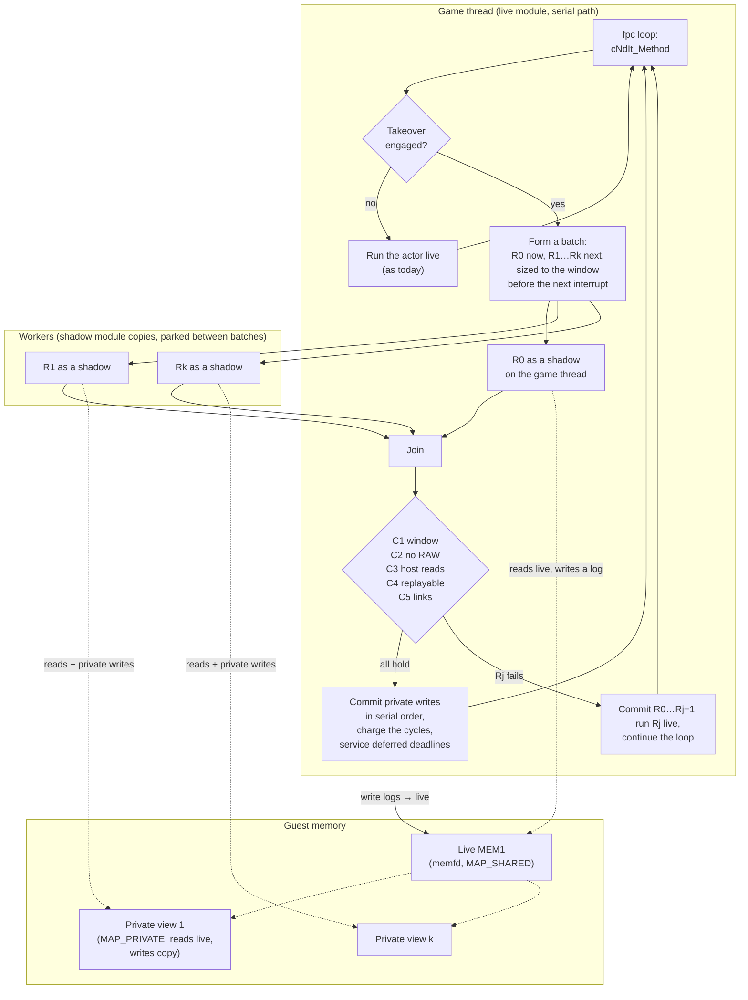

# TECH_PLAN — Parallel guest execution

Status: Design (2026-11-13); the 2026-11-03/04 sections below stay as the record
Source: BlueWake `main` after #554; RecompCore DSP HLE; tww
[PRD](PRD.md) · [Tracker](PROGRESS.md)

## Design (2026-11-13): shadow batches

### The design in one picture



A shadow is the same translated code built without the fixed CPU and fixed MEM1, so each worker has its own registers and its own view of memory. During a batch nothing writes live state; the join is the only place writes land, in the order the serial program would have made them. A failed check costs the wasted shadow run, never correctness: the region runs live from the same logical point, as if the takeover had never engaged.

### Vocabulary

- **Live state**: the guest CPU, MEM1, the REL alias storage and the host's device state, as the serial build keeps them.
- **Region**: one call the serial program makes from a takeover point: an actor's execute or draw, `pMethod(pNode)` inside `cNdIt_Method`.
- **Batch**: regions R0…Rk that the serial program runs back to back from logical time T.
- **Shadow run**: a region executed by the shadow module on a private CPU state, reading live memory and writing only a private copy, counting its cycles.
- **Join**: the game thread has finished its own region and waits for the workers. **Commit**: private writes applied to live state in serial order. **Fallback**: the rest of the batch run through the live module, the serial path, from the current logical point.

### Invariants

1. During a batch nothing writes live guest memory or device state: every participant is a shadow, and the host's deadline services inside the span are deferred to the join.
2. A shadow reads live memory and its own writes, never another shadow's.
3. Commit order is serial order; the cycles charged are the sum of the regions' counted cycles; the host then services the deadlines that fell inside the span, in cycle order, before the guest resumes.
4. Whatever can't be shown serial-equivalent is not committed: the valid prefix commits, the rest runs live. The live path is the serial build's, untouched.

### Serial-equivalence conditions, checked at the join

| Condition | Rule | Why it is sufficient |
| --- | --- | --- |
| C1 window | Σ cycles(R0…Rk) ≤ D(T), the distance to the next guest-visible interrupt (VI event clock, audio DMA, decrementer, pending or dirty sources), computed as [`host_cycle_deadline_distance`](../../../runtime/host/src/main.c) does without its DSP-cadence term | No interrupt would have landed inside the batch in the serial run; DSP interrupts need a guest mailbox write, which aborts a shadow (C4) |
| C2 RAW | For i < j: reads(Rj) ∩ writes(Ri) = ∅, words; cache lines as the first filter | Rj read pre-batch values; serial Rj would have seen Ri's write |
| C3 host services | DSP steps whose deadlines fall in [T, T+Σ) read nothing in writes(R0…Rk); the engine runs them after the commit, in order | The HLE reads guest memory (voice blocks, DAC buffers) at its step; those reads must equal the serial ones |
| C4 replayable | No region aborted: no MMIO (except FIFO stores in the draw pass, logged), no timer read, no exception, no `mtmsr`, no call to a watched address, no direct-call depth overflow, no alias write beyond the side buffer | Everything else the shadow can't keep private or can't time |
| C5 links | The iterator's `pNext->next` words, read early by the takeover, are not in the writes of the regions that serially precede their read | `cNdIt_Method` reads the next link after each method; the takeover reads it before |

WAW is settled by commit order (the last writer wins, as in serial); WAR is settled because shadows read pre-batch values, as the earlier serial reader did. The guest stack is ordinary memory under these rules: all regions write the same range, an uninitialized read of a leftover is a real dependence and falls back, and the ordered commit leaves the serial stack image.

### Privatization rules (each exact)

| Rule | Words | Commit |
| --- | --- | --- |
| P1 reductions | A certified list (`J3DDrawBuffer::entryNum`, allocator counters found by the census) | If every access to the word in the batch is a read followed by a write of read + δ, the word leaves C2 and the engine commits Σδ |
| P2 the RNG | `cM_rnd`'s three words, `cM_rnd2`'s three (tww `c_math.cpp:167`) | Plain, when at most one region of the batch touched them; otherwise the later region fails C2 and falls back. E2 says whether re-seeding a later region from the earlier one's final seed and re-running it on the worker is worth a stronger rule |
| P3 the link words | C5 | Read again after the commit |

### Mechanism

| Part | What |
| --- | --- |
| **Shadow module** | The same composite built with `fixed_cpu=0` and `fixed_mem1=0` (so `ctx` is the parameter and memory is `cpu->ram`: [`global_guest_cpu.py`](../../../scripts/windows/global_guest_cpu.py) is simply not run), gather pipe off, and a shadow variant of the memory fast path in [`gather_pipe.h`](../../../cmake/composite/gather_pipe.h): loads append their line to a per-CPU read filter, stores append (address, size) to a per-CPU write log; the `_slow` paths keep alias writes in a private side buffer that alias reads consult first; MMIO and timer reads abort; FIFO stores in the draw pass go to a per-region GX log. `bw_direct_depth` thread-local; `bw_host_can_skip` answers quiet, and a watched address aborts. One module copy per worker (`dlmopen`) in v1 |
| **Private memory** | Live MEM1 becomes a `MAP_SHARED` mapping of a memfd (mapped over the live module's `BW_GUEST_MEM1` at [`bw_module_cpu_init`](../../../cmake/composite/module_cpu_contract.h), or the live module runs with `cpu->ram` on it); each shadow CPU's `ram` is a `MAP_PRIVATE` mapping of the same memfd: reads see live pages, writes copy privately. After each batch, `madvise(MADV_DONTNEED)` on the pages the write log names resets the view |
| **Workers** | N persistent threads (2 on the Deck by default), spinning on a dispatch word inside a frame and parked between frames; each owns a shadow CPU, a private mapping and its logs |
| **Engine** | At a takeover point: form the batch (up to the workers available, sized against D(T) with last frame's cost per process type), dispatch, run R0 as a shadow on the game thread, join, check C1–C5 and P1–P3, commit the write logs in order and append the GX logs to the live gather pipe, charge the cycles, service the deferred deadlines, continue. On failure: commit the valid prefix, run the first invalid region live, continue iterating |
| **Takeover** | A native entry at `cNdIt_Method` (tww `c_node_iter.cpp:11`), hooked by the existing native-entry mechanism with its body hash, engaged only when `pMethod` is `fpcLnIt_MethodCall` on `g_fpcLn_Queue`'s execute or draw pass; it is the iterator, so a fallback is just calling the method live. Declines to the translation when `BLUEWAKE_SHADOW_WORKERS` is unset or 0 |
| **Verify build** | `BLUEWAKE_SHADOW_VERIFY=1`: after each commit the engine re-executes the batch's regions live from a saved copy of the touched state and compares memory over the union of write sets, the CPU state, the cycles and the GX bytes; any difference is a fatal report. For CI's headless routes and for the Deck during qualification |
| **Census** | Per batch: regions, cycles, window, outcome (committed, C1…C5), per-region abort reasons, the top conflicting words named through the symbol map; printed at exit like the other censuses. It drives the P1 list |

### Memory and opt-in

Off (the default), the design costs nothing: `BLUEWAKE_SHADOW_WORKERS` unset or 0 means the takeover declines, the shadow module is never loaded, and the live path is byte-for-byte today's. On, per worker count N (2 on the Deck):

| Item | RAM when on | Disk | Note |
| --- | --- | --- | --- |
| The shadow module (one copy, thread-local module state) | ≈ 50 MB of relocated tables and data (the `pc_table`s: one pointer per translated instruction, ≈ 30 MB for the DOL and RELs, more with the mod variants) plus its hot code through the page cache, ≈ 100–200 MB at a busy view | ≈ 400 MB as a file (the shipped module is 412 MB; the 1.9 GB module in a build tree is the instrumented training build), ≈ 150 MB more inside an AppImage, or nothing in the default AppImage if it ships as an optional sidecar (`BLUEWAKE_SHADOW_MODULE=path`, like `BLUEWAKE_COMPOSITE`). Player-built like the main module (`--shadow`, no PGO training). A build tree gains a second module compile: ≈ 2 GB of objects as a second target, or a separate ≈ 26 GB folder the way `build_script` lays builds out today | Not huge-paged: a 2 MB-page copy of its code would be ≈ 400 MB more resident per copy. v1 may instead load one copy per worker with `dlmopen`, at ≈ 50 MB more per copy |
| Private memory for the workers' writes | A: `MAP_PRIVATE` views of a memfd-backed MEM1: ≈ 0 until written, then the pages a region writes (tens to hundreds of KB), released after each batch. B: a per-worker store buffer consulted by loads, ≈ 100 KB | — | A keeps shadow loads at full speed but moves the live MEM1 onto a memfd, where it may lose transparent huge pages (a cost to the game thread itself; `MFD_HUGETLB` needs reserved pages). B leaves the live MEM1 untouched and costs each shadow load a probe (≈ 10–20 % on shadow runs). E1 decides |
| Per-worker logs (read filter, write log, alias side buffer) | < 1 MB each | — | Reset per batch |
| The engine's own state and census | < 1 MB | — | — |
| Trace build (B1) only | ≈ 1 MB in the module; the dump ≈ 10–30 KB a region, ≈ 1 GB per 100 traced frames | diagnostic, never shipped | Written through a large stdio buffer; the host stalling on I/O does not change the guest timeline |

So about **+150–300 MB of RAM and ≈ 400 MB of disk when on (≈ 150 MB if it ships inside the AppImage), nothing when off**. The Deck's 16 GB are shared with the GPU and already carry the main module's code on 2 MB pages and the HD textures, which is why the shadow module must stay file-backed and single.

How the disk shows up: the AppImage is a compressed image (242 MB today, holding the 412 MB module, the 290 MB host binary and the libraries at roughly 3:1) that FUSE mounts at launch, so a module's pages are decompressed on demand into the page cache, RAM rather than disk; the live module's code is then copied onto 2 MB pages (#554). A second module inside the image adds its compressed size; as a sidecar file it adds its full size only where the player opts in.

Not RAM but memory all the same: two more cores running translated code pull their instruction and data working sets through the shared L3. Reads of live MEM1 are shared and read-only during a batch, so they cost no invalidations; the commit's writes invalidate only lines the workers no longer need. The instruction working set is the risk (the GX submission-thread experiment lost to cache traffic), and only the engine's A/B measures it.

### Packaging and loading the shadow module

**Added, not replaced.** When the feature is on, both modules are loaded: the main module keeps running the game thread exactly as today, and only the worker threads execute code from the shadow module. (E1a's measurement runs the shadow variant as the live module once, to price its overhead; that is a test, not the shipped arrangement.)

| | Main module (today) | Shadow module (proposed) |
| --- | --- | --- |
| File | `gGZLE01_recomp.so` (`.dll` on Windows, `.dylib` on Apple): an ELF shared object, ≈ 412 MB, the translated game code | `gGZLE01_shadow.so` (`.dll`, `.dylib`): the same composite built with `fixed_cpu=0`, `fixed_mem1=0`, gather pipe off, `BLUEWAKE_SHADOW=1`; ≈ 400 MB; an ordinary ABI-v3 module plus the shadow exports |
| Produced by | The player's build from their disc (`scripts/linux/build.py`), into `BlueWake/` of the build output and the AppImage | The same build with `--shadow-module`: a second CMake target over the same `composite-src` and mod variants, written beside the main module as `BlueWake/gGZLE01_shadow.so` and copied next to the published AppImage; not placed inside the AppImage unless `--shadow-bundled` |
| Found at launch | `BLUEWAKE_COMPOSITE=path`, else the module argument, else `<app dir>/gGZLE01_recomp.so` ([`linux_entry.c`](../../../linux/src/linux_entry.c)) | Only when `BLUEWAKE_SHADOW_WORKERS` ≥ 1: `BLUEWAKE_SHADOW_MODULE=path`, else `<app dir>/gGZLE01_shadow.so` (bundled), else next to the AppImage (`$APPIMAGE`'s folder; on the Deck `/home/deck/gGZLE01_shadow.so` beside `BlueWake-*.AppImage`), else the data folder (`~/.local/share/BlueWake/`). Not found: one log line, workers off, the game runs as today |
| Checked | ABI, CPU layout and game id ([`module_cpu_contract.h`](../../../cmake/composite/module_cpu_contract.h)) | The same, plus the pair: both modules export the composite digest their build recorded (`composite-final.digest`, a new `bluewake_composite_digest()` on both), and the shadow exports `bluewake_composite_shadow_v1()` (version, the trace/shadow state). A digest mismatch, a missing export or a foreign game id refuses the shadow module: one log line, workers off |
| Loaded with | `dlopen(RTLD_NOW \| RTLD_LOCAL)` | `dlmopen(LM_ID_NEWLM, …)` on Linux, `dlopen` of its own path elsewhere; one copy, thread-local module state; never remapped onto 2 MB pages |
| Cost at launch | — | Relocating ≈ 50 MB of tables: a fraction of a second, only when opted in |
| Memory | Code on 2 MB pages (#554) | Hot code through the page cache ≈ 100–200 MB, tables ≈ 50 MB |

So, in practice: with the feature off nothing is added to the AppImage, the data folder or the launch. Opting in means building the extra `.so` once (the builder flag) and placing it beside the AppImage, then setting `BLUEWAKE_SHADOW_WORKERS=2`; the AppImage itself grows (by ≈ 150 MB compressed) only if the owner later chooses to bundle it.

### What stays on

Nothing is turned off on the game thread: the live module keeps every optimization in the stack (fixed CPU and MEM1, 2 MB pages, inline FP, the gather pipe and its batching, lean memory and deadlines, behaviour timing, direct calls and the direct gate, inline GPR, the native routines, the alias cache and the constant-time lookup, the actor-search native). The takeover is one certified native entry at `cNdIt_Method`, which declines unless workers are configured. The shadow module gives up only what ties code to one CPU, one RAM and one GX stream:

| Optimization | Live module | Shadow module |
| --- | --- | --- |
| Fixed CPU, fixed MEM1 | on | off (per-worker CPU state and memory view) |
| Gather pipe | on | off; FIFO stores abort in the execute pass, go to a per-region log in the draw pass |
| 2 MB pages (#554) | on | off (memory) |
| Direct calls, direct gate (#552) | on | on, with a thread-local depth and a shadow answer: quiet, and a watched address aborts |
| Inline FP, inline GPR, lean memory, lean deadlines, behaviour timing, fp_checks | on | on, unchanged (they work through `cpu->ram` and the block shape) |
| Alias cache (#495), constant-time lookup (#501) | on | on for reads; alias writes go to the side buffer |
| Native routines (math, vec, skin, game math, J3D) | on | on only once each logs the ranges its certification already checks, so the commit sees their writes; until then off in shadows (translated bodies, same cycles) |
| Host-side natives at watched addresses (actor search, HD room clip, stage select) | on | a watched address aborts the shadow; the region runs live |
| PGO profile | trained | untrained in v1 |

The trace build (B1) is the shipped configuration plus logging. For a trace the native routines are switched off at runtime (`BLUEWAKE_NATIVE_*=0`), so their accesses go through the logged translated bodies; they charge the same cycles, so the trace's cycle counts are those of the shipped build.

### Limit study (E2), from the same logs, single-threaded

Trace mode runs every region of the execute and draw passes as a shadow on the game thread, one at a time, committing each at once, and dumps per region: the process type, cycles, read lines, write words, abort reason, and the interrupt and deadline events with their cycles. Offline, a script simulates the engine's choices per frame for a batch policy (workers, maximum cycles) and reports the parallel fraction, the failure causes and the serializing words. Three states (`8-busiest`, `6-play`, `1-outset`), 300 frames each, paced to real time so the interrupt pattern is the real one, on the Deck over SSH.

### Experiments

| Id | Question | Method | Stop if |
| --- | --- | --- | --- |
| E0 | Does occupying two more Deck cores slow the game thread? | `8-busiest`, headless unpaced, A/B/B/A/A/B with two spinning cores; then Game Mode through `gm-launch2.sh` with the same spinners | ≥ 15 % |
| E1 | Shadow overhead | The shadow module in trace mode, no parallelism, same route as live | ≥ 35 % |
| E2 | Available exact parallelism | The limit study | < 10 % at 2 workers |

### Builds (agreed 2026-11-13)

Two module variants, both from the current composite, built locally with `build_script` (about 40 minutes each; host-only rebuilds with `--reuse`):

| Build | What | Measures |
| --- | --- | --- |
| **B1 trace** | The shipped configuration (fixed CPU and MEM1, every optimization) plus `BLUEWAKE_SHADOW_TRACE`: the memory fast paths in `gather_pipe.h` append each load's cache line to a per-CPU filter and each store's (address, size) to a log, behind one predictable branch (`bw_trace_on`); the host delimits regions at `fpcLnIt_MethodCall` (0x80040198) entry and return through the edge watch list, and at each region end dumps the sets, the cycles, the abort-relevant events (MMIO, timer read, exception, watched call, alias writes) and the deadline/interrupt events to a binary trace. Single-threaded, writes stay live | E1b (logging cost: `bw_trace_on` off vs on) and **E2** (the limit study) |
| **B2 shadow** | `global_guest_cpu.py` not run, `fixed_mem1` off, gather pipe off (`BLUEWAKE_SHADOW=1`): the worker module. It is an ordinary ABI-v3 module, so the host can also run it *as the live module* | E1a (the non-fixed codegen's own cost, as the live module) and M9 |

Order: B2 first (no code change beyond the builder option), B1 as soon as the trace paths are written, then the limit study on the Deck. `build_script` passes `--fixed-cpu --fixed-mem1` to the Linux builder unconditionally; a local `--shadow` option drops them and sets the module define.

### Power on the Deck (E0, 2026-11-13)

Headless, the game thread ignores two spinning cores (−0.65 %). In Game Mode one pair so far: 25.92 → 23.22 game FPS (**−10.4 %**) and the GPU's busy time 18.1 → 22.4 ms, with spinners that are busy 100 % of the time. The shared power budget is real. Consequences for the engine: workers **park** between batches (futex, not spin) and the gain must beat a penalty that scales with worker busy time; E2 reports the parallel fraction *and* the worker duty it implies. The remaining four Game Mode launches run once the Deck's Steam cloud-sync prompt is dismissed.

### Changes

| Status | File / symbol | Edit | Milestone |
| --- | --- | --- | --- |
| Added | `cmake/composite/shadow_trace.h`, `shadow_trace.c` | The trace state (read lines through a direct-mapped filter, stores by address and size, flags, alias and hardware counts) and its export `bluewake_composite_shadow_trace()`; built only with `BLUEWAKE_SHADOW_TRACE` | M7 (B1) |
| Modified | `cmake/composite/gather_pipe.h`, `inline_gpr.h` | Trace hooks on every guest access path: the inline MEM1 loads and stores, the slow paths (hardware flagged, aliases counted), the interpreter's paired-single and fallback instructions, `dcbz`, the timebase read, the inline register frames; empty macros otherwise | M7 (B1) |
| Modified | `cmake/composite/CMakeLists.txt`, `scripts/linux/build.py` | `BLUEWAKE_SHADOW_TRACE` option, `--shadow-trace` | M7 (B1) |
| Modified | `runtime/host/src/main.c` | `BLUEWAKE_SHADOW_TRACE=path` (`_FROM`, `_TO` retraces): regions delimited at `fpcLnIt_MethodCall`'s entry (0x80040198) and the return into `cNdIt_Method` (0x80244EFC, at the entry's stack pointer), both named so the builder's watch list brings the edge service there; per region the process, its name, the pass, cycles, flags and the access sets; events for interrupt deliveries, DSP steps and retraces | M7 (B1) |
| Added | `scripts/shadow_limit_study.py` | The offline simulation: batches as the engine would form them (workers, window, RAW at line granularity, privatized words), the parallel fraction, the serializing words named through the symbols | M8 |
| Local | `build_script` | `--shadow` (no fixed CPU/MEM1), `--shadow-trace` | M7 |
| Proposed | `runtime/host/src/shadow_engine.c` (new) | Workers, private mappings, batch formation, validation, commit, deferred deadlines, census, verify mode | M9 |
| Proposed | `scripts/windows/native_entries.py` list, `cmake/composite/native_iter.c` (new) | The `cNdIt_Method` takeover as a certified native entry | M9 |
| Proposed | `tests/shadow_engine_test.c` (new) | Synthetic batches: every condition's failure path, commit order, reductions, links | M9 |

Trace record format (little-endian): `BWST` + version; `R` region: tag, process, pass, name (u16), start and end cycle (u64), flags, alias and hardware counts, then the read lines (u32 each, address >> 6) and the stores (u32 address each, then u8 size each); `I` interrupt (PI cause, or 0 for the decrementer), `S` DSP step, `F` retrace: u32 value, u64 cycle.

### Effort

Week 1: E0, E1, the open questions. Weeks 2–3: E2. Weeks 4–8: engine, takeover, verify build, tests. Weeks 9–10: Deck qualification under #503's rule (≥ 6 interleaved Game Mode launches, every one ahead, identical checkpoints and pictures). About ten weeks to a go/no-go with code; the first stop point is after week 1, the decisive one after week 3.

### Open questions for week 1

| Question | Status |
| --- | --- |
| How often does the execute pass read the timebase? | **Settled from source:** game code reads it in `d_timer.cpp` (the timer display), `d_s_play.cpp`, the exception and memory-card paths, and once per actor *creation* (`fopAc_ac_c` constructor, `f_op_actor.cpp:97`); `JUTGamePad` reads it in the main loop's pad read. Execute and draw regions rarely do; the trace counts the rest |
| Takeover addresses | `cNdIt_Method` 0x80244EB4 (0x90 bytes), `fpcLnIt_MethodCall` 0x80040198, `fpcLnIt_Queue` 0x80040200, `cTrIt_Method` 0x802450D0, `cLsIt_Method` 0x80244BF0, `cM_rnd` 0x802462C8 (tww `symbols.txt`) |
| Module copies | The host loads the module with `dlopen(RTLD_NOW \| RTLD_LOCAL)` (`main.c:7763`), so a second copy loads with `dlmopen(LM_ID_NEWLM)` or from a differently named file without symbol interposition. Load time and resident memory on the Deck: to measure |
| MEM1 on a memfd with the fixed-MEM1 live module | `BW_GUEST_MEM1` is `aligned(4096)` (`guest_cpu.c:29`) and `bw_module_cpu_init` zeroes it, so the host can map a shared memfd over it with `MAP_FIXED` first; the host already remaps the module's code the same way for 2 MB pages (`module_hugepages.h:89`) |
| What share of a REL actor's accesses go through the alias slow path? | To measure in the trace (its side-buffer cost) |

---

### Testing strategy

Three questions, each with its own evidence. Every measured run is in Steam Deck Game Mode with the play settings (3x, the HD look, Smooth Motion, `settings.ini`), from the saved states, interleaved A/B/B/A with the serial build of the same commit as the control, at least six launches a side, after an A/A pair that sets the noise floor. Means alone would miss the point at a scene that already holds 30: there the gain is headroom, not frames.

**1. Is it exact?** (the gate; nothing else counts until this holds)

| Check | How |
| --- | --- |
| Guest checkpoints identical to the serial build, every retrace | `BLUEWAKE_GUEST_CHECKPOINT_INTERVAL=1` on both builds over each state's route; the first differing retrace names the failure |
| Identical run to run with workers on | The same route three times with workers; checkpoints must not depend on worker timing |
| Pictures, GX stream, audio | `frame_compare.py` at fixed retraces; the route digest; the audio capture digest |
| Every batch equals its serial re-execution | The verify build (`BLUEWAKE_SHADOW_VERIFY=1`) on the headless CI routes and once per state on the Deck |
| The fallback path | Fault injection: a switch that fails validation at random (and one that aborts shadows at random); the outputs must stay identical and the census must show the fallbacks |

**2. Did work move, and did the frame get cheaper?** (per state, per build)

| Metric | Source | Why |
| --- | --- | --- |
| Game FPS, and the per-update time distribution: p50, p95, p99, worst, updates over 33.3 ms, `[fps-dip]` counts and causes | `[perf]` lines (rate, busy, worst_ms, hitches), `[fps-dip]` | The critical path and its tail; at 30 FPS the tail and the misses are the result |
| Game-thread busy time (%) and its CPU time | `[perf] busy=`, `/proc/PID/task/*/stat` deltas per thread at exit | Headroom at scenes already at 30; the time actually taken off the thread |
| Worker CPU time and duty cycle; GX worker and renderer threads | The same per-thread deltas, printed by the host at exit (`[threads]`) | Work moved, and the busy fraction the power model needs |
| Engine census: batches a frame, regions offloaded, batch sizes, cycles committed, failures by condition (C1–C5), aborts by reason, fallback cycles, the top serializing words | The engine's exit census | Without it an FPS change can't be interpreted |
| GPU busy time a frame, present waits, draws a frame | `[gpu-prof]` (`DOL_AURORA_GPU_PROF=1`), the render log | The GPU's share of the shared budget; E0 showed +24 % GPU time under two busy cores |
| IPC, cycles and instructions a frame on the game thread | `perf stat` over the window (as #503/#592) | Separates less work from a slower clock |

**3. What did it cost in power and heat?** (the Deck's budget is shared)

| Metric | Source | Why |
| --- | --- | --- |
| APU power (mean, p95), CPU clock per core, GPU clock and busy % at 4 Hz | `sampler3.sh` (hwmon `power1_average`, `cpufreq/scaling_cur_freq`, `gpu_busy_percent`, `freq1_input`), aligned to the run's window | The E0 finding in numbers: what the workers' duty costs the game thread's clock and the GPU |
| Energy a game frame (J/frame = power / FPS) | Derived | The efficiency number that stays comparable when FPS changes |
| Temperature and throttling over a long run | hwmon temps; a 15-minute soak at the busiest view, Game Mode, on battery and docked | Sustained behaviour, not the first minute |

**How many workers**

The worker count is measured, not chosen. The limit study reports the parallel fraction at 1, 2 and 3 workers from the same trace, which shows where the batches stop filling (the actor loop's dependences, not the core count, set that). The Deck A/B then prices each worker: its share of the critical path removed, against the clock it costs the game thread and the GPU through the shared power budget (E0: two always-busy cores cost 10.4 % and +24 % GPU time; parked workers cost less, in proportion to their duty). The optimum is the count with the best p95/p99 update time and the fewest misses at the CPU-bound states with no loss at the states that already hold 30, per device: the Deck has four cores and already runs the game thread, the GX worker and the renderer, so one or two is the realistic range there, while a desktop may take more. That count becomes the default when the option is on, with the engine free to park workers for a while when the census shows batches failing to validate.

**Sensitivity and stability**

- Workers 1, 2, 3; batch-size caps; a core-hog beside the game (the engine must degrade to serial, not stall at joins).
- All eight states (`1-outset` … `8-busiest`, the lava room among them for its alias-heavy collision) and the tour stops; report per state, not pooled.
- Scene transitions, REL load and unload (batches drained first), save and load states with workers on, pause and menus, Deck suspend and resume, a 30-minute play session.
- Desktop Linux and Windows: the serial fallback verified where the engine has no backend.

**Acceptance** (per #503's rule, extended): checkpoints identical in every run; ahead of the serial build in every interleaved launch on the game-thread metrics at CPU-bound states, and no worse on any at states that already hold 30 (p95/p99, dips, busy time, GPU time); power and energy a frame recorded, not gated, but a Game Mode power rise that lowers the game thread's clock counts against the result through those metrics.

**Follow-up, settings (M11):** once M10 keeps the feature, the switch moves from an environment variable to a `settings.ini` entry read at launch and a settings-menu item, "Parallel workers: Off / Auto / 1 … N" with N the device's physical cores less one, Off by default. A chosen number is honoured as set, clamped only to N, and the census shows what it did; Auto is one entry among them and resolves per device: on the Deck the count M10 measured; elsewhere the core count less the three threads the game already runs, clamped to what M10 qualified, and shown as the resolved number. The menu refuses the setting with one line when the shadow module is absent or mismatched.

**Tooling to add:** a host `[threads]` exit line (CPU time per thread), the engine census, a merged summary (`gmsum` with the sampler's power and clock series aligned to the window and the census), and the fault-injection switches.

## Earlier plan (2026-11-03/04)

## Inspected facts

- **Fixed CPU and RAM.** Generated chunks carry `extern CPUState bw_guest_cpu; #define ctx (&bw_guest_cpu)` and take `CPUState* ctx_param` unused. ABI v4 requires `bluewake_composite_guest_cpu()`, v5 the MEM1 getter ([`module_cpu_contract.h`](../../../cmake/composite/module_cpu_contract.h)). With `BW_GUEST_MEM1`, `BW_RAM_BYTES` is the linked symbol, not `cpu->ram` ([`gather_pipe.h`](../../../cmake/composite/gather_pipe.h)).
- **Globals on the translated path.** `bw_direct_depth`, `bw_direct_enabled`, `bw_chunk_fns`, host flag pointers in [`direct_calls.h`](../../../cmake/composite/direct_calls.h); gather-pipe drains at hardware accesses and chunk returns ([`dispatch_loop.h`](../../../cmake/composite/dispatch_loop.h)); RecompCore `g_mem_write_journal` (post-store callback), `g_ppc_guest_aliases_overlap_mem1`.
- **Worker pool.** One global pool, one batch at a time, joins before return; caller takes the last share; off unless `BLUEWAKE_NATIVE_WORKERS` is set (Linux and Windows hosts default it to 2); serial on Windows ([`native_work_pool.c`](../../../cmake/composite/native_work_pool.c)).
- **Native coverage.** `native_skin.c` (`calcWeightEnvelopeMtx`, `0x802EE67C`), `native_game_math.c` (`key-s`, `transform-simple`, clipper, cM3d), native J3D transform info; all on by default on Linux and Windows, declining back to translation on unsupported inputs.
- **Model calc** (tww `J3DModel.cpp:690`): `j3dSys.setModel`, skin flags, `frameInit`, visibility, deform, two hooks, `calcAnmMtx` → `recursiveCalc` (static `J3DSys::mCurrent*`, joint callbacks In/Out), `calcWeightEnvelopeMtx`, skin deform, `mCalcCallBack`. Outputs `mpNodeMtx`, `mpWeightEnvMtx`, scale-flag arrays; `viewCalc` derives draw matrices.
- **Guest PC sampler.** `BLUEWAKE_PC_SAMPLE=path`, `_FROM`, `_TO` ([`main.c`](../../../runtime/host/src/main.c)); reads `cpu->pc` every 100 µs; overweights short dispatched functions.
- **Tooling gap.** `bench_tour.py` strips `BLUEWAKE_*` from the child environment, so sampler runs need a wrapper app script.

## Changes

| Status | File / symbol | Practical edit | Milestone | Architecture |
| --- | --- | --- | --- | --- |
| Proposed | `scripts/bench_tour.py` | Pass through an allowlist of diagnostic variables (`BLUEWAKE_PC_SAMPLE*`) | M0 | [Testing](../../architecture/Testing.md) |
| Proposed | `scripts/pc_sample_attribute.py` | Attribute `BLUEWAKE_PC_SAMPLE` output to tww functions and subsystems | M0 | — |
| Modify | `runtime/host/src/main.c`: guest PC sampler | Also count samples per guest thread (the word at `0x800000E4`, as `OSGetCurrentThread` loads it) into `PATH.threads`; `BLUEWAKE_PC_SAMPLE_THREAD=hex` keeps one thread's pcs | M6 | [Host](../../architecture/Host.md) |
| Proposed | `cmake/composite/native_skin.c`, `native_game_math.c` | Count declines by reason (a reason code per guard) | M1 | [Native routines](../../architecture/NativeRoutines.md) |
| Proposed | same, plus generators and oracle tests | Widen the certified domain for the dominant decline reasons | M2 | [Native routines](../../architecture/NativeRoutines.md) |
| Proposed | host diagnostic (opt-in) | Trace reads of one model's `mpNodeMtx`/draw-matrix range between `mDoExt_modelUpdateDL` and the draw-list flush | M3 | [Guest state](../../architecture/GuestState.md) |
| Proposed | new async job path (separate from the pool) | Submit, join at flush, ordered publication; opt-in flag | M4–M5 | [Game thread](../../architecture/GameThread.md) |

## Contracts

**Eligibility** (decided before submission; anything else runs serially as today): no joint callback on any node, no `mCalcCallBack`, no `mpDeformData`/`mpSkinDeform`, no hooks at `0xc4`/`0xc8`, no visibility manager (or proven pure), key-frame or no animation with Basic/Maya/Softimage calc, not the locked `getModelDataType()==1` path, called from `draw()`.

Added by M3-T01: every material's draw buffer is material-sorted or non-sorted (the main opaque list; `mpXluList`, `mpOpaListFilter`, `mpXluListMaskOff`, `mpXluListInvisible` are Z-sorted), and no texture matrix uses an env-map, proj-map or view-proj-map mode.

**What `entry()` reads** (tww `J3DJoint.cpp:230`, `J3DDrawBuffer.cpp:126`, `J3DMatBlock.cpp:1782`, `d_drawlist.cpp:1906`): `entryIn` takes `getAnmMtx(jnt)` and stores it as the buffers' Z matrix (a pointer). `entryZSort` reads its translation to compute the sort key, at entry time. `J3DTexGenBlockPatched::calc` reads the matrix only for env-map, proj-map and view-proj-map texture matrices; other modes ignore it. Material sort (the default) and non-sort don't read it.

**Async pose job** (proposed):

```
actor draw(): setBaseTRMtx → capture inputs → submit(calc+viewCalc) → entry()
...remaining actors' draw()...
draw-list flush: join all → publish matrices + scale flags → set j3dSys as the last serial calc would → draw
```

Guest cycles for the serial calc are charged at submit. A job never writes live guest memory; publication happens on the game thread.

## Existing native sets: port, don't write (2026-11-03)

The natives this plan needs already exist, certified on an older pipeline, and are off:

| File (set) | Covers | Recorded cost |
| --- | --- | --- |
| `native_anim.c` (set 4) | Multi-key `J3DAnmTransformKey::calcTransform`, `J3DGetKeyFrameInterpolation<f32>`/`S`, Hermite | 2.2–2.5 % at Forest Haven, Dragon Roost |
| `native_mtxcalc.c` (entries) | Maya/Basic/Softimage `calcTransform` with callees | 0.46 + 0.14 % on Outset |
| `native_jas.c` (entries, seventh round) | `TOscillator`, `TChannel::updateEffectorParam`/`updateMixer`/`updateAutoMixer`, `Calc::sinfT` | 2.6 % at Forest Haven, 0.9 % at sea |

Why they don't run (generator run against the `m437-a` composite, and #541):

1. **Behaviour timing is on by default** (`build.py`, `--no-behaviour-timing` turns it off). Blocks now start `if (downcount <= -LOOP_BUDGET) return; cycle_block_prepaid = true; downcount -= N; goto bwfast_K;` with budget checks only at loop heads (`behaviour_timing.py --loop-checks`). `native_gx_gen.py`'s `LEADER` expects `cycle_block_prepaid = dolrecomp_block_can_precharge(ctx, N);`, so `native_leaf_gen.py` stops at the first entry (`__ieee754_fmod: 8032EC1C is not a block leader`).
2. **`lean_deadlines.py`'s access form** (`{ bool bw_ool = false; … bw_write32_ato(&bw_ool, ctx, …); if (__builtin_expect(bw_ool, 0) && …) }`) is unknown to the generator (#541's `unhandled ctx` failure).
3. **Hashes.** `native_entries.py` hooks a native only where the translation hashes to the body its differential test ran against; set 4 builds but is never hooked on this tree.

Port: teach `native_gx_gen.py` the behaviour-timing leader and the `_ato` form (the new block shape is simpler: one charge per block, budget at loop heads), re-run `tests/native_leaf_test.c` and the set-4 tests against the current translation, record the hashes. This replaces "write new natives" in M2 and is the serial half of M6-T02.

## Decline reasons (from source, M1-T00)

| Path | Guards | Likely dominant reason | Widening |
| --- | --- | --- | --- |
| Skinning (`native_skin.c`) | FP/PS state, no write journal, plain RAM, stores apart from reads, finite floats < 2^31, **the whole function's cycles (58 + 23 per envelope + 60 per joint) inside the turn budget and before the next deadline** | The turn-budget guard, **confirmed by [#541](https://github.com/chrissotraidis/bluewake/pull/541)** (8k+ cycle calls decline 91–100 %) | Done and dropped: #541's partial runs were exact but within noise; out of scope here |
| `transform-simple` (`J3DAnmTransformKey::calcTransform`) | **zero- or one-key channels only**; `ready(256)` | By design: any animated channel (> 1 key) declines | Native multi-key transform calling the native `key-s`/`key-f` interpolation; the largest M2 item |
| `key-s` (`J3DGetKeyFrameInterpolationS`) | `ready(512)` (no positive `downcount`, budget and deadline ≥ 512 cycles), GQR5 must be signed short with scale 0, ≤ 256 keys, strictly increasing times, time in range | Unknown: GQR5 scale, key count and the cycle bound are all plausible | Count reasons first (M1-T01) |

## Validation

- Native widening: existing differential oracles extended to each widened case; checkpoint and picture comparison over `bench_tour` stops.
- Async: serial build as oracle; identical checkpoints and pictures; A/A then A/B with `render_bench` on the Deck; report p95/p99 update time, not only means.

## Commands

```sh
# guest-PC profile of the Outset stop (wrapper app sets BLUEWAKE_PC_SAMPLE, _FROM=2700, _TO=4200)
python3 scripts/bench_tour.py CARD wrapper.sh --mode headless
python3 pc_sample_attribute.py tww/config/GZLE01/symbols.txt outset.pcs 45
```
