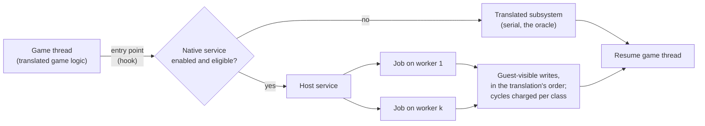

# TECH_PLAN — Guest services migration

Status: Planning only (programme)
Source: fork PR #9's research and tooling; #593 (the draw side's own plan); #542 (collision harness); #541 (native skinning); #561 (the audio thread)
[PRD](PRD.md) · [Tracker](PROGRESS.md)

## What a migration is

A guest service is a subsystem the game calls through a narrow set of entry points and whose effects on guest memory are bounded: the J3D draw side, background collision, the audio thread, particles. Migrating one means the host answers those entry points natively, writes back exactly the guest memory the translation would have written (or a certified subset nothing else reads), charges the cycles the plan's exactness class requires, and runs its own work on as many cores as it likes. The translation stays as the fallback and the oracle, selected per service by an opt-in switch, as the native routines are today ([NativeRoutines](../../architecture/NativeRoutines.md)).

## Common infrastructure (exists on #9 and in the tree)

| Piece | Use here |
| --- | --- |
| `BLUEWAKE_SHADOW_TRACE` (B1 trace build) and `scripts/shadow_limit_study.py` | A service's read and write sets, cycles and flags per region, at any marked entry/return pair: the contract a migration must honour, measured, not guessed |
| The shadow module (built without the fixed CPU and MEM1, exact, 2–5 % slower) | For any job that must still run *translated* code off the game thread (a certified translated region as an async job) |
| `native_entries.py` hooks with body hashes, `native_leaf_test.c`, the differential oracles | Routing an entry to the host only where the translation matches what was certified; the test shape |
| The verify-build idea from #9 | Run the translation beside the service and compare outputs, in CI and on the Deck |
| `render_bench`, Game Mode runs, the per-thread sampler, the testing strategy in #9 | Acceptance: ≥ 6 interleaved Deck launches, checkpoints or digests, power and the per-update tail |

## Per service

### 1. The J3D draw side ([#593](https://github.com/chrissotraidis/bluewake/pull/593) phase 2 owns the design)

- **Boundary:** `mDoExt_modelUpdateDL` / `J3DModel::calc`, `entry`, `viewCalc`, the material and shape `load`/`draw`, `J3DDrawBuffer` entry and draw, the room draws in the scene's draw; the GX stream they produce.
- **Contract to measure:** per model, the reads (model data, animation state, base matrix) and writes (`mpNodeMtx`, draw matrices, packet state, `j3dSys`, draw-buffer links), from a trace with 'D' markers and markers inside `dScnPly_Draw`.
- **Measured at actor-draw granularity (2026-11-14, tracker M1-T01):** the outputs (53–55 % of the words an actor's draw writes; ≈ 70 % for PLAYER and BRIDGE) are consumed only by the painter, which runs first in the next `fpcM_Management`, so the join is there and the jobs' window is the rest of the draw loop. The chain between consecutive draws is the draw-side scratch (`j3dSys`, `J3DSys::mCurrentMtx`, `mCurrentS`, `mParentS`, `mDoLib_clipper::mClipper`, `mDoMtx_stack_c::now`, `sGDLObj`/`__GDCurrentDL`, `sNoUseDrawMtxPtr`/`sNoUseNrmMtxPtr`, `sInterruptFlag`) and heap shared by instances of one actor type: job-private copies, with the draw-buffer order serial. The cross-pass set the next execute reads: `j3dSys`, `dStage_roomControl_c::mStatus`, `l_fopDwTg_id`, `g_env_light`, `J3DSys::sTexCoordScaleTable`, `g_dComIfG_gameInfo`, the dMap fields, and the model matrices attachments read. Per-model sets need markers at the J3D calls (M1-T01b).
- **Host shape:** per-model jobs (calc, skinning, material setup, the model's GX bytes into a private buffer) over the pool; the draw-buffer order and the final GX assembly on the game thread; the gather pipe fed in the translation's order.
- **Exactness:** "plays the same" with the GX stream digest and pictures as the oracle; the guest writes other code reads (matrices for attachments, scale flags) bit-exact; cycle-exact optional.
- **Expected:** ≈ 8 % native, ≈ 6 % more at two workers at the busiest view.

### 2. Background collision

- **Boundary:** `dBgS` queries (`GroundCross`, `WallCorrect`, roof, line checks) and the world's per-frame update; the `cBgW` block structures in REL alias storage (#501).
- **Contract:** the results of each query (exact), the world update's writes; #542's harness and census.
- **Host shape:** a host spatial index built from the BG data at room load, answering queries serially (each actor needs its answer at once) and updating moving BG in parallel per object.
- **Exactness:** exact results; the cycles as the translation charges (#542's model) or "plays the same".
- **Expected:** ≈ 3–5 % here, more in collision-heavy rooms.

### 3. The audio thread

- **Boundary:** `TAudioThread::audioproc`'s work (`Kernel::updateDac`, `TDSP_DACBuffer::updateDSP`), woken by the AI DMA and DSP interrupts (#561; #9's audio notes).
- **Contract:** the JAI command queue in, DSP mails and guest audio state out; measured with markers at the wake points.
- **Host shape:** its own host thread, consuming a per-frame snapshot of the queue, one frame of latency at most; deterministic by construction.
- **Exactness:** bit-exact DSP command output; the `JASChannel` natives of round 7 as building blocks.
- **Expected:** ≈ 5 %.

### 4. Particles

- **Boundary:** `dPa_control_c::calc` (emitters, particles) and the JPA draw.
- **Contract:** emitter inputs written by actors, particle state, the draw's reads; JPA's own RNG.
- **Host shape:** per-emitter jobs after the execute pass, joined before the draw pass.
- **Exactness:** bit-exact simulation.
- **Expected:** ≈ 2–3 %.

### 5 and 6. Host overheads; the Z-targeting scan

Serial work on the existing paths (the direct-call check, the dispatch loop, the GX writes; the remainder of `dAttention_c::Run` beside the native actor search). Weeks each, a percent or two each, diminishing.

## Order and dependencies

1. Finish #9's data gathering (the draw pass and the scene's sub-phases traced), which gives services 1, 4 and 6 their measured shares.
2. The draw side (#593 phase 2), designed parallel from the start.
3. Collision and the audio thread in either order; particles alongside the draw side if its measured share justifies it.

## Validation

Per service: the differential oracle (translation beside the host service) in CI on the headless routes; on the Deck, #503's rule with the testing strategy of #9 (checkpoints or digests every retrace, the per-update tail, per-thread CPU time, power and energy a frame, a soak).
